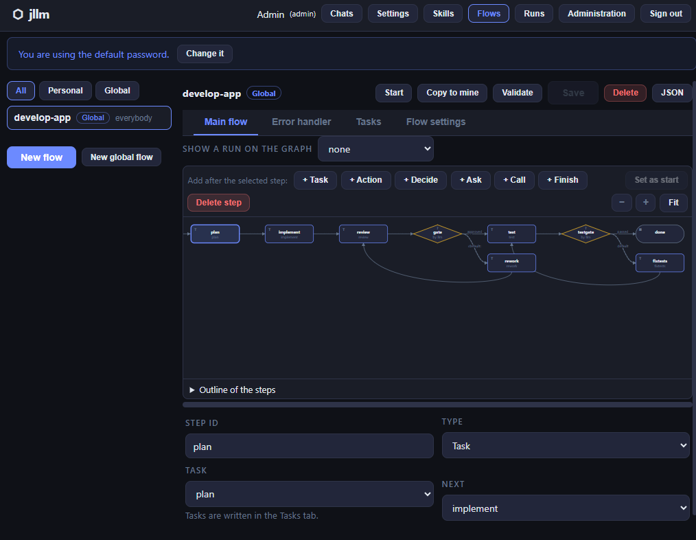
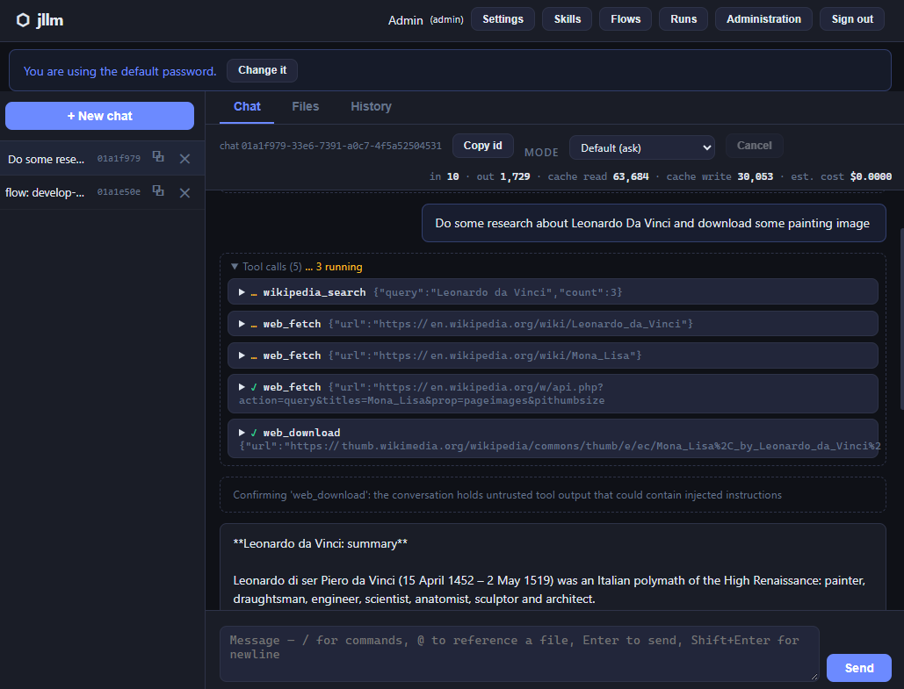
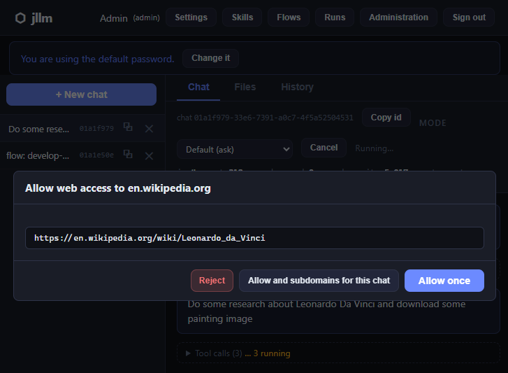
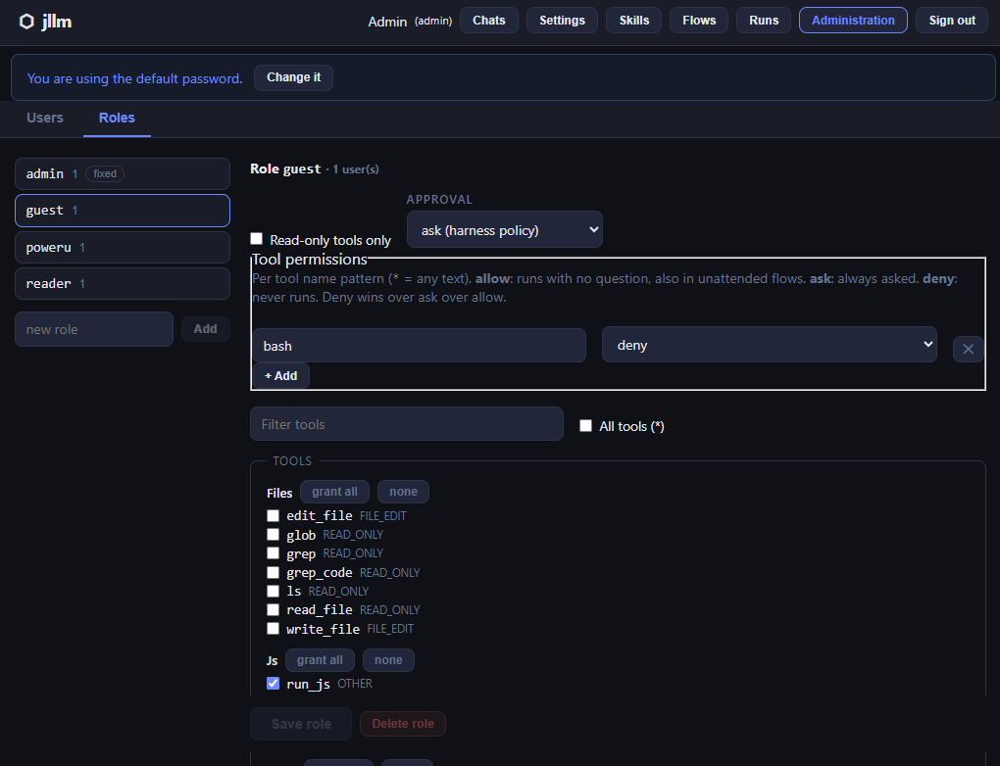
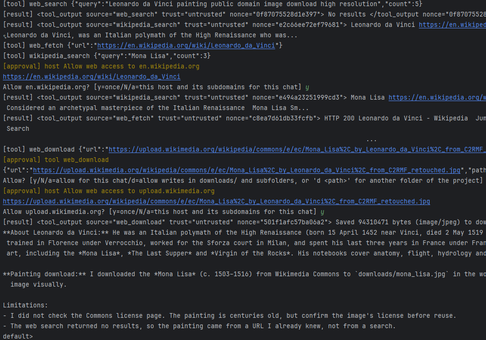

# JLLM: a governed agent runtime for Java

**Embed a tool-using AI agent in your Java application. Your code, your MCP servers and your REST APIs become its
tools, under permissions, approvals and isolation that you control.**

One library, Java 21, no application framework in the core. The agent loop runs inside your process; your application
decides what the agent may touch and what needs a human.

> Not related to other projects named *jllm* (for example beehive-lab/jllm or cmc-labo/jllm, which are inference
> engines). JLLM talks to any OpenAI-compatible endpoint, so those can serve as its model backend.

```java
AgentHarness h = new AgentHarnessBuilder()
    .modelClient(ModelClients.anthropic(AnthropicSettings.defaults(System.getenv("ANTHROPIC_API_KEY")), mapper))
    .tools(List.of(myTool))                      // your Java code as tools
    .settings(Path.of("harness.json"))           // MCP servers and REST APIs
    .approvalPolicy(ToolApprovalPolicy.byKind()) // who may do what without asking
    .systemPrompt("You work on the billing system. Never refund over 100 EUR without asking.")
    .build();

String chatId = h.sessions().create(null).chatId();
h.subscribe(chatId, 0, ev -> push(ev));          // text, tool_call, approval_request, ...
h.start(chatId, "Why was invoice 4711 charged twice?");
```

## See it

<table>
<tr>
<td align="center" valign="top" width="50%">
<a href="docs/images/flows_web.png"></a><br>
<b>Deterministic flows</b><br>
A process as a graph of steps; the engine walks the path, the model works inside each step (<a href="docs/guides/workflow.md">flows</a>)
</td>
<td align="center" valign="top" width="50%">
<a href="docs/images/chat_web.png"></a><br>
<b>Governed tool calls</b><br>
Every call is visible; calls acting on untrusted content ask first
</td>
</tr>
<tr>
<td align="center" valign="top" width="50%">
<a href="docs/images/tools_auth_web.png"></a><br>
<b>Human approval</b><br>
Example: the agent asks before contacting a new host
</td>
<td align="center" valign="top" width="50%">
<a href="docs/images/roles_web.png"></a><br>
<b>Roles and tool permissions</b><br>
Allow, ask or deny per tool pattern
</td>
</tr>
<tr>
<td align="center" valign="top" colspan="2">
<a href="docs/images/chat_cli.png"></a><br>
<b>Same runtime in the terminal</b><br>
Untrusted tool output tagged, approvals inline (<a href="jllm-cli/README.md">jllm-cli</a>)
</td>
</tr>
</table>

## Why enterprises pick it

| | |
|---|---|
| **Framework-free core** | Jackson, the JDK `HttpClient`, jsoup, json-schema-validator, swagger-parser (with its transitive libraries) and `slf4j-api` (full list: `mvn dependency:tree -pl core/jllm-harness`). No Spring, JPA or Micrometer in the library. Fits Spring Boot, Quarkus, Jakarta EE or plain Java ([Spring recipes](docs/getting-started/spring-boot.md)) |
| **Governed tool calls** | tool kinds, permission modes, regex deny rules, hidden tools, per-host network approval, hooks to deny, rewrite or audit ([security model](docs/enterprise/security-model.md)) |
| **Isolation** | path jail for file tools, Docker sandbox per command or per chat (also remote), and a JavaScript sandbox with no host access ([JS](docs/guides/js.md)) |
| **Deterministic flows** | business processes as JSON maps of steps: your engine decides the path, the model does bounded work inside a step ([flows](docs/guides/workflow.md)) |
| **Your infrastructure** | ports for chat stores, tokens, metrics, approvals and sandbox; OIDC sign-in and roles in the reference web app ([identity](docs/enterprise/identity-and-access.md), [governance](docs/enterprise/governance-and-audit.md)) |
| **Open license** | Apache-2.0, small dependency footprint ([compliance](docs/enterprise/compliance-and-licensing.md)) |

Model support: Anthropic and any OpenAI-compatible endpoint (OpenAI, Qwen, Grok, Gemini, llama.cpp, vLLM, Ollama),
with fallback chains and an optional fast model for summaries and classification.

## Three ways to give the agent tools

| Source | You write |
|---|---|
| Your Java code | a `HarnessTool` or `SimpleTool` with a lambda |
| MCP servers | a `mcpServers` entry: URL or command, headers, allow and deny lists |
| REST APIs | a `restApis` entry: OpenAPI URL, allowed and denied paths, OAuth per user |

Built-in tools (files in a path jail, shell, web, sub-agents, skills) are also there and can be switched on and off.
See [MCP and REST](docs/guides/mcp.md) and [TOOLS](docs/guides/tools.md).

## Where it fits

JLLM is an agent runtime, not a RAG toolkit or a model SDK. Use it beside Spring AI or LangChain4j when the agent must
act under approval and isolation. Comparison: [JVM landscape](docs/comparisons/jvm-landscape.md),
[terminal agents](docs/comparisons/harnesses-compare.md) ([sources](docs/comparisons/harnesses-sources.md)), [Why JLLM](docs/why-jllm.md).

## Modules

| Module | What | Doc |
|---|---|---|
| [jllm-harness](core/jllm-harness) | the library | [README](core/jllm-harness/README.md) |
| [jllm-cli](jllm-cli) | terminal front end, one shaded jar | [README](jllm-cli/README.md) |
| [jllm-web-commons](web/jllm-web-commons) | framework-free handlers of the web API (chat, files, sign-in, users) | [README](web/jllm-web-commons/README.md) |
| [jllm-web-spring-starter](web/jllm-web-spring-starter) | REST + SSE web API as a Spring Boot starter | [README](web/jllm-web-spring-starter/README.md) |
| [jllm-web](jllm-web) | reference web app: OIDC and password sign-in, roles, Vue chat UI, flow editor | [README](jllm-web/README.md) |
| [jllm-workflows](plugins/jllm-workflows), [jllm-workflow-web](plugins/jllm-workflow-web) | optional flow engine and its web endpoints | [WORKFLOW](docs/guides/workflow.md) |
| jllm-js, jllm-pdf, jllm-docs | optional plugins: JavaScript sandbox, document readers | [JS](docs/guides/js.md), [TOOLS](docs/guides/tools.md#document-readers) |

## Quick start

```sh
mvn -pl jllm-cli -am package
java -jar jllm-cli/target/jllm-cli-1.3.0-jllm.jar --provider anthropic --mode edit      # terminal

mvn -pl jllm-web -am package
java -jar jllm-web/target/jllm-web-1.3.0-jllm.jar --provider anthropic                 # http://localhost:8080
```

Set `ANTHROPIC_API_KEY` (or `OPENAI_API_KEY`, `GROK_API_KEY`, `QWEN_API_KEY`) first.

The jars do not contain GraalJS, so `run_js` is off in the commands above. For development, run once `scripts/setup`
(`.sh`, `.ps1`, `.cmd`): it downloads the GraalJS set into the git-ignored `.graal/<graalvm.version>/` (commercial
edition after you accept the Oracle GraalVM Free Terms and Conditions, or `--accept-license`; `--edition community`
for the community one) and runs the first build (`--no-build` skips it). Every module then sees GraalJS as a `provided`
dependency, with no profile and no flag. These run the built jars or the eval module on it (`.sh`, `.ps1` and `.cmd` of each):

```sh
scripts/run-cli.sh --provider anthropic --mode edit       # terminal, with run_js
scripts/run-web.sh --jllm.provider=anthropic              # http://localhost:8080, with run_js
scripts/run-eval.sh                                       # eval module (needs a model; you run it, not the build)
mvn test                                                  # js plugin tests run on the same set
```

The release zip ships the same set in `lib-ext/`. Licensing and details: [JS guide](docs/guides/js.md#enabling).

> The GraalJS libraries are not in this repository. If they are present in `.graal/`, you downloaded them with
> `scripts/setup` and accepted the license terms of the chosen edition. After a `graalvm.version` change, run
> `scripts/setup` again.


## Maven Central

All modules are available on Maven Central under the group `org.kendar.llm`.

## Tests and coverage

`mvn test` (or any later phase) runs the tests with JaCoCo and writes the aggregated report to
[docs/coverage](docs/coverage/README.md) (Markdown index, committed); the HTML report goes to `docs/coverage/html/` and is git-ignored.

## Evaluation

[jllm-eval](core/jllm-eval/README.md) runs the harness features against real models, graded by checks and an LLM
judge. Every run is recorded in the [eval history](core/jllm-eval/eval-results/history/INDEX.md): one row per run
(model, judge, pass rate, pass^k, tokens per trial, comparison with the baseline) linking to the run's recap.

## Documentation

| For | Start here |
|---|---|
| **Evaluating** | [Why JLLM](docs/why-jllm.md), [security model](docs/enterprise/security-model.md), [compliance](docs/enterprise/compliance-and-licensing.md), [limits](docs/enterprise/roadmap-and-limits.md) |
| **Integrating** | [Embed in Java](docs/getting-started/embed-in-java.md), [Spring Boot](docs/getting-started/spring-boot.md), [Extending](docs/guides/extending.md) |
| **Operating** | [Deployment](docs/enterprise/deployment.md), [identity](docs/enterprise/identity-and-access.md), [observability](docs/enterprise/observability.md), [governance](docs/enterprise/governance-and-audit.md) |
| **Everything** | [Docs index](docs/index.md), [long overview](docs/reference/overview.md) |

## Known limits and what is next

Today: single OIDC provider and no IdP role mapping; one global API key per model provider; the web app is a
reference front end to run behind your proxy; no Spring Boot starter for the harness itself (only the web API starter `jllm-web-spring-starter`; harness beans are recipes); no external security audit.

Stores (chat history, users, roles, tokens) are files by default. To use your own storage, implement the store
interfaces and register them as beans or on the builder ([ports](docs/enterprise/governance-and-audit.md#ports-for-your-stores)).

Next: IdP role mapping (token claims to roles) and per-user model credentials (own API key or OAuth login per
provider, in development). Details: [roadmap and limits](docs/enterprise/roadmap-and-limits.md).

## Credits

- [mnemonic-proxy](https://github.com/lastreload/mnemonic-proxy): the alternative `mnemonic` context strategy.
- [building-a-coding-agent-from-scratch-course](https://github.com/decodingai-magazine/building-a-coding-agent-from-scratch-course):
  the structure of the harness.
- [opencode](https://github.com/sst/opencode): the inspiration.

## License

[Apache License 2.0](LICENSE). Redistributions and derivative works must keep the copyright notice and the
[NOTICE](NOTICE) file.
