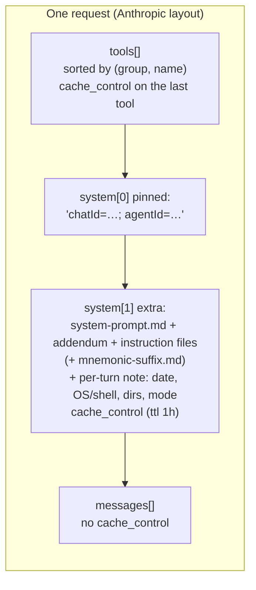
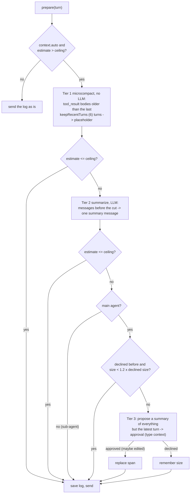
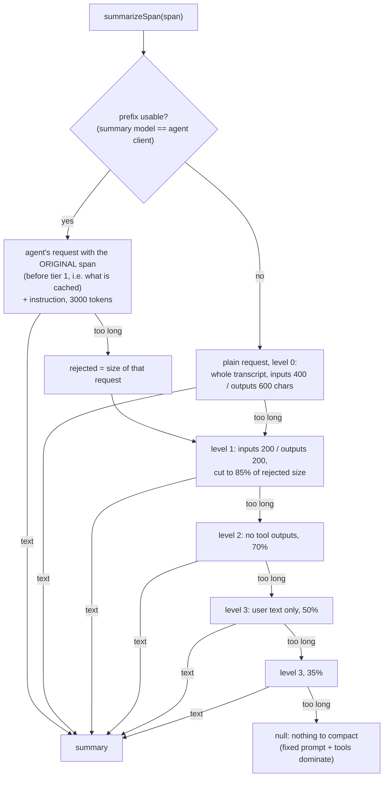
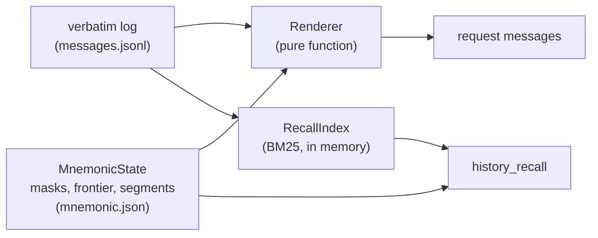
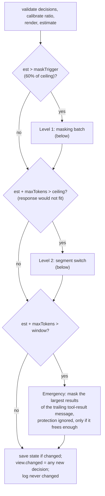
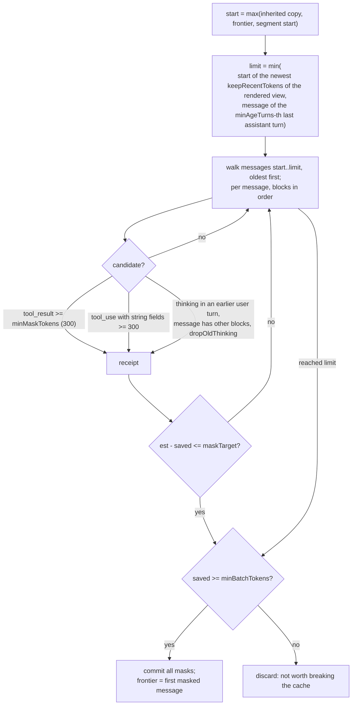
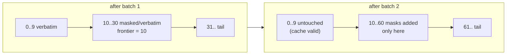
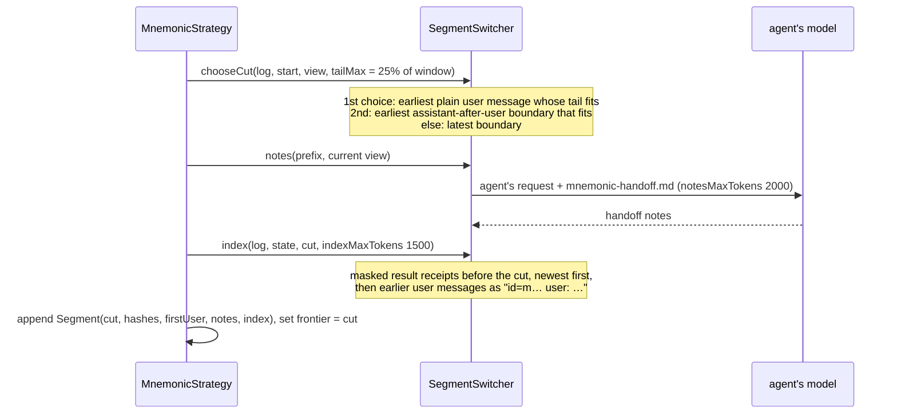
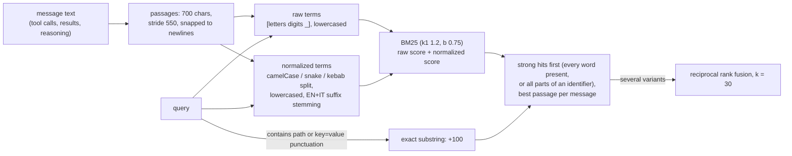

# Prompt cache and context strategies

Two problems, solved together:

1. **Prompt cache**: providers (Anthropic `cache_control`, OpenAI automatic prefix caching) and local servers
   (llama.cpp, vLLM, Ollama KV-cache reuse) only reuse work for a byte-identical prefix. Everything that can change
   must come after what does not.
2. **Context window**: the conversation grows until it no longer fits. A *context strategy* decides what the next
   request carries.

Classes: `context.ContextStrategy` (interface), `context.compaction.*` (default), `context.mnemonic.*`,
`context.scope.*`.

## 1. Prompt cache layout

`ModelRequest` = `pinnedSystem` + `extraSystem` + `tools` + `messages`.



| Part | Changes when | Why it is stable otherwise |
|---|---|---|
| tools | a tool group is added (`request_tool_group`), a tool/source/skill is toggled | registry snapshot sorted by `(group, name)`; tool set fixed on the chat's first message |
| `pinnedSystem` | never within a chat | `ChatSessionService.pinnedPrefix`: only chat id and agent id |
| base prompt, instructions | never after `build()` | read once |
| per-turn note | mode switch, new day, different directory | it is the **last** text of the system block |
| messages | every turn | appended only (compaction rewrites them; mnemonic renders them deterministically) |

What this means per provider:

- **Anthropic**: two breakpoints. The tool block is cached on its own; tools + system are cached as a whole. Messages
  carry no `cache_control`, so the history is sent as normal input on each request. A mode switch or a new date
  invalidates the system entry, the tool entry still hits. `AnthropicSettings.cacheTtl = "1h"` (default) uses the
  extended TTL.
- **OpenAI-compatible** (`OpenAiCompatModelClient`): one `system` message = pinned + `\n\n` + extra, then the
  history. Prefix caching reuses everything up to the first changed byte, history included, so a mode switch or a new
  day re-processes the conversation from the note on. Cached tokens are read from
  `usage.prompt_tokens_details.cached_tokens` and reported as `cacheReadTokens`.

### Requests the strategies make themselves

Summary requests (compaction tier 2, `/compact`) and handoff notes (mnemonic segment switch) are built as **the
agent's own request plus one instruction**, so they share the cached prefix:

```mermaid
sequenceDiagram
    participant L as AgentLoop
    participant CS as ContextStrategy
    participant LLM as model
    L->>LLM: turn N: prefix + messages[0..k]
    LLM-->>L: response (prefix now cached)
    L->>CS: prepare(turn N+1, RequestPrefix)
    CS->>LLM: same prefix + messages[0..k] + "write the summary / handoff notes"
    Note over LLM: prefix cache hit
    LLM-->>CS: text
    CS-->>L: ContextView for turn N+1
```



`RequestPrefix` (pinned, extra, tools, client, disableParallelToolUse) is what makes this possible. If the last
message is a user message (tool results), the instruction is appended to it instead of adding a second user turn.
For compaction this path is used only when the summary model is the agent's own client (no separate fast model);
otherwise a plain text request goes to the fast model.

### Model-call serialization

With `execution.maxParallel` (default 1) every model client is wrapped in `LimitedModelClient(…, maxParallel)`; with 1, one call
in flight for the whole harness, sub-agents run one at a time, depth-first. A local server with one KV cache slot then
never has its cache evicted by a concurrent request.

### Sub-agents as a cache stack

With `execution.useContextStack` (default `true`) a sub-agent request has the same pinned text, system prompt, mode note
and tool list as its parent, followed by the parent's history and then the sub-agent's role text and task. The sub-agent
therefore extends the parent's cached prefix (push) and the parent's next request is the earlier prefix plus the `task`
call and its result (pop). Without it the sub-agent's prefix differs from the start and a single-slot server re-prefills.

## 2. Size estimates

| | Compaction | Mnemonic |
|---|---|---|
| Estimate | `ceil(chars(messages + prefix) / 3.5) × ratio` (the ratio is learned from the measured usage) | `ceil(chars(view + prefix) / 3.5) × ratio` |
| Measured usage | over the ceiling when the estimate or `lastUsage.contextTokens()` is; calibrates `ratio` as in Mnemonic | calibrates `ratio = measured / estimate`, accepted in 0.5..2 |
| After a rewrite | measured usage is stale: estimate only | `changed` view resets `lastUsage` |

`Usage.contextTokens()` = input + cache read + cache creation tokens of the previous request.

Ceiling (both strategies): `window − buffer`, `buffer` = `context.buffer` if set, else `max(15% of window, 16000)` once
the window is ≥ 32000 tokens. Window = `context.maxTokens` / `--context-tokens` (default 100000 → ceiling 84000).

## 3. Compaction strategy (default)

The message log itself is rewritten and saved. `CompactionStrategy` delegates to `ContextManager`. Three tiers,
cheapest first, run at the top of every loop turn.



### Turns and cut points

A *turn* starts at a plain user text message (no `tool_result` blocks). Cuts always land on such a message, so a
`tool_use` is never separated from its `tool_result`.

```text
idx  role       content
 0   user       "Add a login page"          <- turn start
 1   assistant  tool_use read_file
 2   user       tool_result                 (not a turn start)
 3   assistant  text
 4   user       "Now add tests"             <- turn start
 ...
```

- `cutIndex(keepTurns)`: start of the `keepTurns`-th most recent turn (0 if there are fewer turns).
- `tokenCutIndex(keepTokens)`: start of the newest run of whole turns that fits in `keepTokens` (15000); the latest
  turn is always kept, even if larger.
- Tier 1 clears results before `cutIndex(keepRecentTurns)`; only bodies longer than the placeholder + 50 chars, which
  become `[tool result cleared to save context]`.
- Tier 2 summarizes everything before `max(cutIndex(keepRecentTurns), tokenCutIndex(keepTokens))`, the later of the
  two, so the verbatim tail respects both limits.

### The summary

The span is replaced by one user message `[Summary of the earlier conversation]\n<summary>`. Prompts:
`compaction-create.md` the first time, `compaction-update.md` when the span already starts with a summary (old
summary merged with newer history). The summary follows `compaction-template.md`:

```text
## Objective  ## Requirements  ## Decisions  ## Work State (Completed / Active / Blocked)
## Next Move  ## Relevant Files  ## Important Context
```



Shortened bodies keep the newest part and start with `[earlier history omitted]`. Plain requests use
`compaction-system.md` and go to the summary model (fast model if configured).

### Other entry points

| Entry | Behavior |
|---|---|
| `/compact [focus]` | tier 1 keeping 1 turn, then summarize all but the latest turn, with the prefix; no approval; `focus` is added to the instruction |
| provider rejects a request as too long (`onOverflow`) | `compactNow` without prefix, then retry the same turn once; a second rejection is an `error` event. With `context.auto: false` nothing happens |
| sub-agent with `inheritContext` (`compactInherited`) | the agent's own messages are compacted first into what is left of the ceiling after the parent copy; if still over, the copy is summarized into a user/assistant pair. The parent's log is never touched |
| sub-agent without inherited context | tiers 1–2 only |

## 4. Mnemonic strategy

The log is **never rewritten**. Each request is *rendered* from the verbatim log plus persisted, append-only
decisions. Same log + same decisions → same bytes, so the cached prefix stays valid up to the first message a new
decision touches. Anything removed from the prompt stays retrievable word for word through `history_recall`.



State is kept per `(chatId, agentKey)`: the main agent's in the `MnemonicStore` (`FileMnemonicStore` in the CLI:
`.jllm/history/<chat>/<agent>/mnemonic.json`, written atomically); a sub-agent's in memory only, released when it
ends.

### Decisions

| Record | Fields | Effect when rendered |
|---|---|---|
| `Mask` `tool_result` | index, hash, block, id `r…` | content → `[masked: read_file(path=src/A.java) -> ~4200 tokens, recall id=r3f2a91c0d4e1]` (`error from …` for errors) |
| `Mask` `tool_input` | id `a…` | each string field ≥ `minMaskTokens` → `[masked ~N tokens, recall id=a…]` |
| `Mask` `thinking` | id `t…` | the reasoning block is dropped |
| `Segment` | cut, cut hash, first user index + hash, notes, index | messages before `cut` replaced by a head message |
| `frontier` | int | new masks only at or after it |

Recall ids are the first 12 hex chars of `sha256(messageHash + ":" + block)`; message ids (`m…`) come from the message
hash. The message hash is `sha256(index + canonical JSON)` — keys sorted, reasoning blocks dropped, CRLF and trailing
whitespace normalized.

**Validation**: on every turn each decision's hash is checked against the log. From the first mismatch on (log
cleared with `/clear`, edited, truncated) every decision is dropped and `frontier` is moved back. Decisions are never
undone otherwise.

### `prepare`, every turn

Defaults for a 100000 window (ceiling 84000): trigger 50400, target 25200, minBatch 16800, keepRecent 15000,
tailMax 25000.



Note that the segment-switch test uses the output limit: with `--max-tokens 32000` and a 100000 window it fires once
the prompt passes 52000 tokens.

### Level 1: masking batch



Why batches and a frontier: every new mask changes the bytes at its message and invalidates the cache from there on.
Masking many blocks at once, rarely (only above the trigger, down to well below it, and only when it frees a lot),
costs one cache rebuild per batch. The frontier makes the cache break point only move forward:



### Level 2: segment switch

When masking cannot keep room for the response, the older part of the conversation is moved out of the prompt.



The rendered request after a switch:

```text
user:      <first user request of the chat, verbatim>
           [Context segment N. The earlier conversation was moved out of the prompt. ...]
           <handoff notes>
           Recall index (newest first):
           - read_file(path=src/A.java) -> ~4200 tokens, recall id=r…
           - id=m… user: Now add tests…
assistant: Understood. Continuing from the handoff notes.     (only if the tail starts with a user message)
<messages from cut on, with their masks>
```

If the notes request fails, a placeholder asks the model to use `history_recall`. A switch is one cache rebuild; the
new head is stable until the next switch.

### Overflow and `/compact`

| Event | Behavior |
|---|---|
| provider rejects as too long | `ratio ×= 1.3` (max 2), then a batch down to 60% of the estimate with no minimum; else a segment switch; else emergency masks; else give up (error) |
| `/compact` | does nothing (`Not used with the mnemonic context strategy`) |
| sub-agent with `inheritContext` | copies the parent's **rendered** view; its own masks never go before the copy |

### `history_recall`

Always offered while the strategy is active (group `Memory`, READ_ONLY). It only searches what is **not** visible:
masked messages and messages before the current segment.

| Input | Returns |
|---|---|
| `{"id": "r…"}` / `a…` / `t…` | the original tool output / tool input / reasoning, paged by `recallMaxChars` (12000); continue with `offset` |
| `{"id": "m…"}` | a whole message |
| `{"id": "<runId>"}` | prompt, answer and transcript of a sub-agent run (`task` results carry `runId`) |
| `{"query": "login \| auth flow"}` | up to 8 hits with ids and snippets; ` \| ` separates variants |
| `{"file": "src/A.java"}` | every tool call whose input names the file (up to 30), with result ids |
| `{"scope": "<runId>", "query": "…"}` | search inside a sub-agent transcript |

`RecallIndex` is lexical, no embeddings:



The index grows incrementally with the log and is rebuilt if the indexed part changed; it is not persisted.

### Receipt guard

The strategy installs a `PRE_TOOL` hook: `write_file`, `edit_file` and `bash` inputs containing `[masked … recall
id=…` are denied with a message telling the model to recall the original first. The system prompt gets
`mnemonic-suffix.md`, which explains receipts and recall.

### Settings

```json
"context": {"maxTokens": 100000, "strategy": "mnemonic",
            "mnemonic": {"maskTrigger": null, "maskTarget": null, "minBatchTokens": null, "minMaskTokens": 300,
                         "keepRecentTokens": null, "minAgeTurns": 2, "tailMaxTokens": null, "notesMaxTokens": 2000,
                         "indexMaxTokens": 1500, "recallMaxChars": 12000, "dropOldThinking": true}}
```

`null` means derived: trigger 60%, target 30%, minBatch 20% of the ceiling; keepRecent = `context.keepTokens`;
tailMax 25% of the window.

### Noise commands (any strategy)

After a main-agent run, `NoiseCommandPruner` removes shell calls that add no information (`mkdir`, `rm`, `cd`, `mv`,
`cp`, `touch`, `chmod`, ...) from the context. It rewrites the call and its result **in place** to a stub, so the
prompt changes from that message on: a cache miss for the rest of the prompt, the same as a mnemonic frontier move.
That is why drops are batched: the calls are collected after each turn and rewritten together once they save at least
1000 tokens (estimated). The stub is stored in the log, so after a restart the prompt is byte-identical and nothing is
qualified twice. See [INTERNALS §9](INTERNALS.md#9-sessions-and-persistence). `context.noiseCommands: false` turns it
off.

## 5. Scope strategy

`context.scope.ScopeStrategy`, selected with `context.strategy: scope`. It reuses the summarizer of `ContextManager`
and adds a whole-request budget, offloading, a pinned first message and a task list.

**Budget.** `window - reserve - safety - fixed`, in tokens (chars / 3.5, corrected by the ratio between the measured and the estimated prompt):

| Part | Value |
|---|---|
| `window` | `contextBudgetTokens` |
| `reserve` | `min(window / 4, maxTokens)`, room for the whole answer; `reserveCap` > 0 lowers it to `min(window / 4, reserveCap, maxTokens)` (default 0: not set) |
| `safety` | `safetyPercent` of the window (2) |
| `fixed` | pinned system block, per-turn note and tool schemas of the request |

Nothing happens while the messages fit (and with `compaction.auto` off, nothing happens at all).

**Trim order**, each step only while the request is still over budget:

1. **Offload.** A `tool_result` longer than `offloadChars` (20000) is written in full to
   `<scratch>/offload/<tool_use_id>.txt` and replaced in the log by
   `[Output offloaded to <path> (N chars); read it with read_file if you need more.]` plus `previewChars` (1500) of head and
   tail. First outside the latest turn, then everywhere. The agent's own scratch directory is readable by the file
   tools in every mode. If the write fails the original stays.
2. **Clear.** Tool results older than `keepRecentTurns` turns are blanked; an offload pointer is cut back to its first
   line, so the path survives.
3. **Summarize.** `ContextManager.compactNow` on the log without its first message: everything but the latest turn
   becomes `[Summary of the earlier conversation]`.

If it still does not fit a `warning` event says so and the request is sent; the provider may then refuse it. There is no
user-approved rewrite tier.

**Pinned first message.** The first user message of the chat is never summarized or cleared. After the first summary the
log is `[first user message] [assistant "Understood."] [summary] [recent turns]`; the next compaction leaves the first two
alone and merges the old summary into the new one. A log that does not start with a plain user message (for example one
that came from `compaction`) has no pin.

**Todos.** `todo_write` replaces the whole list (`id`, `content`, `status` of `pending`, `in_progress`, `completed`; at
most one `in_progress`; a rejected write keeps the old list); `todo_read` returns it. Both are `READ_ONLY`, so they need
no approval and work in plan mode. The list lives in the `StateStore` under `todos-<agent>`, per chat and agent. Each
request gets it appended as a `<todo_list>` block to the last user message, on a copy: the stored log never contains
it, so no compaction can lose or duplicate it, and the cached prefix does not change. A `todos` event is emitted on every
write.

**Overflow.** `onOverflow` runs one forced pass: offload at `overflowOffloadChars` (2000), clear all but the latest turn,
summarize. `/compact` clears and summarizes with an optional focus.

### Settings

```json
"context": {"strategy": "scope",
            "scope": {"offloadChars": 20000, "overflowOffloadChars": 2000, "previewChars": 1500,
                      "safetyPercent": 2, "reserveCap": 0}}
```

Unset values keep these defaults. Code: `builder.scopeOptions(new ScopeStrategy.Options(...))`; the settings file wins.

## 6. Choosing

| | Compaction | Mnemonic | Scope |
|---|---|---|---|
| Log on disk | rewritten (summaries replace history) | verbatim forever | rewritten; large outputs kept as files |
| Information loss | summaries are lossy; cleared results are gone | none: everything recallable | summaries are lossy; offloaded outputs stay on disk |
| Extra model calls | a summary per tier-2/3 compaction | handoff notes per segment switch | a summary per compaction |
| User interaction | tier 3 may ask for approval | never | never |
| Cache behavior | each compaction rewrites the prefix of the history | breaks only at the first newly masked message; rare, batched | like compaction; the todo block is at the end |
| Pinned | none | first user message per segment | first user message, todo list |
| Best for | short chats, hosted models | long agentic sessions, local servers with prefix KV cache | long task-driven sessions with large tool outputs |
| `/compact` | yes | no-op | yes |

Select with `context.strategy`, `--context-strategy`, `HarnessConfig.withContextStrategy(...)`, or a custom
implementation through `builder.contextStrategy(factory)` ([EXTENDING §7](EXTENDING.md#7-context-strategy)).
`/status` shows the active one.
