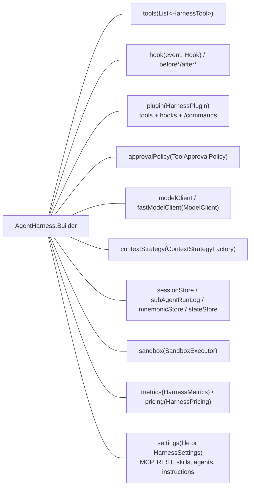
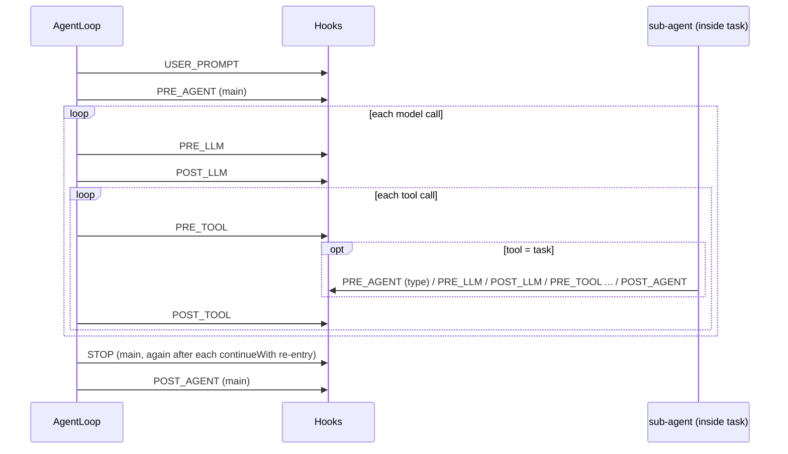
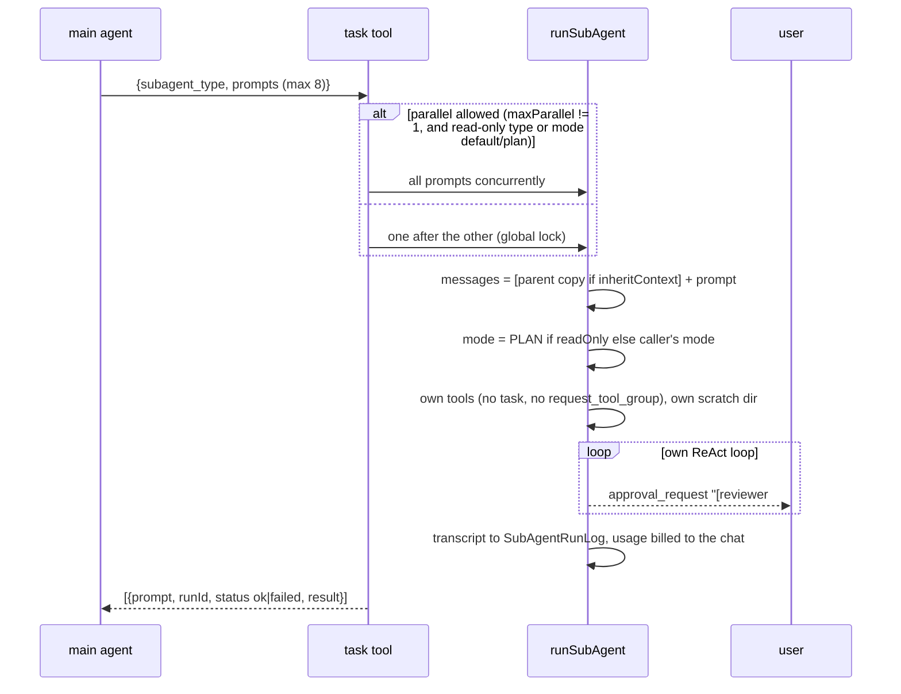
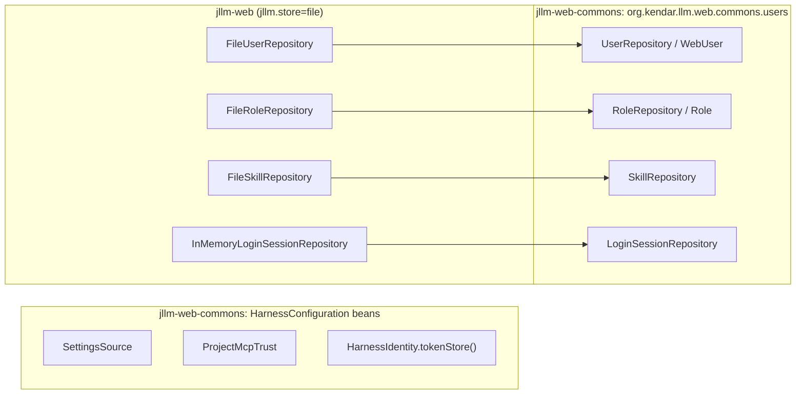

# Extending the harness

Every extension point is a plain Java interface passed to `AgentHarness.builder()`. No framework, no reflection.



| Section | Extension |
|---|---|
| [1](#1-tools) | tools |
| [2](#2-hooks) | hooks |
| [3](#3-plugins-and-slash-commands) | plugins and slash commands |
| [4](#4-approval-policy) | approval policy |
| [5](#5-model-providers) | model providers |
| [6](#6-sub-agent-types) | sub-agent types |
| [7](#7-context-strategy) | context strategy |
| [8](#8-persistence) | persistence |
| [9](#9-sandbox) | sandbox |
| [10](#10-metrics-and-pricing) | metrics and pricing |
| [11](#11-prompts) | prompts |
| [12](#12-testing) | testing |
| [13](#13-web-storage) | web storage (users, roles, skills, sign-in sessions, settings, tokens) |

External tools without code: [MCP and REST APIs](MCP.md). Instructions without code: [SKILLS](SKILLS.md).

## Jars to import

All artifacts: group `org.kendar.llm`, version `1.1.0-jllm` (`mvn install` from the root puts them in the local
repository; JDK 21).

| Artifact | Contains | Import when |
|---|---|---|
| `jllm-commons` | `HarnessTool`, `ToolContext`, `ToolKind`, `HarnessPlugin`, hooks, shared records | writing a plugin (scope `provided`: the host supplies it) |
| `jllm-harness` | `AgentHarness`, `AgentLoop`, model clients, sessions, settings, context, sandbox | embedding the harness (brings `jllm-commons`, `jllm-fs`, `jllm-webbrowse`, `jllm-apimcp`) |
| `jllm-fs` | file tools (read, write, edit, grep, remote files) | only with the tools and no harness |
| `jllm-webbrowse` | web search and fetch tools | only with the tools and no harness |
| `jllm-apimcp` | REST API and MCP tool providers | only with the tools and no harness |
| `jllm-test-support` | `HarnessTestSupport`: `ScriptedModel`, `Rig`, `Events` ([12](#12-testing)) | tests (scope `test`) |
| `jllm-web-commons` | Spring Boot REST + SSE chat and file API, storage interfaces ([13](#13-web-storage)) | building a web front end with its own sign-in and storage |
| `jllm-web` | the reference web application (file stores, cookie sign-in, admin) | running it, or as an example |

A plugin jar (loaded from the plugin directory by the CLI and the web app):

```xml
<dependency>
    <groupId>org.kendar.llm</groupId>
    <artifactId>jllm-commons</artifactId>
    <version>1.1.0-jllm</version>
    <scope>provided</scope>
</dependency>
<dependency>
    <groupId>org.kendar.llm</groupId>
    <artifactId>jllm-harness</artifactId>
    <version>1.1.0-jllm</version>
    <scope>test</scope>
</dependency>
<dependency>
    <groupId>org.kendar.llm</groupId>
    <artifactId>jllm-test-support</artifactId>
    <version>1.1.0-jllm</version>
    <scope>test</scope>
</dependency>
```

Package third-party libraries into the plugin (`jar-with-dependencies`, as `plugins/jllm-pdf` and `plugins/jllm-js`
do); never the `jllm-*` jars. An application embedding the harness depends on `jllm-harness` (compile scope); a web
application on `jllm-web-commons`.

## 1. Tools

```java
public interface HarnessTool {
    String name();                 // [a-zA-Z0-9_-]{1,64}, unique in the harness
    String description();          // what the model reads to decide when to call it
    JsonNode inputSchema();        // JSON Schema of the input object
    String group();                // e.g. "Files", "Db/Query"; unit of selection and of /tools toggles
    ToolKind kind();               // READ_ONLY, FILE_EDIT, OTHER: drives approval
    String execute(ToolContext ctx, JsonNode input) throws Exception;
    default String preview(ToolContext ctx, JsonNode input) { return input.toString(); } // approval dialog
}
```

`SimpleTool` covers most cases:

```java
HarnessTool sql = new SimpleTool("db_query",
        "Run a read-only SQL query against the reporting database. Returns CSV, at most 500 rows.",
        SimpleTool.schema(
                "sql", "SELECT statement",
                "limit:integer?", "Row limit (default 100)"),   // name[:type][?] , description
        "Db", ToolKind.READ_ONLY,
        (ctx, in) -> reporting.query(in.path("sql").asText(), in.path("limit").asInt(100)));

AgentHarness h = AgentHarness.builder().modelClient(client).tools(List.of(sql)).build();
```

Group several tools in a `HarnessToolSet` (`List<HarnessTool> tools()`), as the built-ins do.

### What `execute` gets

| `ToolContext` field | Use |
|---|---|
| `chatId` | scope per-chat state |
| `workDir` | root of the path jail; use `FileSystemAgentTools.jail(ctx, path)` / `jailWrite(ctx, path)` for paths |
| `scratchDir` | per chat and agent, always writable |
| `readOnlyWork` | true in plan mode: do not change `workDir` |
| `mode` | permission mode of the calling agent |
| `toolUseId` | id of this call |
| `run` | `sink()` to emit extra events, `cancelled()` to stop long work, `contextKey()` |

Rules the loop applies around it:

- A thrown exception becomes an error result (`Error: <message>`); the run continues. Throw with a message the model
  can act on.
- Output over `output.toolMaxChars` (30000) is cut. Keep results short and structured; page large data.
- All tool calls of one response run concurrently: `execute` must be thread-safe.
- Cancel interrupts the thread; honor interrupts in blocking code.
- `kind` is a promise. A `READ_ONLY` tool never asks and is given to read-only sub-agents (`explore`, `plan`).
- Name, description and schema are part of the cached prompt prefix: keep them constant. A description computed from
  state (like `skill`) changes the prefix whenever the state changes.
- The tool must be in a group the chat has. With more than `toolBatchThreshold` (12) tools the selector picks groups
  on the first message; `coreGroups` (`Files`, `Shell`) are always included. Add your group with
  `config.withCoreGroups(Set.of("Files", "Shell", "Db"))` if it must always be there.
- The input is checked against `inputSchema()` before `execute` runs (see [TOOLS §5](TOOLS.md#5-one-tool-call)), so
  declare `required` and types accurately. Add a rule of your own (a path allow-list, a value range) with
  `builder.addToolInputValidator((tool, input, mode) -> ...)`, or swap the whole check with `toolInputValidator(...)`.
  The validator returns the input to use and a list of problems; it must not modify the input it receives.

## 2. Hooks

```java
@FunctionalInterface
public interface Hook { HookResult run(HookContext ctx) throws Exception; }
```

| Event | Fires | `ctx` fields | Can |
|---|---|---|---|
| `USER_PROMPT` | user message, before anything | `text` | deny (prompt dropped, warning), add context to the message |
| `PRE_AGENT` | main agent start, every sub-agent start | `agent`, `text` (prompt) | deny (main: no run; sub-agent: its `task` entry fails) |
| `PRE_LLM` | before every model call | `agent` | deny (run ends with an error; log stays valid) |
| `POST_LLM` | after every model call | `agent`, `text`, `isError`, `durationMs`, `usage` (null on failure) | observe |
| `PRE_TOOL` | before the permission check | `tool`, `input` | deny, rewrite input, add context to the result |
| `POST_TOOL` | after the tool ran | `tool`, `input`, `output`, `isError`, `durationMs` | add context to the result |
| `POST_AGENT` | agent end, also on failure | `agent`, `text` (answer or error), `isError` | observe |
| `STOP` | an agent (main or sub-agent) is about to finish; once per attempt; not in plan mode or on cancel | `agent` (`main` or the sub-agent label `"<type> #<n>"`), `text` (final answer), `attempt` (1, 2, ...) | veto with `HookResult.continueWith(message)`: the agent is told the message and keeps working |



Chain semantics (`Hooks.run`): hooks run in registration order; the first denial stops the chain; input rewrites
chain (each hook sees the previous rewrite); added context is joined with newlines, `continueWith` messages with blank
lines; a hook that throws is logged and skipped.

**Verify on stop.** A `STOP` hook that returns `HookResult.continueWith(message)` keeps the agent working: the loop
appends "The stop check failed. Fix the problem and finish again." and the message as a user message, sends
`verify_failed`, and calls the model again. After `loop.verify.maxReentries` (default 3) re-entries, or the same
message twice in a row, the run ends `UNVERIFIED` (a sub-agent reports status `unverified`). Existing `STOP` hooks
that assumed the main agent should check `ctx.agent()`. A test run needs no code: `hooks.stop` in the settings
([USAGE](USAGE.md#verify-on-stop)) registers a `CommandStopHook`. An LLM judge is a plugin `STOP` hook that asks the
fast model and returns `continueWith` with its objection. `AgentLoop.changedInRun(chatId, agent)` tells a hook
whether a tool that changes things ran in the run. A `PRE_TOOL` denial is reported to the model as `Denied by a hook: <reason>`.

```java
builder.beforeToolCall(ctx -> ctx.tool().equals("bash") && ctx.input().path("command").asText().contains("rm -rf")
                ? HookResult.deny("destructive command") : HookResult.allow())
       .beforeToolCall(ctx -> ctx.tool().equals("web_fetch")
                ? HookResult.modifyInput(((ObjectNode) ctx.input().deepCopy()).put("url", proxied(ctx.input())))
                : HookResult.allow())
       .afterToolCall(ctx -> ctx.isError() ? HookResult.addContext("Hint: check the path with glob first.")
                : HookResult.allow())
       .afterLlmCall(ctx -> { audit.log(ctx.chatId(), ctx.agent(), ctx.text()); return HookResult.allow(); });
```

### Tracing

`durationMs` and `usage` on `POST_LLM` / `POST_TOOL` are all a tracing adapter needs; the harness has no OpenTelemetry
dependency. An adapter is a plugin that registers hooks and keeps the spans itself (sketch, not shipped):

```java
public final class OtelPlugin implements HarnessPlugin {
    public void install(PluginRegistrar r) {
        Tracer tracer = GlobalOpenTelemetry.getTracer("jllm");
        r.hook(HookEvent.POST_LLM, c -> {
            Span s = tracer.spanBuilder("llm").setStartTimestamp(Instant.now().minusMillis(c.durationMs())).startSpan();
            if (c.usage() != null) s.setAttribute("tokens.input", c.usage().contextTokens());
            if (c.isError()) s.setStatus(StatusCode.ERROR);
            s.end();
            return HookResult.allow();
        });
        r.hook(HookEvent.POST_TOOL, c -> {
            Span s = tracer.spanBuilder("tool " + c.tool()).setStartTimestamp(Instant.now().minusMillis(c.durationMs())).startSpan();
            if (c.isError()) s.setStatus(StatusCode.ERROR);
            s.end();
            return HookResult.allow();
        });
    }
}
```

The factories `HookContext.afterLlm(...)` and `HookContext.postTool(..., durationMs)` carry the timing; the older
factories report `durationMs` 0. A hook that throws is logged and skipped.

## 3. Plugins and slash commands

A plugin bundles tools, hooks and commands:

```java
public final class DeployPlugin implements HarnessPlugin {
    @Override
    public void install(PluginRegistrar r) {
        r.tool(new SimpleTool("deploy_status", "Status of the last deployment", SimpleTool.schema(),
                        "Deploy", ToolKind.READ_ONLY, (ctx, in) -> deployer.status()))
         .hook(HookEvent.STOP, ctx -> { notifier.done(ctx.chatId()); return HookResult.allow(); })
         .command("/deploy", "Deploy the current branch", (chatId, arg) -> deployer.deploy(arg));
    }
}

AgentHarness h = AgentHarness.builder().modelClient(client).plugin(new DeployPlugin()).build();
```

A plugin can also register a `DocumentReader` for `read_file` (`r.documentReader(reader)`; see
[TOOLS](TOOLS.md#document-readers)). Plugins listed in `META-INF/services/org.kendar.llm.harness.plugin.HarnessPlugin`
are found by `builder.discoverPlugins()`.

Every plugin has an id, returned by `id()` (pattern `[a-z][a-z0-9-]{1,31}`, unique); a plugin without one fails startup.
`install(registrar, settings)` receives `plugins.<id>.settings` (an empty object when absent); a plugin overrides
whichever `install` it needs. Plugins passed with `builder.plugin(...)` are installed at `build()` and need no settings
entry (an entry with `"enabled": false` skips them). Plugins found by discovery, on the classpath or in
`builder.pluginDir(dir)` (jars, loaded by a child class loader with their own libraries inside), load only when listed
and enabled:

```json
"plugins": {
  "pdf":  { "enabled": true },
  "docs": { "enabled": false },
  "js":   { "enabled": true, "settings": { "storage": { "maxBytes": -1 } } }
}
```

A found plugin that is not listed, or has no `enabled`, is skipped with a WARN; a listed plugin that is not found gets a
WARN; a disabled one gets an INFO line. One INFO line summarises what loaded. Settings files merge per plugin id.
Jars in the plugin directory run with full application rights: do not let untrusted users write there.

Commands must start with `/`, contain no spaces and not clash with a built-in. They run without the model; the
returned string is shown to the user; an exception is shown as `error: …`. They appear in `/help`.

## 4. Approval policy

`ToolApprovalPolicy` decides what asks in `default` mode (and for non-`FILE_EDIT` tools in `plan`/`edit`):

```java
ToolApprovalPolicy policy = new ToolApprovalPolicy() {
    @Override public boolean requiresApproval(HarnessTool t) {
        return t.kind() != ToolKind.READ_ONLY && !t.name().startsWith("pets__");   // trust one API
    }
    @Override public void registered(HarnessTool t) { log.info("tool {}", t.name()); } // every tool, also MCP/REST
};
builder.approvalPolicy(policy);
```

The mode layer (`PermissionGate`) runs before it: `auto` allows everything, `edit`/`plan` allow `FILE_EDIT`. To
block a tool outright use a `PRE_TOOL` hook or `/tools disable`. Grants from `a` answers and the `auto` classifier
are applied after the policy.

## 5. Model providers

```java
public interface ModelClient {
    ModelResponse complete(ModelRequest request);
    default ModelResponse complete(ModelRequest request, CancelToken cancel) { return complete(request); }
    String simpleComplete(String system, String user, int maxTokens);
    default String simpleComplete(String system, String user, int maxTokens, Consumer<Usage> usageSink) { … }
    /** explicit sampling temperature for yes/no decisions; a client that cannot send one (Anthropic) ignores it */
    default String simpleComplete(String system, String user, int maxTokens, Double temperature,
                                  Consumer<Usage> usageSink) { … }
}
```

Built-in: `ModelClients.anthropic(AnthropicSettings, mapper)`, `ModelClients.from(LlmSettings, mapper)` (any
OpenAI-compatible endpoint, or `anthropic` by name), `ModelClients.ollama(model, mapper)`.

A new provider must:

- read `request.messages()` in **Anthropic shape** (`role`, `content` blocks `text`, `tool_use`, `tool_result`,
  `thinking`) and translate them;
- send `pinnedSystem` then `extraSystem` as system text, tools in the given order (cache prefix, see
  [CACHES](CACHES.md));
- return `ModelResponse(content, stopReason, usage)` with content in Anthropic shape (`text`, `tool_use` with `id`,
  `name`, `input`) and stop reasons `end_turn`, `tool_use`, `max_tokens`, `stop_sequence`, `pause_turn`, `refusal`;
- report `Usage(input, output, cacheRead, cacheCreation)` (input **excluding** cached tokens);
- throw `ModelException` on failure; a message matching `ModelException.isContextOverflow` ("too long", "context
  length", "413", …) triggers the strategy's overflow handling;
- honor `CancelToken` (`cancel.send(http, request)`, `cancel.sleep(ms)`) and throw `ModelCancelledException`.

Named providers, `/model` switching and temperature are described in [USAGE](USAGE.md#providers-and-temperature). A
`ModelRequest.temperature()` of `null` means "do not send"; wrap a client in `TemperatureModelClient` to give it a
default.

**Fallback.** `ProviderSettings.order` chains configured providers: `ProviderCatalog.client(...)` returns a
`FallbackModelClient` that tries them in ascending `order` when one throws a `ModelException` (not a context overflow,
not a cancellation). `FallbackModelClient.onFallback(listener)` reports the provider about to be tried. Retry stays
inside each client (`maxRetries`).

`fastModelClient(...)` (or settings `fastModel`) adds a small model for tool-group selection, compaction summaries and
the `auto` classifier. Unless `maxParallel` is -1 both are wrapped in `LimitedModelClient(…, maxParallel)`.

## 6. Sub-agent types

Configured in the settings `agents` list (or `HarnessSettings` built in code). The `task` tool offers them next to the
built-ins.

```json
"agents": [
  {"name": "reviewer", "description": "Reviews a diff for bugs",
   "tools": ["read_file", "grep", "glob", "bash"], "readOnly": false,
   "promptFile": "agents/reviewer.md", "inheritContext": true,
   "model": {"name": "anthropic", "baseUrl": "https://api.anthropic.com", "apiKey": "${ANTHROPIC_API_KEY}",
             "model": "claude-haiku-5-5", "maxTokens": 8192, "maxRetries": 3, "timeoutSeconds": 600,
             "requireApiKey": true, "useMaxCompletionTokens": false}}
]
```

| Field | Default | Meaning |
|---|---|---|
| `name` | required | `subagent_type`; must not clash with `general`, `explore`, `plan` |
| `description` | `""` | shown in the `task` description |
| `tools` | all | tool names it may get (still filtered by the selector) |
| `readOnly` | `false` | always PLAN mode with READ_ONLY tools |
| `prompt` / `promptFile` | none | added to its system text |
| `inheritContext` | `false` | start from a copy of the caller's conversation |
| `model` | main model | own `LlmSettings` |



Sub-agents inherit the caller's hooks, permission policy and chat grants; their transcript stays out of the chat log.

## 7. Context strategy

```java
public interface ContextStrategy {
    ContextStrategyKind kind();                 // CUSTOM for your own
    ContextView prepare(ContextTurn turn);      // every turn: messages to send
    ContextView onOverflow(ContextTurn turn);   // provider said too long; null = give up
    CompactResult compactNow(ContextTurn turn, String focus);   // /compact
    long contextTokens(String chatId, String agentKey, ArrayNode log);
    default ArrayNode inheritedView(String chatId, String agentKey, ArrayNode log) { return log; }
    default List<HarnessTool> tools() { return List.of(); }   // offered to every agent, same list each call
    default void install(Hooks hooks) { }
    default void release(String chatId, String agentKey) { }  // sub-agent finished
    default void forget(String chatId) { }
}
```

```java
builder.contextStrategy(deps -> new SlidingWindowStrategy(deps.config(), deps.mapper()));
```

`deps` gives `config`, `model`, `summaryModel` (fast or main), `approvals`, `mapper`, `metrics`, `subAgentRuns`.
Built-in kinds are `COMPACTION`, `MNEMONIC` and `SCOPE` (`context.scope.*`, `builder.scopeOptions(...)`); the todo
tools of `SCOPE` come from `tools()`, a pattern to reuse for a strategy that needs tools of its own.

Contract:

- `ContextView(messages, changed, logChanged)`: return the log itself or a rendered copy. Set `logChanged` only if you
  rewrote `turn.log()` in place (the loop saves it). Set `changed` when the request differs from the previous one by
  more than appended messages (the last measured usage is then discarded).
- Never separate a `tool_use` from its `tool_result`; keep the first message a user message.
- `turn.prefix()` lets your own model calls reuse the cached prefix; `turn.usageSink()` bills them to the chat;
  `turn.main()` is false for sub-agents (do not ask the user then).
- One instance serves every chat and agent: key state by `(chatId, agentKey)` and synchronize.

## 8. Persistence

| Port | Default | CLI | Holds |
|---|---|---|---|
| `ChatSessionStore` | `InMemoryChatSessionStore` | `FileChatSessionStore` | `ChatSessionData`: messages (JSON lines), mode, tool groups, usage, title, agent id, message count |
| `SubAgentRunLog` | `InMemorySubAgentRunLog` | `FileHistorySubAgentRunLog` | sub-agent prompt, transcript, answer, status, usage |
| `MnemonicStore` | `InMemoryMnemonicStore` | `FileMnemonicStore` | mnemonic decisions per chat and agent |
| `StateStore` | `InMemoryStateStore` | `FileStateStore` | small JSON documents per chat: tool grants (`grants`), todo lists (`todos-<agent>`); `<history>/<chat>/state/<name>.json` |

```java
public interface ChatSessionStore {
    ChatSessionData save(ChatSessionData session);     // insert or replace by chatId
    Optional<ChatSessionData> find(String chatId);
    List<ChatSessionData> list();                      // most recently updated first
    void delete(String chatId);
}
```

`save` is called after the user message, after every model response and after every tool-result message: make it
cheap or write behind. The `FileHistory*` stores are decorators: they wrap another store and mirror to
`<root>/<chatId>/<agentId>/messages.jsonl`, so a database store can be wrapped the same way.

### Token stores

OAuth tokens (REST APIs, MCP servers, provider logins) go through `org.kendar.llm.harness.auth.TokenStore`. Shipped:
`FileTokenStore` (one file per principal, optional `TokenCipher` encryption, cross-process file lock) and
`NativeTokenStore` (macOS Keychain, Windows DPAPI, Linux Secret Service; single user). `AgentHarness.Builder.tokenStore(store)`
takes any implementation and wins over the `tokenStore` settings ([MCP](MCP.md#6-token-storage)).

```java
public interface TokenStore {
    Optional<OAuthToken> get(String principalId, String name);   // principalId null: single user / shared login
    void put(String principalId, String name, OAuthToken token);
    boolean remove(String principalId, String name);
    List<String> names(String principalId);
    default void removeAll(String principalId) { ... }           // user deleted
    default boolean compareAndPut(String principalId, String name, OAuthToken expected, OAuthToken next) { ... }
    default <T> T locked(String principalId, String name, Supplier<T> action) { ... } // in-process by default
    default boolean crossProcess() { return false; }
    String describe();                                             // "file ...", "macOS keychain": never a secret
}
```

Rules:
- Only keep tokens. Never refresh them in the store: the harness refreshes under `locked`, re-reads, and saves with
  `compareAndPut`; a second refresher of a rotating refresh token would break the first.
- `compareAndPut` with `next == null` removes the entry (a revoked token).
- Implement `locked` and `crossProcess()` when several processes share the store, else the refresh is safe inside one
  process only.
- Never log `OAuthToken` contents (its `toString` hides them).

Example: HashiCorp Vault KV v2, where `compareAndPut` maps to Vault's `cas` (check-and-set), so it is safe across
processes. `vault` is your client of choice; none is a harness dependency.

```java
final class VaultTokenStore implements TokenStore {
    private final VaultKv vault;                        // your KV v2 client: read(path) -> {data, version}, write(path, data, cas)

    private static String path(String p, String name) {
        return "jllm/" + (p == null ? "-" : p) + "/" + URLEncoder.encode(name, UTF_8);
    }

    public Optional<OAuthToken> get(String p, String name) {
        return vault.read(path(p, name)).map(v -> Tokens.fromJson(v.data()));
    }

    public void put(String p, String name, OAuthToken t) {
        vault.write(path(p, name), Tokens.toJson(t), null);           // unconditional
    }

    public boolean compareAndPut(String p, String name, OAuthToken expected, OAuthToken next) {
        var cur = vault.read(path(p, name));
        if (!Objects.equals(cur.map(v -> Tokens.fromJson(v.data())).orElse(null), expected)) return false;
        int cas = cur.map(VaultKv.Entry::version).orElse(0);      // 0: create only
        try {
            if (next == null) vault.delete(path(p, name));
            else vault.write(path(p, name), Tokens.toJson(next), cas);
            return true;
        } catch (VaultKv.CasMismatch e) {
            return false;                                          // another process won: the harness uses its token
        }
    }

    public <T> T locked(String p, String name, Supplier<T> action) { return action.get(); } // CAS does the work
    public boolean crossProcess() { return true; }
    public boolean remove(String p, String name) { return vault.delete(path(p, name)); }
    public List<String> names(String p) { return vault.list("jllm/" + (p == null ? "-" : p)); }
    public String describe() { return "vault " + vault.address(); }
}
```

Other choices:
- **A database table** `(principal, name, data, version)` with the data encrypted by `TokenCipher`
  (`cipher.encrypt(json)` / `decrypt(sealed)`); `compareAndPut` is an `UPDATE ... WHERE version = ?`.
- **AWS Secrets Manager** works too, but each refresh is a paid, rate-limited write per user and hour; a database
  scales better.

## 9. Sandbox

```java
public interface SandboxExecutor {
    ExecutionResult execute(String chatId, String command, Duration timeout);
    default ExecutionResult execute(String chatId, Path runDir, Path readOnlyDir, String command, Duration timeout);
    Path workDir(String chatId);          // root of the file tools' jail
    Path location();
    default Path scratchDir(String chatId, String agentId);
    default String shellEnvironment();    // told to the model (OS, shell)
    default void deleteWorkDir(String chatId);
    default FileBackend files(String chatId, String agentId);  // null: the file tools use workDir on the host
    default String displayPath(Path p);   // how the model and the user see a path
    default String clean(String chatId);  // remove sandbox resources outside the work dir (container)
    default void close();                 // release resources (web containers)
}
```

| Implementation | Work dir | Isolation |
|---|---|---|
| `LocalDirSandboxExecutor` (default) | `<sandbox.baseDir>/<chatId>` | none (warning at startup) |
| `CwdSandboxExecutor` (CLI) | the project directory for every chat | none |
| `ChatDirSandboxExecutor` (web) | `<base>/<chatId>`, with its own `.jllm` | none |
| `RemoteExecSandboxExecutor(config, runner, layoutExecutor, Kind, projectDir)` (settings `sandbox.backend: docker`, `sandbox.docker.mode: daemon`) | `/workspace` in a long-running container; bind mount (CLI) or volume (web) | as `Docker…`, plus a per-container token; default docker network |
| `DockerSandboxExecutor(config, new ProcessDockerCommandRunner()[, layoutExecutor])` (settings `sandbox.backend: docker`) | that of the layout executor, mounted into the container | `--network none`, memory/cpu/pids limits, user `1000:1000`, work dir mounted read-only in plan mode |

Docker settings come from `HarnessConfig.Docker` (`binary`, `image` default `python:3.12-slim`, `memory`, `cpus`,
`pidsLimit`, `user`, `network`, `mode`), set in the settings file under `sandbox.docker`. The file tools run in the JVM
against `workDir`, and only `bash` goes through the executor, unless `files(chatId, agentId)` returns a `FileBackend`
(daemon mode): then all file tools go through it and no host paths are used. To plug in another remote sandbox,
implement `FileBackend` (read, write, stat, glob, grep and the browse calls) and return it from `files`. Full description of each backend: [SANDBOX](SANDBOX.md).

## 10. Metrics and pricing

```java
builder.metrics(new HarnessMetrics() {
    public void modelCall(Duration d, String outcome) { … }      // ok, error, cancelled
    public void tokens(Usage u) { … }
    public void toolCall(String tool, String outcome, Duration d) { … }
    public void turn() { … }
    public void compaction(int tier) { … }
    public void context(String kind) { … }                       // mnemonic: mask, segment
    public void approval(String kind, boolean approved) { … }    // tool, context
});
builder.pricing(new HarnessPricing(3.0, 15.0, 0.30, 3.75));      // USD per million: input, output, cache read, cache write
```

## 11. Prompts

All built-in prompts are classpath resources under `/agent-harness/prompts/`, loaded by `Prompts.load`. Lines
starting with `# ` are comments and are dropped.

| File | Used for |
|---|---|
| `system-prompt.md` | base system prompt of every agent |
| `subagent-suffix.md`, `subagent-readonly-suffix.md` | added for sub-agents |
| `agent-explore.md`, `agent-plan.md` | built-in agent types |
| `compaction-*.md` | summary instructions, rules and template |
| `mnemonic-suffix.md`, `mnemonic-handoff.md` | mnemonic strategy |
| `tool-selector-system.md` | tool-group selection |
| `tool-classifier-system.md` | `auto`-mode classifier |

Project rules go in `builder.systemPrompt(...)` or instruction files. To replace a built-in prompt, put a resource
with the same path earlier on the class path.

## 12. Testing

`HarnessTestSupport` (`org.kendar.llm.harness.testsupport`) ships in `jllm-test-support` (scope `test`):

| Helper | Use |
|---|---|
| `ScriptedModel` | fake `ModelClient`: `enqueue(...)` responses, `simpleReplies` for `simpleComplete`, or a `handler`; records every request in `requests` |
| `text`, `toolUse`, `resp`, `json` | build responses |
| `Rig(Path baseDir)` | a wired `AgentLoop` (real gate, approvals, sessions, local sandbox, context strategy) over a `ScriptedModel`: `register(tools…)`, `newChat()`, `configure(cfg -> …)`, `loopWith(client)`, `requiresApproval.put(name, true)` |
| `Events` | `EventSink` that records: `ofType("tool_result")`, `types()` |
| `CountingMetrics` | token totals by type |
| `tool(name, group, kind, body)`, `config(baseDir)` | quick tool and test config |

`Rig` mocks the registry with Mockito, so the consumer needs `mockito-core` in test scope.

```java
Rig rig = new Rig(tempDir).register(myTool);
rig.model.enqueue(toolUse("t1", "db_query", "{\"sql\":\"select 1\"}"), text("one row"));
String chat = rig.newChat();
Events events = new Events();
rig.loop.run(chat, "How many rows?", events, () -> false);
assertEquals("one row", events.ofType("text").getLast().path("text").asText());
```

## 13. Web storage

A web application built on `jllm-web-commons` keeps its users, roles, skills, sign-in sessions, settings and tokens
behind interfaces. `jllm-web` ships file and in-memory implementations, wired when `jllm.store=file` (the default,
`WebAuthConfiguration`); another store (e.g. SQL) sets `jllm.store` to another value and supplies its own beans. The
controllers and the harness depend only on the interfaces.



| Interface | Module, package | Default (jllm-web) | Holds |
|---|---|---|---|
| `UserRepository` | jllm-web-commons, `...web.commons.users` | `FileUserRepository`: `webauth/users/<id>.json` | `WebUser`: id, name, role, password hash, per-source credential headers (`env:NAME` only), disabled tools and skills |
| `RoleRepository` | jllm-web-commons, `...web.commons.users` | `FileRoleRepository`: `webauth/permissions/<role>.json` | `Role`: tool patterns, read-only, approval `ask`/`off`; the fixed `admin` role is never stored |
| `SkillRepository` | jllm-web-commons, `...web.commons.users` | `FileSkillRepository`: `webauth/global-skills/`, `webauth/user-skills/<id>/` | global and per-user skills (name, description, content) |
| `LoginSessionRepository` | jllm-web-commons, `...web.commons.users` | `InMemoryLoginSessionRepository` (a restart signs everybody out) | cookie token → user id, sliding `TTL` of 7 days |
| `SettingsSource` | jllm-harness, `...harness.settings` | `FileSettingsSource`: `~/.jllm/settings.json`, `<project>/.jllm/settings.json`, `--settings`/`jllm.settings` | `SettingsLayer`s, `GLOBAL` → `PROJECT` → `EXPLICIT`, a later layer wins |
| `ProjectMcpTrust` | jllm-harness, `...harness.settings` | `FileProjectMcpTrust.user()`: `~/.jllm/trusted-mcp.json` | trust answers for project MCP servers, tied to a SHA-256 of the definition |
| `TokenStore` | jllm-harness, `...harness.auth` | `FileTokenStore` from the `tokenStore` settings | OAuth tokens per principal ([8](#token-stores)) |
| `ChatSessionStore`, `SubAgentRunLog`, `StateStore` | jllm-commons, `...harness.session`, `...harness.state` | `FileChatSessionStore`, `FileHistorySubAgentRunLog`, `FileStateStore` under `<base>/<chatId>/.jllm/history` | chats, sub-agent runs, per-chat state ([8](#8-persistence)) |
| `MnemonicStore` | jllm-harness, `...harness.context.mnemonic` | `FileMnemonicStore` under the same root | mnemonic decisions per chat and agent |

```java
public interface UserRepository {
    Optional<WebUser> find(String id);
    List<WebUser> all();
    boolean exists(String id);
    WebUser create(String id, String name, String role, String passwordHash); // IllegalStateException if it exists
    WebUser setName(String id, String name);                                   // setters: NoSuchElementException if unknown
    WebUser setRole(String id, String role);
    WebUser setPassword(String id, String passwordHash);                       // null = default password
    WebUser setCredentials(String id, Map<String, Map<String, String>> credentials);
    WebUser setDisabledTools(String id, List<String> patterns);
    WebUser setDisabledSkills(String id, List<String> names);
    boolean delete(String id);
}

public interface RoleRepository {
    Optional<Role> find(String name);
    List<Role> all();
    void save(Role role);
    boolean delete(String name);
}

public interface SkillRepository {
    List<Skill> global();
    List<Skill> own(String userId);
    Optional<Skill> findGlobal(String name);
    Optional<Skill> findOwn(String userId, String name);
    Skill writeGlobal(String name, String description, String content);
    Skill writeOwn(String userId, String name, String description, String content);
    boolean deleteGlobal(String name);
    boolean deleteOwn(String userId, String name);
    void deleteAllOwn(String userId);
    List<String> ownersOf(String name);
}

public interface LoginSessionRepository {
    Duration TTL = Duration.ofDays(7);
    String create(String userId);              // token: at least 256 random bits
    Optional<String> find(String token);       // slides the expiry
    void revoke(String token);
    void revokeUser(String userId, String keep);
}

@FunctionalInterface
public interface SettingsSource {
    List<SettingsLayer> layers();              // global, project, explicit; a missing layer is left out
}
```

Wiring:
- `UserRepository`, `RoleRepository`, `SkillRepository`, `LoginSessionRepository`: beans. The `jllm-web` ones are
  `@ConditionalOnProperty(name = "jllm.store", havingValue = "file", matchIfMissing = true)`.
- `SettingsSource`, `ProjectMcpTrust`: optional beans read by `HarnessConfiguration` (`ObjectProvider`); without
  them the files are used.
- `TokenStore`: returned by your `HarnessIdentity.tokenStore()`; null = the store the `tokenStore` settings describe,
  under `HarnessIdentity.tokenDir()`.
- `HarnessIdentity`, `WebAuthentication`, `ChatAccess` (sign-in, per-user policy, chat ownership) are beans too;
  `JllmWebCommonsAutoConfiguration` falls back to "nobody signs in" without them.

Rules every store keeps (the helpers are static methods on the interfaces):
- ids and names `[a-z0-9_-]{1,64}` (`UserRepository.validId`, `SkillRepository.validName`);
- credential values only `env:NAME` references (`UserRepository.checkCredentials`), never secrets;
- skills at most 64 KB (`SkillRepository.checkSize`) and 50 own skills per user (`MAX_OWN`);
- read on each use: a change applies at once, no cache across requests;
- a persistent login session store keeps a hash of the token, never the token.

Chat history: `ChatSessionStore`, `SubAgentRunLog`, `MnemonicStore` and `StateStore` ([8](#8-persistence)) are
optional beans read by `HarnessConfiguration`; without them it uses `FileChatSessionStore`,
`FileHistorySubAgentRunLog`, `FileMnemonicStore` and `FileStateStore` under each chat's history root
(`<base>/<chatId>/.jllm/history`). Chat retention (`chatRetentionLimit`) picks the chats to delete from `ChatSessionStore.list()`.

A sketch of a MySQL store (tables, mapping of errors, token table) is in [jllm-web/README.md](../jllm-web/README.md#a-possible-extension-a-mysql-store).
