# jllm-harness: flow

Source of truth: `src/main/java/org/kendar/llm/harness`. Class names below are real; line-level details can drift, re-check against code when changing behavior.

## 1. Components

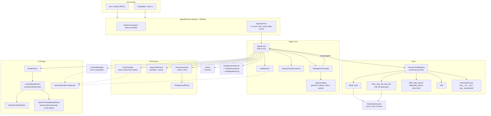

The fast model is optional. If none is configured, `ContextManager` and `ToolSelector` use the main model, and `ToolClassifier` is null (auto mode never asks).

## 2. Startup: `AgentHarness.Builder.build()`

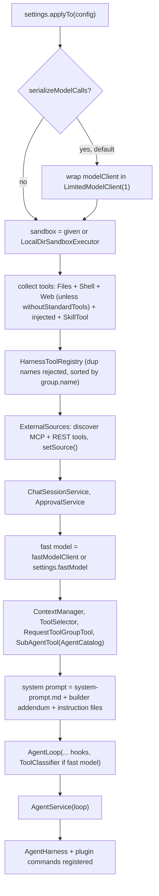

`jllm-cli` Main additionally wires `CwdSandboxExecutor` (workdir = project dir, scratch under `.kendhar/scratchpad`) and `FileHistory*` stores (`.kendhar/history/<chatId>/<agentId>/messages.jsonl`).

## 3. One user turn, end to end

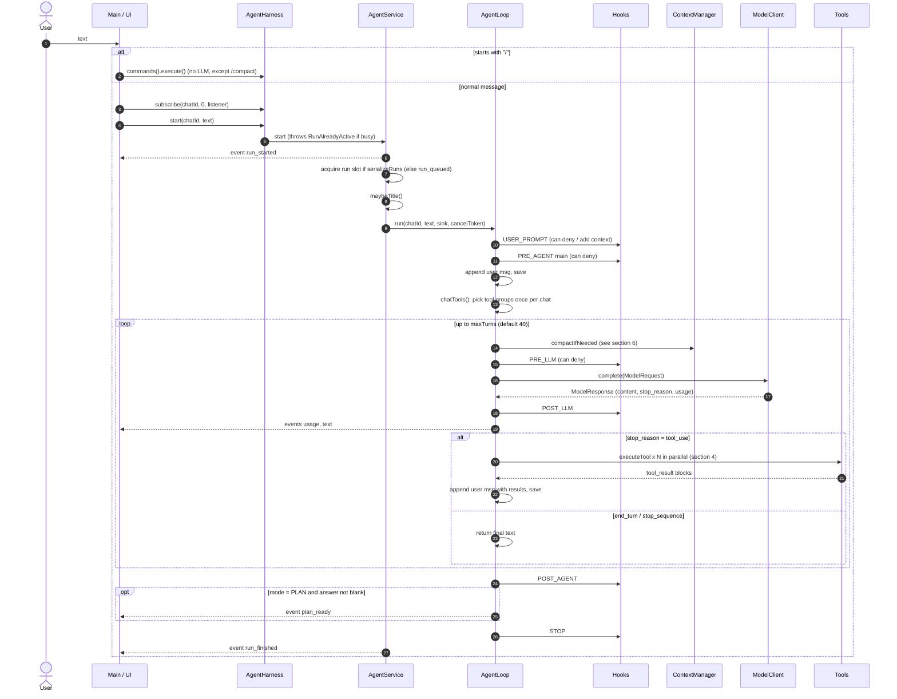

### Stop reasons handled in the loop

| `stop_reason` | Behavior |
|---|---|
| `tool_use` | run tools, loop again |
| `end_turn`, `stop_sequence` | return last text |
| `pause_turn` | `continue`, resend with assistant content as is |
| `max_tokens` | warning; text only: ask to continue (max 3 in a row); cut `tool_use`: complete calls run, the cut one gets a "Not executed: … cut off" result (a cut `write_file` keeps its complete lines in scratch), retried once |
| `refusal`, `model_context_window_exceeded` | warning; return |
| context-overflow error | `compactNow` once, retry same turn (`turn--`); second failure is an `error` event |
| cancel | `cancelled` event, return |
| `maxTurns` reached | warning "Stopped after N turns" |

## 4. Tool call pipeline (`AgentLoop.executeTool`)

All `tool_use` blocks of one response run concurrently on virtual threads. Results are collected in order; every `tool_use` always gets a `tool_result` (cancel yields "Cancelled by user").

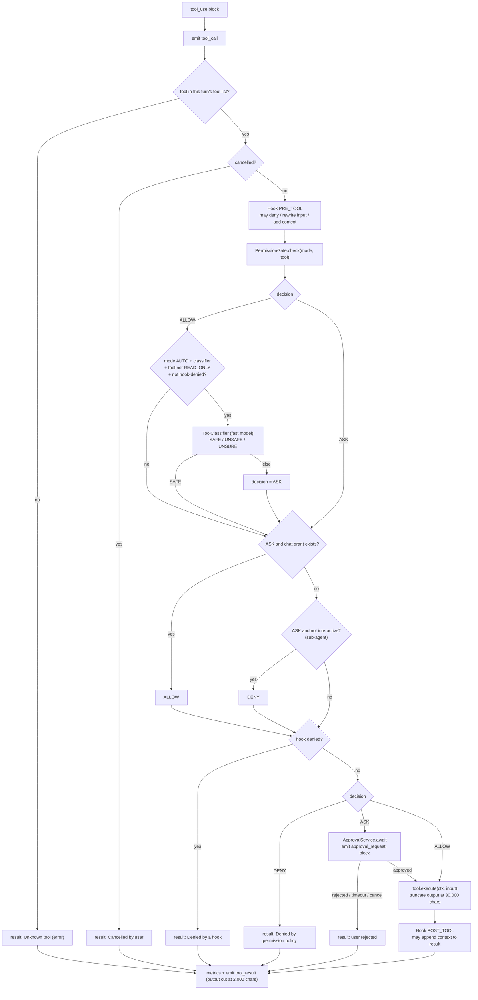

Notes:
- Order matters: hook, then gate, then classifier, then settings `ask` rule, then chat grant, then `allow` rule, then non-interactive deny, then hook-deny check; a settings `deny` rule wins over all of them (see [USAGE](USAGE.md#permission-rules)). A "remember" approval (`a`) adds a grant for the tool name for the whole chat, sub-agents included. A grant only replaces the question; deny rules, hooks and plan confinement still apply.
- `ApprovalService.await` serializes dialogs per chat (fair lock), timeout (default 600 s) starts when shown.
- `Decision` is computed by `PermissionGate`, pure policy:

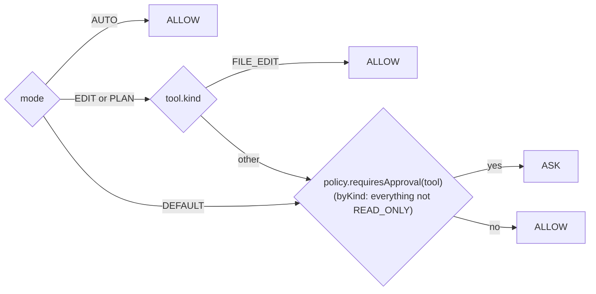

### Modes

| Mode | Working dir | Scratch dir | Asks |
|---|---|---|---|
| DEFAULT | per tool policy | writable | every non-READ_ONLY tool |
| PLAN | read-only (file tools confined to scratch via `ToolContext.readOnlyWork`; shell runs in scratch; Docker mounts workdir read-only) | writable | shell and other non-FILE_EDIT tools |
| EDIT | writable | writable | shell and other non-FILE_EDIT tools |
| AUTO | writable | writable | nothing, unless the classifier says not SAFE |

The mode note is the last text of `extraSystem`, so switching modes keeps the cached tool block and the text before the note (see CACHES.md §1).

## 5. Tool set per chat

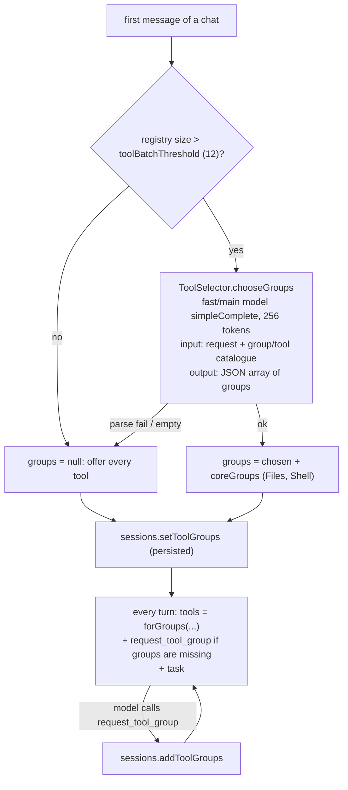

The set is stable on purpose (prompt-cache prefix). It only grows, and the new tools apply from the next model call because `toolSource` is re-read every turn.

## 6. Context strategy

`AgentLoop` calls `ContextStrategy.prepare(ContextTurn)` at the top of every turn and sends the `ContextView` it returns;
the log is saved only when the view says `logChanged`. A too-long rejection calls `onOverflow` once; `/compact` calls
`compactNow`. Two implementations: `context.compaction.CompactionStrategy` (below, the default) and
`context.mnemonic.MnemonicStrategy` (log never rewritten; masking batches, segment handoffs, `history_recall`; see the
README). Selected by `config.contextStrategy()` (settings `context.strategy`, CLI `--context-strategy`) or a builder
`contextStrategy(factory)`.

### Compaction (`ContextManager`)

Runs at the top of every loop turn. Ceiling = window - buffer (buffer = 15% of window, min 16k when window >= 32k). Size = max(chars/4, last measured usage).

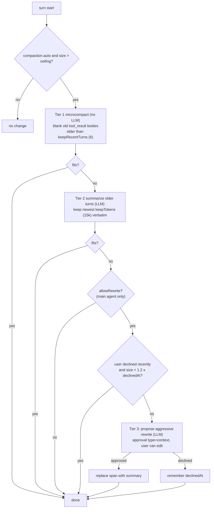

Summary request (`summarizeSpan`):

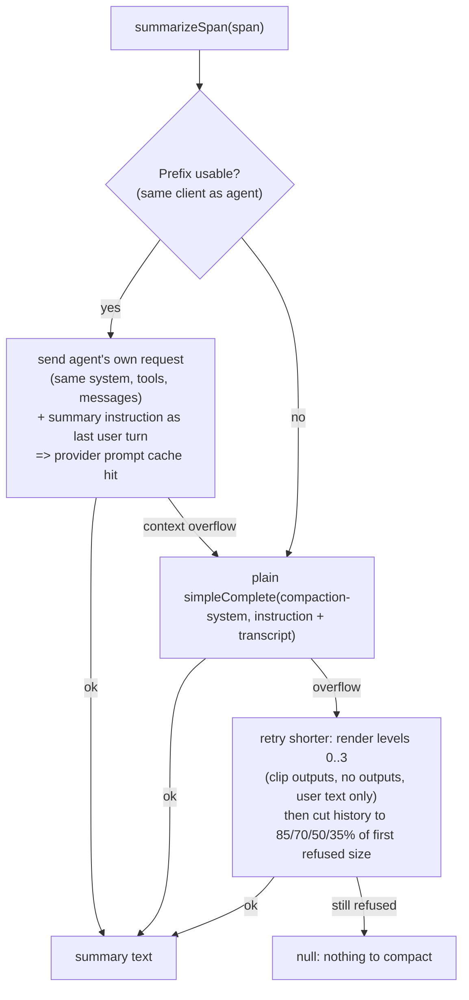

- Prompt: `compaction-create.md` first time, `compaction-update.md` when the span already starts with `[Summary of the earlier conversation]` (merge old summary with newer history). Template/rules in `compaction-template.md`, `compaction-rules.md`.
- Cuts always land on a plain user text message, so a `tool_use` is never separated from its `tool_result`.
- Manual `/compact [focus]`: `AgentLoop.compact` -> `compactNow` (tier 1 with keepTurns=1, then summarize all but the latest turn, no approval). Rejected while a run is active.
- Sub-agents with inherited context: `compactInherited` compacts the agent's own messages first, summarizes the parent copy only if still over, never asks the user.
- Overflow retry: the provider rejecting a request as too long triggers `compactNow` once, then retries the turn.

## 7. Sub-agents (`task` tool)

`task` is a `READ_ONLY` tool added only to the main agent's tool list. Sub-agents never see `task` or `request_tool_group`.

```mermaid
sequenceDiagram
    autonumber
    participant M as Main loop
    participant ST as SubAgentTool (task)
    participant SL as AgentLoop.runSubAgent
    participant LLM as ModelClient
    participant U as User (approvals)

    M->>ST: execute({subagent_type, prompts[<=8]})
    ST->>ST: type = AgentCatalog.get(name)
    ST->>ST: serial if (!parallel) or (writable type and mode EDIT/AUTO)
    par per prompt (parallel) or one after another (serial, global lock)
        ST->>SL: runSubAgent(chatId, toolUseId, prompt, type, parentMode, run)
        SL->>SL: fresh messages [+ copy of parent history if inheritContext]
        SL->>SL: mode = PLAN if readOnly type else parentMode
        SL->>SL: tools = ToolSelector.select(prompt, registry filtered by readOnly + type.tools)
        SL->>SL: extra = system + subagent-suffix (+ readonly-suffix) (+ type prompt)
        SL->>SL: hook PRE_AGENT (deny => task entry fails)
        loop own ReAct loop (persist=false)
            SL->>LLM: complete (type.model or main model)
            SL->>SL: tool calls through same pipeline; ASK skipped if chat grant
            SL-->>U: approval_request forwarded to parent sink, label "[general #2] tool"
        end
        SL->>SL: hook POST_AGENT
        SL->>SL: bill usage to chat, record SubAgentRunData (transcript, answer, status)
        SL-->>ST: answer text or failure
    end
    ST-->>M: JSON array [{prompt, status ok|failed, result}]
```

Built-in types:

| Type | Tools | Read-only | Prompt |
|---|---|---|---|
| `general` | all (filtered by selector) | no | none |
| `explore` | `read_file`, `glob`, `grep` | yes (PLAN) | `agent-explore.md` |
| `plan` | all READ_ONLY tools | yes (PLAN) | `agent-plan.md` |
| custom (settings `agents`) | `tools` list or all | only if `readOnly: true` | `prompt` / `promptFile`, optional own `model`, `inheritContext` |

Differences from the main loop:
- Transcript is not in the chat log; it goes to `SubAgentRunLog`. Token usage is added to the chat.
- A model failure inside becomes a failed `task` entry, never an empty "ok".
- Inherits the caller's mode (never looser), permission rules, hooks, chat grants. Approvals it needs are raised through the parent's sink and answered by the user (one dialog per chat at a time).
- Its own scratch dir: `<agent>-<uuidv7>`.

## 8. LLM calls

Every model call in the system, who makes it, and with what:

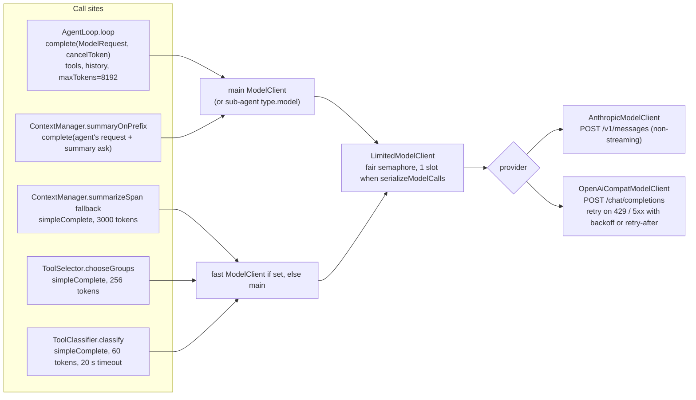

`ModelRequest` = `pinnedSystem` (`chatId=...; agentId`, never rewritten) + `extraSystem` (base prompt + date + mode note) + `messages` (raw Anthropic-style JSON, provider clients translate) + `tools` + `maxTokens` + `toolChoice` + `disableParallelToolUse` (= `!parallelToolUse`).

Anthropic request layout (prompt-cache friendly):
1. `system[0]` pinned block, `system[1]` extra block with `cache_control: ephemeral` (ttl `1h` if configured).
2. `tools[]` sorted by group, name; last tool carries `cache_control`.
3. `messages` as is; RAG tool results (`search_local_knowledge`) are converted to `search_result` blocks when citations are on.
4. `tool_choice` only set when non-auto or parallel tool use is disabled; forced choice is dropped if extended thinking is on.

Cancel: `CancelToken` aborts the in-flight HTTP call and backoff sleeps (`ModelCancelledException`). `LimitedModelClient` waiters are interrupted by it too.

## 9. Hooks

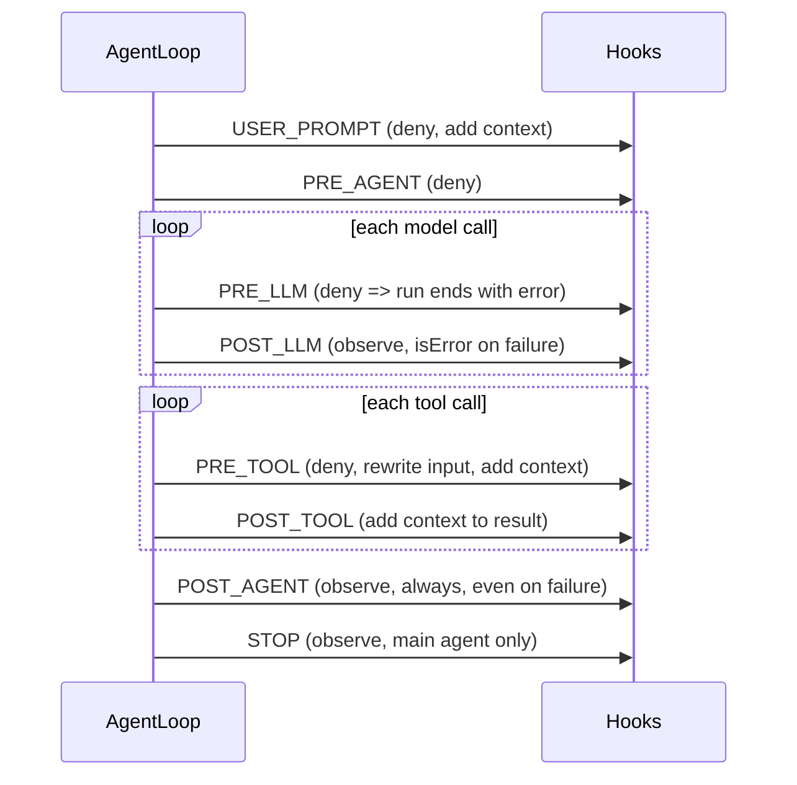

Hooks run in registration order. The first denial stops the chain; input rewrites chain; added context is concatenated. A hook that throws is logged and skipped. Sub-agents fire `PRE/POST_AGENT` and `PRE/POST_LLM` nested inside the parent's `task` tool call, with `ctx.agent()` = type name (`main` for the main agent).

## 10. Events, cancellation, approvals (front-end contract)

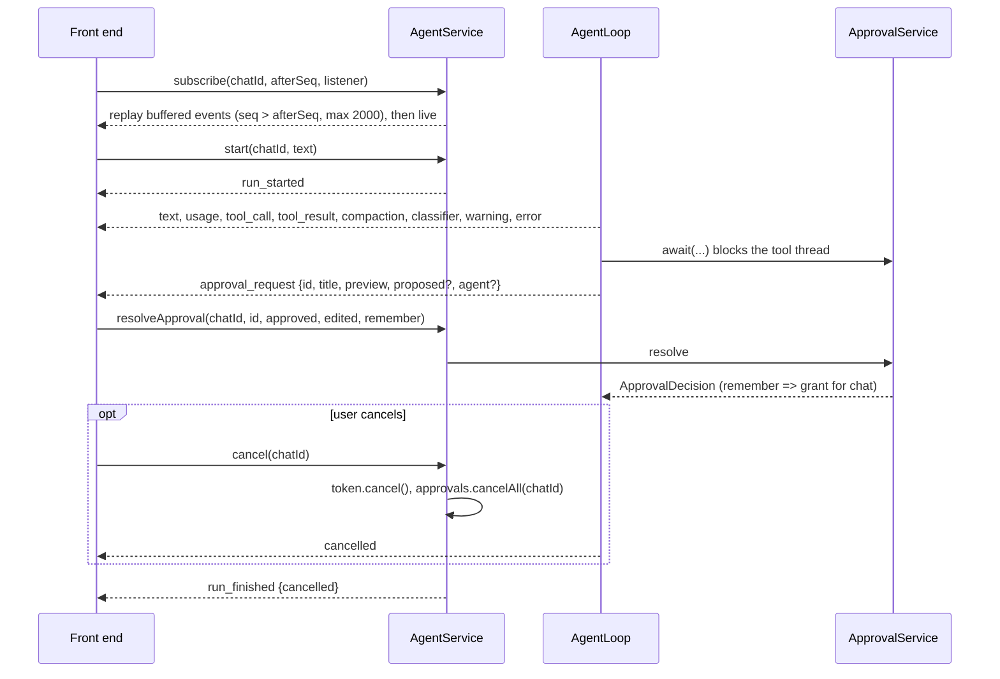

Event types: `run_started`, `run_queued`, `text`, `usage`, `tool_call`, `tool_result`, `approval_request`, `classifier`, `compaction`, `warning`, `error`, `cancelled`, `plan_ready`, `run_finished`.

## 11. Sessions and persistence

- `ChatSessionData` holds messages (JSON lines), mode, tool groups, usage counters, title, `agentId`.
- `AgentLoop` saves the message log after the user message, after every assistant response, and after every tool-result message. A model call that fails or is denied appends nothing, so the log always stays valid for the next call.
- Stores: `InMemoryChatSessionStore` (default), `FileHistoryChatSessionStore` (mirrors to `messages.jsonl`, CLI). Sub-agent runs: `InMemorySubAgentRunLog`, `FileHistorySubAgentRunLog`.
- Grants (`approve always`) and declined-rewrite markers are runtime state only, never in the context.

## 12. Sandbox

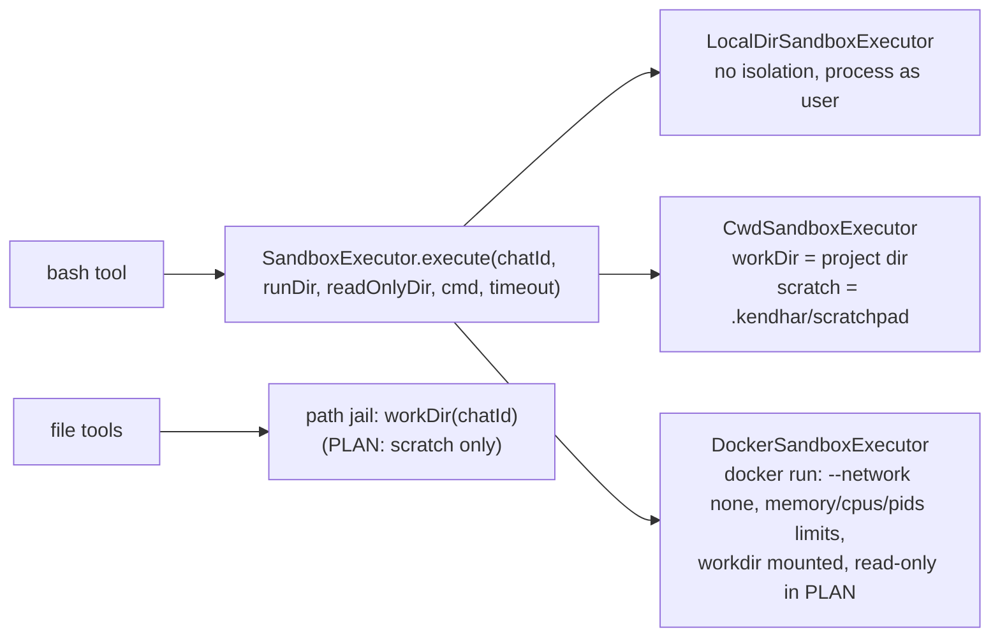

Plan mode runs the shell from scratch; only Docker can enforce that the workdir is not written.

## 13. Slash commands (no agent loop)

`SlashCommands.handles(line)` is checked before `start()`. Built-ins: `/help /clear /new /compact /mode /default /plan /edit /auto /cancel /tools /mcp /apis /skills /back /cost /where /status /chats /resume /title /exit`, plus plugin commands registered through `PluginRegistrar.command`. Menus (`/tools /mcp /apis /skills /mode`) are stateful per chat via `MenuController`; numbers select, Esc, `/back` or `b` goes up. Only `/compact` calls an LLM.

- Steering: after each tool-result round, and when an answer has no tool calls, the loop drains the chat's steering queue (and, only in the second case, one follow-up) into user messages and calls the model again.
