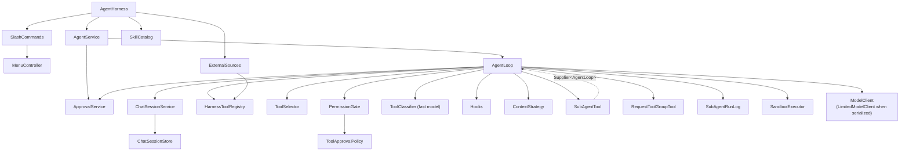
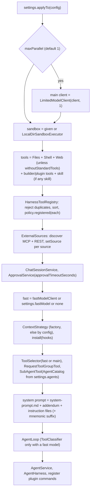
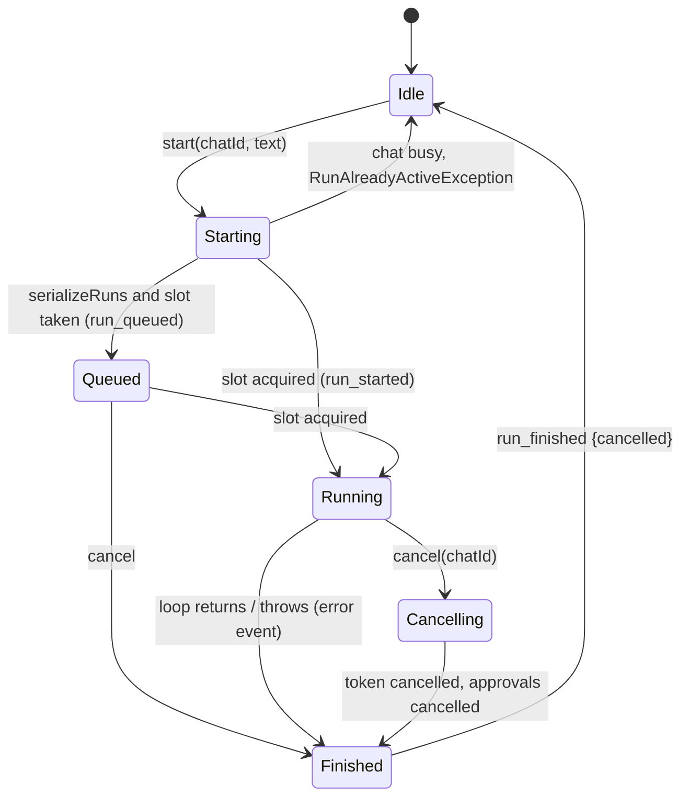
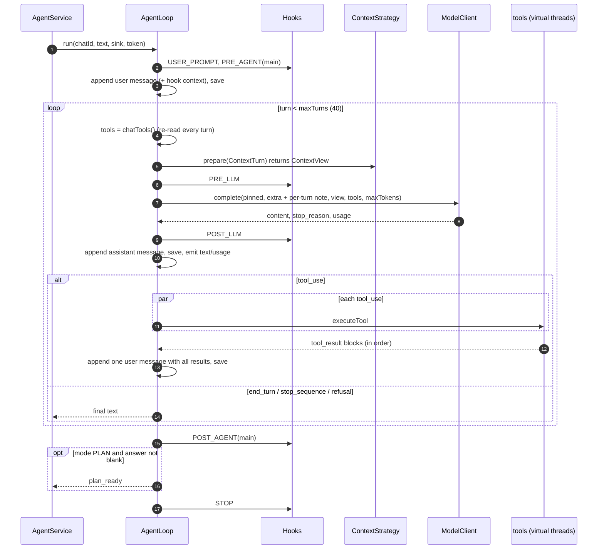
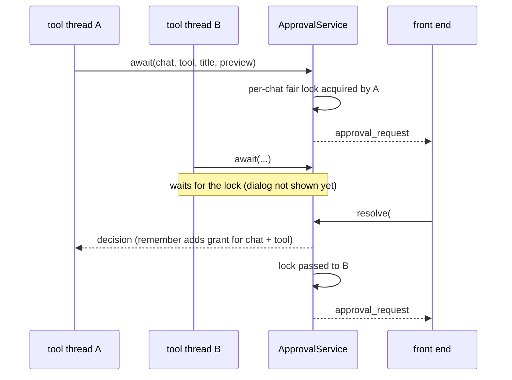

# Internals

How the harness is put together and how a turn runs. Context management (compaction, mnemonic, prompt-cache layout)
is not covered here: see [CACHES](CACHES.md). Step-by-step diagrams of every pipeline are in [FLOW](FLOW.md).

Source root: `src/main/java/org/kendar/llm/harness`.

## 1. Packages

| Package | Contents |
|---|---|
| (root) | `AgentHarness` (facade + builder), `HarnessConfig`, `Prompts`, `HarnessMetrics`, `HarnessPricing` |
| `agent` | `AgentService` (runs, events, cancel), `AgentLoop` (ReAct loop), `ToolSelector`, `SubAgentTool`, `RequestToolGroupTool`, `AgentCatalog` |
| `llm` | `ModelClient`, `AnthropicModelClient`, `OpenAiCompatModelClient`, `LimitedModelClient`, `CancelToken`, request/response records |
| `tools` | `HarnessTool`, `SimpleTool`, `HarnessToolRegistry`, Files/Shell/Web tools, `ToolContext` |
| `permission` | `PermissionGate`, `ToolApprovalPolicy`, `ApprovalService`, `ToolClassifier`, `PermissionMode` |
| `hooks` | `Hooks`, `Hook`, `HookContext`, `HookResult`, `HookEvent` |
| `session` | `ChatSessionService`, stores, `SubAgentRunLog` |
| `sandbox` | `SandboxExecutor`, Local / Cwd / Docker executors |
| `integration` | `ExternalSources`, `McpHttpClient`, `McpToolProvider`, `RestApiToolProvider` |
| `skills`, `instructions` | `SkillCatalog`, `SkillTool`, `InstructionLoader` |
| `settings` | `HarnessSettings` and its records (JSON file) |
| `commands`, `plugin` | `SlashCommands`, `MenuController`, `CustomCommand`, `HarnessPlugin` |
| `context` | strategies, see [CACHES](CACHES.md) |

## 2. Object graph



`SubAgentTool` needs the loop and the loop needs the tool: the builder breaks the cycle with a one-element array
captured by a `Supplier`. `SubAgentTool` and `RequestToolGroupTool` are not in the registry, so they cannot be
disabled by `/tools`, are never seen by sub-agents, and never clash with registry names.

## 3. Build order (`Builder.build()`)



Failures at build time: no model client, duplicate tool names, duplicate skill/agent/source names, unreadable agent
`promptFile`. A missing skill file, instruction file or unreachable source is only logged.

## 4. Run lifecycle (`AgentService`)

One run per chat at a time; each on its own virtual thread.



- `serializeRuns` (config, default `true`): a fair semaphore with one permit across all chats.
- The first message of a chat titled `New chat` sets the title (first 60 chars).
- Events go to an in-memory buffer (max 2000 per chat, cleared at each `start`) and to listeners. A listener that
  throws is removed. `subscribe(afterSeq)` replays the buffer then streams live events, deduplicated by `seq`.
- `compact()` takes the same per-chat busy flag, so `/compact` is refused during a run.

## 5. The ReAct loop (`AgentLoop`)



### Stop reasons and errors

| Case | Behavior |
|---|---|
| `tool_use` | run the tools, next turn |
| `end_turn`, `stop_sequence` | return the last text |
| `pause_turn` | next turn with the assistant content as is |
| `max_tokens`, no tool call | warning; a user message starting `[harness: response cut off]` asks the model to continue where it stopped, up to `MAX_CONTINUATIONS` (3) in a row, then return. The final text joins the parts |
| `max_tokens`, last block is a cut `tool_use` | warning; complete calls before it still run; the cut call gets an error result asking for smaller output (write in parts with `append: true`). A cut `write_file` keeps its complete lines in `<scratch>/partial/<callId>-<file>` and the result says how to finish it. A response that is *only* a cut call is retried once; twice in a row ends the run |
| `max_tokens` with output tokens below 90% of `maxTokens` | the server's context window is full, not the output limit (llama.cpp reports both as `length`): the warning and the cut call's result say so, and cut text is not continued |
| `refusal`, `model_context_window_exceeded` | warning, return |
| model error that `isContextOverflow` | `ContextStrategy.onOverflow` once, retry the same turn; a second rejection is an `error` event |
| other model error | `error` event, return |
| cancel (`ModelCancelledException` or token) | `cancelled` event, return; nothing was appended for the turn |
| `PRE_LLM` denied | `error` event, return; nothing appended |
| `maxTurns` reached | interactive run: approval of type `continue` (approve = another `maxTurns`); otherwise, or when rejected, warning `Stopped after N turns` |

**Log invariant**: the message log is valid for the next request at every save. A failed or denied model call
appends nothing; every `tool_use` gets a `tool_result` (cancelled, unknown, denied, failed or truncated calls get an
error result).

**Cut-off calls on local servers**: a server cut off while writing a call often returns the raw call as text
(`<tool_call>…` with no closing tag) or broken JSON arguments (kept as `{"_raw_arguments": …}`).
`OpenAiCompatModelClient` turns an unclosed text call into a `tool_use` block, so the loop treats it as a cut call.
`PartialToolCall` reads `path` and `content` leniently from either the JSON or the Qwen XML
(`<function=…><parameter=…>`) format.

### Per-turn system text

`extra` = base prompt + addendum + instruction files (+ sub-agent suffixes and type prompt). The loop appends a note
built each run: today's date, `sandbox.shellEnvironment()` (OS, shell), working directory, scratch directory, and the
mode sentence. The pinned block is `chatId=<id>; agentId=<id>` for the main agent and `chatId=<id>; subagent` for
sub-agents.

## 6. Permissions and approvals

The order of checks for one tool call is in [TOOLS §5](TOOLS.md#5-one-tool-call). The pieces:

| Component | Decides | State |
|---|---|---|
| `PermissionGate` | mode × kind → `ALLOW`/`ASK` via the policy | none |
| `ToolApprovalPolicy` | what asks in default mode (default: not `READ_ONLY`) | none |
| `ToolClassifier` | in `auto`, `SAFE`/`UNSAFE`/`UNSURE` | none |
| `ApprovalService` | pending dialogs, grants | pending: per chat, in memory; grants: also saved in the `StateStore` |

### `ApprovalService`



- One dialog per chat at a time, main agent and sub-agents alike; the timeout (`approvalTimeoutSeconds`, 600) starts
  when the dialog is shown. Timeout or cancel = rejected.
- A grant (`remember`) allows that tool name for the rest of the chat. It only replaces the question: hooks, plan
  confinement and the classifier verdict are still evaluated first.
- `cancel(chatId)` rejects every pending approval of the chat.
- Tier-3 compaction uses the same service with type `context` and a `proposed` text the user may edit.

### Classifier (`auto` mode)

Only with a fast model, only for tools that are not `READ_ONLY`. Input: working directory, the newest plain user
message (clipped to 1000 chars), tool name and input (4000 chars). Never tool output, so a tool result cannot steer
it. Answer: JSON `{verdict, confidence}`; below 0.8 confidence, unparseable, error or 20 s timeout → `UNSURE` → ask.

## 7. Sub-agents

`task` runs up to 8 prompts. Each prompt is `AgentLoop.runSubAgent`, which reuses the same loop code with
`persist=false`:

| Aspect | Main agent | Sub-agent |
|---|---|---|
| Messages | chat log, saved | fresh array (+ parent copy with `inheritContext`), never saved to the chat |
| Tools | chat tool set + strategy tools + `request_tool_group` + `task` | selector over registry filtered by type; + strategy tools |
| Mode | chat mode | caller's mode; `PLAN` for read-only types |
| Scratch dir | `<chat>/<agentId>` | `<chat>/<type>-<uuidv7>` |
| Context state key | session agent id (persistent) | scratch id (released at the end) |
| Model | main | type's `model` or main |
| Events | all to the chat | only `approval_request` forwarded; `error` and `usage` captured |
| Record | chat log | `SubAgentRunData` in `SubAgentRunLog` (transcript, answer, status, usage) |
| Usage | added per call | summed, added to the chat at the end |

A model error inside a sub-agent becomes `status: failed` for that prompt, never an empty `ok`. Cancel of the parent
run cancels the sub-agents (same token).

Parallelism: prompts run concurrently unless `maxParallel` is 1, or the type is writable and the mode is
`edit`/`auto` (writers would race on the same files). Serial runs share one global fair lock, so a sub-agent finishes
before any other starts, across `task` calls too.

## 8. Concurrency

| Where | Mechanism |
|---|---|
| runs | one virtual thread per run; `serializeRuns` semaphore (1, fair) across chats |
| tool calls of one response | virtual-thread executor; results joined in order; cancel interrupts the futures |
| sub-agent prompts | virtual threads, or a single-thread executor + global lock when serial |
| model calls | `LimitedModelClient` fair semaphore (`maxParallel` slots, none when -1); waiting is cancellable |
| approvals | per-chat fair lock in `ApprovalService` |
| sessions | `ChatSessionService` write methods are `synchronized` |
| registry | immutable snapshots, `volatile` swap; source changes `synchronized` |
| context strategy | one instance for all chats; mnemonic synchronizes per agent |

`CancelToken` aborts the in-flight HTTP request, backoff sleeps and slot waits (`ModelCancelledException`).

## 9. Sessions and persistence

`ChatSessionData`: `chatId` (UUIDv7), `agentId` (`<config.agentId>-<uuidv7>`, also names the scratch dir), title,
mode, `toolGroups` (`*` = all, or a comma list), messages as JSON lines, token counters (input, output, cache read,
cache creation), timestamps.

`ChatSessionData` also carries `messageCount`, so listing chats never reads the logs.

Saves happen after the user message, after each assistant message, after each tool-result message, and when a context
strategy reports `logChanged`. The CLI and web use `FileChatSessionStore` (chats) and `FileHistorySubAgentRunLog`
(sub-agent runs), under `.kendhar/history/` (web: `<chatId>/.kendhar/history/`):

```
<root>/.lock                              held by the running process
<root>/<chatId>/session.json              chat row without messages (atomic write: temp file + move)
<root>/<chatId>/<agentId>/messages.jsonl  message log: appended when the new log extends the old one, else rewritten
<root>/<chatId>/<agentId>/mnemonic.json   mnemonic decisions
<root>/<chatId>/state/<name>.json         grants, todos
<root>/<chatId>/subagent-<runId>/         messages.jsonl, result.txt, run.json
```

`find` reads the log lazily; `list()` scans the chat directories for `session.json` (no index file) and caches the rows.
The log is written before the row, so a crash leaves a row at most one turn behind. A corrupt row is skipped with a
warning. `InterruptedTurnRepair` completes an unanswered `tool_use` at the end of a loaded log. Restoring needs no
extra step: the mnemonic, state and tool-group data are keyed by chat and agent id, which the row keeps, so the next
request is the one the chat would have sent without the restart (`RestartRestoreTest`). Old `messages.jsonl` files
without `session.json` are not read.

### Noise commands

`NoiseCommandPruner` (`context/noise/`, called by `AgentLoop` after a main-agent run, never by sub-agents) shrinks the
context by replacing shell commands that add no information. All of these must hold, else the call stays as it is:
a `bash` call with a command under 512 characters, a result starting with `exit code: 0` (no timeout, not an error)
and under 200 characters, and the turn that issued it has ended. A failing command is never qualified.

`NoiseQualifier` decides `keep` or `drop`:

- a regex allow-list of state-changing commands (a chain of simple `mkdir`, `rm`, `cd`, `mv`, `cp`, `touch`, `chmod`,
  ... with no pipe, redirect or substitution) is `drop` without a model call; a regex list of informative commands
  (`cat`, `ls`, `git log`, `grep`, builds, test runs, ...) is `keep` without a model call;
- otherwise one plain request to the fast model (the main model when none is set) with **temperature 0**
  (`ModelClient.simpleComplete(..., temperature, ...)`; Anthropic ignores a temperature), a 4 s timeout and one retry.
  Input: the command text and the exit code, never the output (untrusted). Answer: one word. An error, a timeout, an
  unparsable answer or a rate limit is `keep`; the loop is never blocked for long. Its tokens go to
  `qualifierInputTokens` / `qualifierOutputTokens` of the chat row and show as a separate line of `/cost`.

A `drop` is applied in a batch (see [CACHES](CACHES.md#noise-commands-any-strategy)). The call and its result become a
stub (`tool_use.input.command` cut to 80 characters, result `ok (exit 0)`), so the pairing stays valid for every
provider. The originals follow the stub in `messages.jsonl` as a reference line:

```
{"role":"assistant","content":[{"type":"tool_use","id":"t1","name":"bash","input":{"command":"mkdir -p build"}}]}
{"role":"user","content":[{"type":"tool_result","tool_use_id":"t1","content":"ok (exit 0)"}]}
{"ignore":true,"replaces":"t1","original":{"tool_use":{...},"tool_result":{...}}}
```

`ChatSessionService.messages()` skips `ignore` lines, so the context, the message indexes of the strategies and every
provider request never see them; `references(chatId)` (web: `GET /api/chat/{id}/references`) returns them for audit.
`saveMessages` keeps each reference after the message holding the result it replaces, and drops it when that message
is gone (compaction, `/clear`). The model cannot recall them (`history_recall` does not read them).

## 10. What never reaches the model's context

| Item | Where it lives |
|---|---|
| approval grants | `ApprovalService`, saved in the `StateStore` (`grants`), survive a restart |
| declined tier-3 sizes | `ContextManager`, memory only |
| todo list (`scope` strategy) | `StateStore` (`todos-<agent>`); added to each request on a copy, not to the log |
| chat title, mode name changes | session row (the mode sentence is in the per-turn note, not the pinned block) |
| sub-agent transcripts | `SubAgentRunLog` (the parent gets only the answer; mnemonic `history_recall` can read them) |
| tool output beyond `toolMaxChars` | dropped (`[truncated N chars]`) |
| event payloads (`tool_result.output` cut at `eventMaxChars`) | front end only |
| classifier and tool-selector requests | separate plain requests to the fast model |
| hook decisions | only their effect (denial text, rewritten input, added context) |
| mnemonic decisions, recall index | `MnemonicStore`, memory; the model sees receipts only |

## 11. LLM clients

| | `AnthropicModelClient` | `OpenAiCompatModelClient` |
|---|---|---|
| Endpoint | `POST {baseUrl}/v1/messages`, non-streaming | `POST {baseUrl}/chat/completions` |
| System | two blocks, `cache_control` on the second | one `system` message |
| Tools | `cache_control` on the last; `tool_choice` only when needed | translated to functions |
| Retries | 429, 529, 5xx and I/O errors; `retry-after` or exponential backoff (max 30 s); each wait is reported as a `retry` event (`CancelToken.onRetry`) | 429, 5xx and I/O errors; same backoff and event |
| Auth | `x-api-key`, or an `AuthProvider`; one retry after a 401 | `Authorization: Bearer`, or an `AuthProvider`; one retry after a 401 |
| Extras | extended thinking (`thinkingBudget`), citations: `search_local_knowledge` results become `search_result` blocks | `max_completion_tokens` for OpenAI proper |

Messages are kept in Anthropic shape everywhere; the OpenAI client translates on the way out and back.
