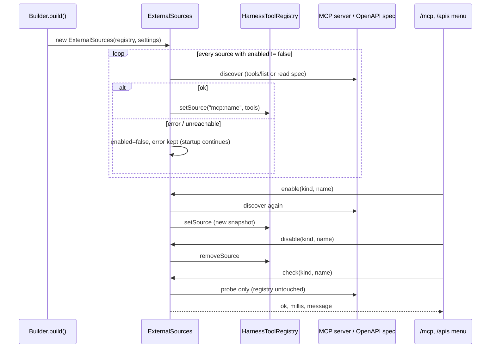
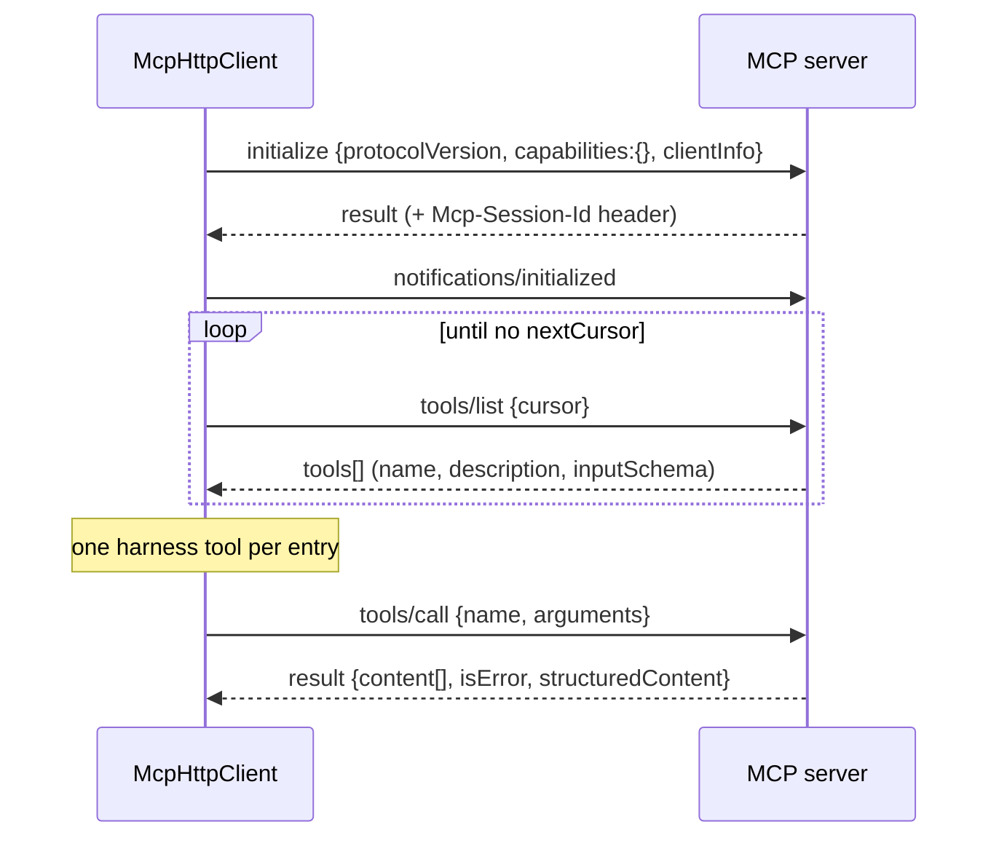
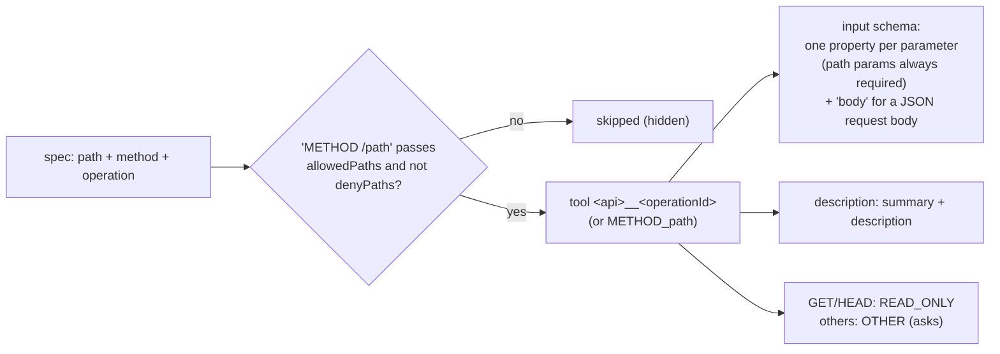

# MCP servers and REST APIs

External tools come from two kinds of sources, both declared in the settings file and managed by `ExternalSources`:

| Source | Settings key | Tool name | Group (default) | Kind |
|---|---|---|---|---|
| MCP server (streamable HTTP or stdio) | `mcpServers` | `mcp__<server>__<tool>` | `Mcp/<server>` | READ_ONLY if `"readOnly": true`, else OTHER |
| REST API (OpenAPI 3) | `restApis` | `<api>__<operationId>` | `Rest/<api>` | READ_ONLY for GET/HEAD, else OTHER |

Names are sanitized to `[a-zA-Z0-9_-]` and cut to 64 characters. A clash with another tool name makes the source fail
to enable (it stays disabled with that error).

## 1. Lifecycle



- Discovery happens at `build()` and on every `enable`. A server that is down at startup does not stop the harness.
- State is in memory: `enabled` in the settings is only the startup default.
- `check` for MCP lists the tools again; for REST it parses the spec and sends a GET to the base URL (any HTTP status
  counts as reachable).
- A chat whose tool set is "every tool" sees an enabled/disabled source from its next model call. A chat with a fixed
  group list sees new tools only if their group is in the list (or after `request_tool_group`). Either change alters
  the tool block of the request, so the next call writes a new prompt cache (see [CACHES](CACHES.md)).

## 2. MCP servers

```json
"mcpServers": [
  {"name": "docs", "url": "https://host/mcp",
   "headers": {"Authorization": "Bearer ${DOCS_TOKEN}"},
   "group": "Docs", "readOnly": true, "enabled": true}
]
```

| Field | Default | Meaning |
|---|---|---|
| `name` | required | used in the tool names and in `/mcp` |
| `url` | one of `url` / `command` | streamable-HTTP endpoint |
| `command` | one of `url` / `command` | executable of a stdio server, started as a child process |
| `args` | `[]` | arguments of `command` |
| `env` | none | environment added to the child process; `${ENV}` expanded |
| `headers` | none | sent on every request; `${ENV}` expanded |
| `group` | `Mcp/<name>` | tool group (selection, `/tools`, `request_tool_group`) |
| `readOnly` | `false` | `true`: the tools never ask for approval |
| `enabled` | `true` | startup state |
| `oauth` | `false` | HTTP server that needs an OAuth login, see below |
| `perUser` | `true` with users, `false` for a single user | with `oauth`: each user's calls carry their own token; refused on a stdio server |
| `allowList` | absent = all | tool names (`*` wildcard) that are exposed; `[]` exposes none, `["*"]` all |
| `denyList` | empty = none | tool names (`*` wildcard) that are hidden; `["*"]` hides all |

Visibility lists decide which tools exist, before the model sees them. Absent `allow` = all; `[]` = none; `["*"]` = all. A `deny` list hides matches (`["*"]` hides all). When both are set, a tool is visible if it is allowed and not denied. A hidden tool is never created, so it is not sent to the model and cannot be called. This is a separate layer from `permissions` (regex rules that decide approval of visible tools).

Example: `"allowList": ["search*", "get_*"], "denyList": ["get_secret"]` exposes `search_docs` and `get_page`, not `get_secret`.

### Protocol

`McpHttpClient` is a minimal client: protocol version `2025-03-26`, JSON-RPC over HTTP POST, 60 s timeout.



- The response may be plain JSON or an SSE stream (`text/event-stream`); for SSE the message with the request id is
  taken.
- `Mcp-Session-Id` from the server is echoed on the following requests.
- Result rendering: `text` blocks are joined with newlines, other blocks as JSON; `structuredContent` is used when
  there is no content; `isError: true` prefixes `Error: `.
- The tool's `inputSchema` is passed to the model unchanged (default `{"type":"object"}`).

### stdio servers

```json
"mcpServers": [
  {"name": "adexpert", "command": "/opt/adexpert/.venv/bin/python3", "args": ["/opt/adexpert/mcp_server.py"],
   "env": {"ADEXPERT_SERVER_URL": "http://localhost:8180"}, "readOnly": true}
]
```

- `McpStdioClient` starts the command on the first connection and talks newline-delimited JSON-RPC on its stdin and
  stdout, with the same methods as the HTTP client. Its stderr goes to the debug log.
- The process lives as long as the source is enabled: `/mcp disable` and a re-enable stop and restart it. The JVM exit
  closes the pipe, which ends a well-behaved server.
- A `check` starts a separate process and stops it again.
- A server that writes requests of its own (sampling, roots) gets no answer; its messages are ignored.

Not supported: resources, prompts, sampling, server notifications.

### OAuth

With `"oauth": true` run `/login mcp:<name>` once. The harness reads `/.well-known/oauth-protected-resource` of the
server's origin (falling back to the origin itself as authorization server), then the authorization server metadata,
registers a public client dynamically (needs a `registration_endpoint`) and runs the authorization code flow with PKCE.
On the command line the redirect goes to a loopback listener on `127.0.0.1` and the URL is opened in a browser or
printed; in jllm-web it goes to `<jllm.web.public-url>/oauth/callback`, and that URL is what gets registered. The token
is stored in the [token store](#6-token-storage) as `mcp:<name>` together with the client id and token endpoint, sent
as `Authorization: Bearer`, refreshed ahead of expiry and refreshed once more after a 401. Without a stored login the
server is skipped at startup with "run /login mcp:<name>". `/logout mcp:<name>` removes it. Static `headers` still work
for servers with API keys.

**Per user** (`perUser`, default when the harness has users, e.g. jllm-web): the login above is the *shared* one,
made by an admin (`/login mcp:<name> shared`); it is used for `initialize` and `tools/list` at startup, when no user
exists yet. Each user then runs `/login mcp:<name>` (or Connect in the web UI) and every `tools/call` of their chats
carries their own token, in their own MCP session:

- one session per user, created on their first call; at most 256, the least recently used closed beyond that, and a
  session unused for 15 minutes is closed (HTTP `DELETE` with its `Mcp-Session-Id`);
- `/logout`, `/mcp disable` and a deleted user close the user's sessions;
- a 401 to the user's token refreshes it and retries once; a second 401, or no login, ends as a
  [login required](#login-required) tool result;
- the tool list is the one discovered at startup, the same for everyone; a tool the user's account cannot use fails
  when called.

A single user (command line, jllm-web without users) keeps one login per server, as before.

## 3. REST APIs (OpenAPI)

```json
"restApis": [
  {"name": "pets", "openApiUrl": "https://host/openapi.yaml", "baseUrl": "https://host/api",
   "headers": {"X-Api-Key": "${PETS_KEY}"},
   "allowedPaths": ["GET /pets", "/pets/{id}", "/store/*"], "denyPaths": ["DELETE *"], "enabled": true}
]
```

| Field | Default | Meaning |
|---|---|---|
| `name` | required | tool name prefix |
| `openApiUrl` / `openApiFile` | one required | spec location (OpenAPI 3, refs resolved fully) |
| `baseUrl` | first `servers` entry of the spec | where calls go |
| `headers` | none | sent on calls, and used to fetch the spec |
| `allowedPaths` | absent = all operations; `[]` = **no tools** | `METHOD /path`, method optional, `*` wildcard |
| `denyPaths` | empty = none | same syntax; matching operations are hidden; `["*"]` hides all |
| `group` | `Rest/<name>` | tool group |
| `enabled` | `true` | startup state |

### From spec to tool



At call time path parameters are substituted (URL-encoded), query parameters appended, header parameters sent, and
`body` serialized as JSON. The result is `HTTP <status>\n<body>`, cut at 20000 characters. Non-2xx statuses are
returned to the model, not raised.

Visibility lists decide which tools exist, before the model sees them. Absent `allow` = all; `[]` = none; `["*"]` = all. A `deny` list hides matches (`["*"]` hides all). When both are set, a tool is visible if it is allowed and not denied. A hidden tool is never created, so it is not sent to the model and cannot be called. This is a separate layer from `permissions` (regex rules that decide approval of visible tools).

`allowedPaths` and `denyPaths` examples:

| Entry | Matches |
|---|---|
| `GET /pets` | only `GET /pets` |
| `/pets/{id}` | every method on `/pets/{id}` |
| `/store/*` | every method on every path under `/store/` |
| `POST *` | every POST |
| `DELETE *` (in `denyPaths`) | hides every DELETE |

### OAuth

A REST API can declare OAuth2. Every call then carries the token of the person behind the chat: with users (jllm-web)
each user logs in with their own account; for a single user (command line) that is the local user, with one token per
API.

```json
"restApis": [{
  "name": "crm", "openApiUrl": "https://crm.example.com/openapi.json",
  "oauth": {
    "flow": "authorization_code",
    "issuer": "https://login.example.com",
    "clientId": "jllm", "clientSecret": "${CRM_CLIENT_SECRET}",
    "scopes": ["crm.read", "crm.write"],
    "extraParams": {"audience": "https://crm.example.com"},
    "perUser": true
  }
}]
```

| Field | Default | Meaning |
|---|---|---|
| `flow` | `authorization_code` | `authorization_code` (PKCE always), `device_code`, or `client_credentials` (a service account, no login) |
| `issuer` | none | endpoints from `<issuer>/.well-known/oauth-authorization-server`, then `openid-configuration` |
| `authorizationUrl`, `tokenUrl`, `deviceAuthorizationUrl` | from `issuer`, else from the spec | explicit endpoints win |
| (from the spec) | | without explicit endpoints, the first `oauth2` scheme of `components.securitySchemes` that has the flow gives the URLs and the default scopes |
| `clientId` | required, except with dynamic registration (issuer with a `registration_endpoint`) | |
| `clientSecret` | none (public client) | in a project file only as `${ENV}`; a literal secret there is refused |
| `scopes` | the scopes of the spec's scheme that the allowed operations require (all the flow's scopes when none names any) | |
| `extraParams` | none | extra authorization request parameters (`client_credentials`: extra token request parameters) |
| `perUser` | `true` (`client_credentials`: `false`) | `false`: one token shared by every user, logged in by an admin |
| `header`, `scheme` | `Authorization`, `Bearer` | for APIs that want the token elsewhere; an empty `scheme` sends the bare token |
| `specAuth` | none | `client_credentials`: the spec is fetched with a client credentials token |

Startup fails, naming the API, for an unknown `flow`, `client_credentials` with `perUser: true`, or no token endpoint
anywhere (no `tokenUrl`, no `issuer`, no `oauth2` scheme in a readable spec).

Per call:

```
headers(principal, "api:crm"):
  client_credentials                  -> cached service token (memory, renewed 60 s before expiry)
  perUser ? principal.id : null       -> key
  no stored token for (key, api:crm)  -> login required
  else                                -> Authorization: Bearer <access>, refreshed as needed
```

- Header precedence: settings `headers` < user-file headers (jllm-web) < the OAuth header. A settings
  `headers.Authorization` together with `oauth` is logged at startup (the OAuth one wins).
- A 401 refreshes the token and retries the call once; a second 401 asks for a login.
- A refresh that fails with `invalid_grant` (revoked) removes the token and asks for a login.
- `Authorization` stays out of the model's reach, as before: no tool parameter can set it.
- The spec is read at startup, when no user exists: with the static `headers`, from `openApiFile`, or with
  `specAuth: client_credentials`. A spec that needs a user's token must be given as a file.
- Tools of a per-user API carry one fixed line in their description, "Needs the user's crm login.", the same for every
  user.

Logging in: `/login api:crm` (loopback redirect on the command line, the device code with `device_code`). In jllm-web,
`/login api:crm` and the **Connect** buttons open the authorization page in a new tab; the redirect goes to
`<jllm.web.public-url>/oauth/callback` (see the [jllm-web README](../jllm-web/README.md#oauth-logins)).
`/logout api:crm` removes the token.

A project's own `.jllm/settings.json` can send a user's token to any host with an `oauth` block: such an API is asked
about once, like a project stdio MCP server, and remembered in `~/.jllm/trusted-mcp.json` as `oauth:api:<name>`. Not
trusted (or no one to ask): the API is skipped with a warning.

### Login required

A call without a usable login never changes the tool list (the prompt-cache prefix stays the same for every user and
login state). The tool result is an error:

```
Error: Not connected to api:crm. Ask the user to connect it (/login api:crm), then retry.
```

and the run gets a `login_required {source, agent?}` event, once per run and source (a model that retries does not
flood the front end; the stuck detector ends a model that keeps retrying). A sub-agent's `login_required` is forwarded
to the parent run. The web UI shows a Connect button; after connecting, the user resends or steers ("retry").

## 4. Runtime control

| Command | Effect |
|---|---|
| `/mcp`, `/apis` | numbered menu: status (on, N tools / off, last error), enable, disable, check |
| `/mcp enable\|disable\|check <name>` | scripted form |
| `/apis enable\|disable\|check <name>` | scripted form |
| `/tools disable mcp__docs__search` | hide one tool, source stays enabled |

From code: `harness.sources().list(Kind.MCP)`, `enable`, `disable`, `check`.

## 5. Approval

Unless `readOnly` (MCP) or GET/HEAD (REST), external tools are `OTHER`: they ask in `default`, `plan` and `edit`, and
in `auto` go through the classifier when a fast model is configured. A custom `ToolApprovalPolicy` can decide per
tool name (see [EXTENDING §4](EXTENDING.md#4-approval-policy)).

## 6. Token storage

OAuth tokens (MCP servers, REST APIs, provider logins) go through one `TokenStore`, chosen by the `tokenStore`
settings section or given in code (`AgentHarness.Builder.tokenStore`, which wins):

```json
"tokenStore": {"type": "auto", "dir": null, "encrypt": null}
```

| Field | Default | Meaning |
|---|---|---|
| `type` | `auto` | `file`; `native` (the OS secret store, single user only); `auto`: native for a single user when the OS store works, else file |
| `dir` | `~/.jllm` (single user); with users the embedder's choice (jllm-web: `<webauth>/tokens`) | where the file store writes |
| `encrypt` | `false` (single user); with users `true` when `JLLM_TOKEN_KEY` is set | encrypt the files with `JLLM_TOKEN_KEY` |

The section is read from the user settings and `--settings` only; in a project file it is ignored with a warning.
Startup fails for `type: native` with users (one OS account would hold everybody's tokens) and for `encrypt: true`
without `JLLM_TOKEN_KEY`.

**File store**: one JSON file per principal: `<dir>/auth.json` for the single user and the shared logins (the same
file and format as before, so existing logins keep working), `<dir>/users/<userId>.json` per user. Atomic writes,
owner-only permissions, a lock file per file (safe across processes). With encryption: AES-256-GCM, the key 32 bytes
in base64 in `JLLM_TOKEN_KEY` (`openssl rand -base64 32`), a random nonce per write and the key id in the file. To
rotate, set the new key in `JLLM_TOKEN_KEY` and the old one in `JLLM_TOKEN_KEY_OLD`: files are re-encrypted as they are
read. A tampered, wrong-key or (with encryption on) plain file is reported once and read as empty (its users log in again);
it never stops the run.

**Native store** (no new dependency, the OS tools run as processes with a 10 s timeout, the secret always on stdin):

| OS | Backend | Notes |
|---|---|---|
| macOS | Keychain generic passwords (service `jllm`) through `security -i` | |
| Windows | DPAPI, current user, through PowerShell; the protected blob in `~/.jllm/auth.dpapi` | only the same Windows user can decrypt it |
| Linux | Secret Service (GNOME Keyring, KWallet) through `secret-tool` | needs a Secret Service on D-Bus; headless machines fall back to the file |

With `auto` the OS store is probed (write, read, delete) the first time a token is needed; when it does not work the
file store is used, with one log line saying why. The first native run moves the tokens of `~/.jllm/auth.json` into it
and renames the file to `auth.json.migrated`. Locking is in-process only: two jllm processes of the same user
refreshing the same token at the same instant can still race (rare for one desktop user).

**Refresh races**: providers that rotate refresh tokens invalidate the old one at each refresh. A refresh runs under the
store's lock for that entry, re-reads it first (another refresher may have stored a fresh token), stores the result
with a compare-and-set before using it, and uses the stored token when the compare fails. A store only keeps tokens: it
must never refresh them on its own. Own implementations: [EXTENDING](EXTENDING.md#token-stores).

