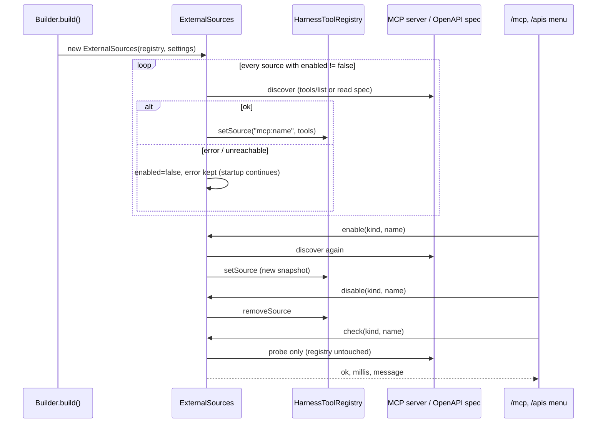
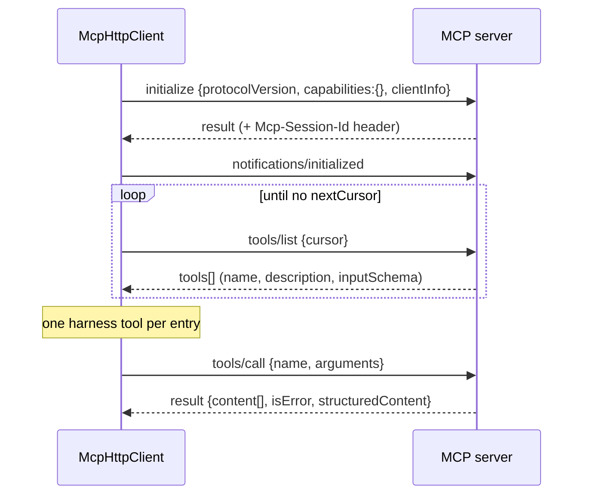
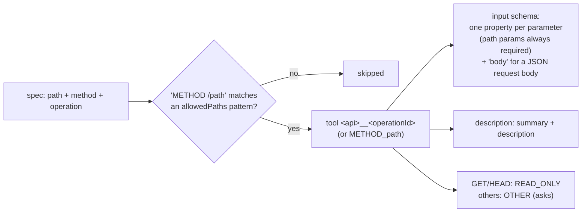

# MCP servers and REST APIs

External tools come from two kinds of sources, both declared in the settings file and managed by `ExternalSources`:

| Source | Settings key | Tool name | Group (default) | Kind |
|---|---|---|---|---|
| MCP server (streamable HTTP or stdio) | `mcpServers` | `mcp__<server>__<tool>` | `Mcp/<server>` | READ_ONLY if `"readOnly": true`, else OTHER |
| REST API (OpenAPI 3) | `restApis` | `<api>__<operationId>` | `Rest/<api>` | READ_ONLY for GET/HEAD, else OTHER |

Names are sanitized to `[a-zA-Z0-9_-]` and cut to 64 characters. A clash with another tool name makes the source fail
to enable (it stays disabled with that error).

## 1. Lifecycle



- Discovery happens at `build()` and on every `enable`. A server that is down at startup does not stop the harness.
- State is in memory: `enabled` in the settings is only the startup default.
- `check` for MCP lists the tools again; for REST it parses the spec and sends a GET to the base URL (any HTTP status
  counts as reachable).
- A chat whose tool set is "every tool" sees an enabled/disabled source from its next model call. A chat with a fixed
  group list sees new tools only if their group is in the list (or after `request_tool_group`). Either change alters
  the tool block of the request, so the next call writes a new prompt cache (see [CACHES](CACHES.md)).

## 2. MCP servers

```json
"mcpServers": [
  {"name": "docs", "url": "https://host/mcp",
   "headers": {"Authorization": "Bearer ${DOCS_TOKEN}"},
   "group": "Docs", "readOnly": true, "enabled": true}
]
```

| Field | Default | Meaning |
|---|---|---|
| `name` | required | used in the tool names and in `/mcp` |
| `url` | one of `url` / `command` | streamable-HTTP endpoint |
| `command` | one of `url` / `command` | executable of a stdio server, started as a child process |
| `args` | `[]` | arguments of `command` |
| `env` | none | environment added to the child process; `${ENV}` expanded |
| `headers` | none | sent on every request; `${ENV}` expanded |
| `group` | `Mcp/<name>` | tool group (selection, `/tools`, `request_tool_group`) |
| `readOnly` | `false` | `true`: the tools never ask for approval |
| `enabled` | `true` | startup state |
| `oauth` | `false` | HTTP server that needs an OAuth login, see below |

### Protocol

`McpHttpClient` is a minimal client: protocol version `2025-03-26`, JSON-RPC over HTTP POST, 60 s timeout.



- The response may be plain JSON or an SSE stream (`text/event-stream`); for SSE the message with the request id is
  taken.
- `Mcp-Session-Id` from the server is echoed on the following requests.
- Result rendering: `text` blocks are joined with newlines, other blocks as JSON; `structuredContent` is used when
  there is no content; `isError: true` prefixes `Error: `.
- The tool's `inputSchema` is passed to the model unchanged (default `{"type":"object"}`).

### stdio servers

```json
"mcpServers": [
  {"name": "adexpert", "command": "/opt/adexpert/.venv/bin/python3", "args": ["/opt/adexpert/mcp_server.py"],
   "env": {"ADEXPERT_SERVER_URL": "http://localhost:8180"}, "readOnly": true}
]
```

- `McpStdioClient` starts the command on the first connection and talks newline-delimited JSON-RPC on its stdin and
  stdout, with the same methods as the HTTP client. Its stderr goes to the debug log.
- The process lives as long as the source is enabled: `/mcp disable` and a re-enable stop and restart it. The JVM exit
  closes the pipe, which ends a well-behaved server.
- A `check` starts a separate process and stops it again.
- A server that writes requests of its own (sampling, roots) gets no answer; its messages are ignored.

Not supported: resources, prompts, sampling, server notifications.

### OAuth

With `"oauth": true` run `/login mcp:<name>` once. The harness reads `/.well-known/oauth-protected-resource` of the
server's origin (falling back to the origin itself as authorization server), then the authorization server metadata,
registers a public client dynamically (needs a `registration_endpoint`) and runs the authorization code flow with PKCE
through a loopback redirect on `127.0.0.1`; the URL is opened in a browser or printed. The token is stored in
`~/.jllm/auth.json` as `mcp:<name>` together with the client id and token endpoint, sent as `Authorization: Bearer`,
refreshed ahead of expiry and refreshed once more after a 401. Without a stored login the server is skipped at startup
with "run /login mcp:<name>". `/logout mcp:<name>` removes it. Static `headers` still work for servers with API keys.

## 3. REST APIs (OpenAPI)

```json
"restApis": [
  {"name": "pets", "openApiUrl": "https://host/openapi.yaml", "baseUrl": "https://host/api",
   "headers": {"X-Api-Key": "${PETS_KEY}"},
   "allowedPaths": ["GET /pets", "/pets/{id}", "/store/*"], "enabled": true}
]
```

| Field | Default | Meaning |
|---|---|---|
| `name` | required | tool name prefix |
| `openApiUrl` / `openApiFile` | one required | spec location (OpenAPI 3, refs resolved fully) |
| `baseUrl` | first `servers` entry of the spec | where calls go |
| `headers` | none | sent on calls, and used to fetch the spec |
| `allowedPaths` | empty = **no tools** | `METHOD /path`, method optional, `*` wildcard |
| `group` | `Rest/<name>` | tool group |
| `enabled` | `true` | startup state |

### From spec to tool



At call time path parameters are substituted (URL-encoded), query parameters appended, header parameters sent, and
`body` serialized as JSON. The result is `HTTP <status>\n<body>`, cut at 20000 characters. Non-2xx statuses are
returned to the model, not raised.

`allowedPaths` examples:

| Entry | Matches |
|---|---|
| `GET /pets` | only `GET /pets` |
| `/pets/{id}` | every method on `/pets/{id}` |
| `/store/*` | every method on every path under `/store/` |
| `POST *` | every POST |

## 4. Runtime control

| Command | Effect |
|---|---|
| `/mcp`, `/apis` | numbered menu: status (on, N tools / off, last error), enable, disable, check |
| `/mcp enable\|disable\|check <name>` | scripted form |
| `/apis enable\|disable\|check <name>` | scripted form |
| `/tools disable mcp__docs__search` | hide one tool, source stays enabled |

From code: `harness.sources().list(Kind.MCP)`, `enable`, `disable`, `check`.

## 5. Approval

Unless `readOnly` (MCP) or GET/HEAD (REST), external tools are `OTHER`: they ask in `default`, `plan` and `edit`, and
in `auto` go through the classifier when a fast model is configured. A custom `ToolApprovalPolicy` can decide per
tool name (see [EXTENDING §4](EXTENDING.md#4-approval-policy)).
