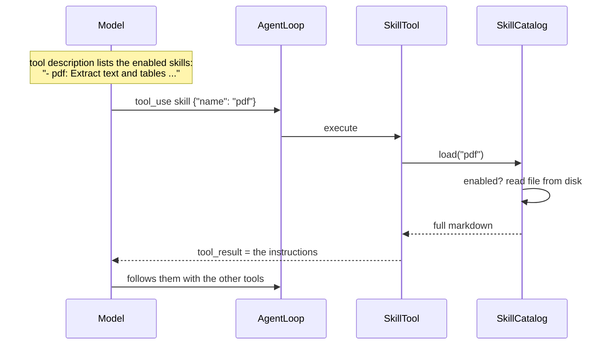
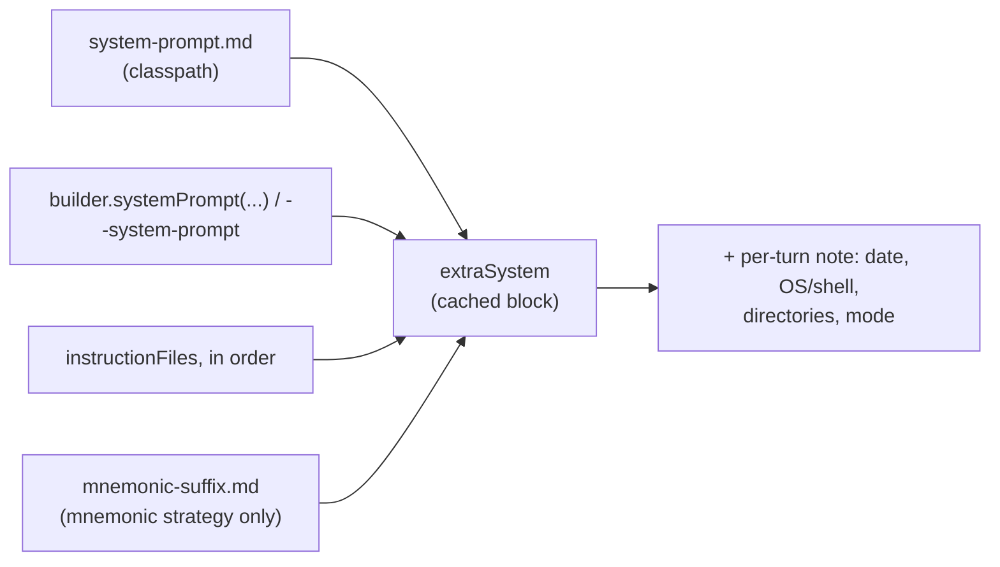

# Skills and instruction files

Two ways to give the model text it did not have: **skills** are loaded on demand through a tool, **instruction
files** are always part of the system prompt.

| | Skills | Instruction files |
|---|---|---|
| Settings key | `skills` | `instructionFiles` |
| When the model sees it | after calling `skill {"name": …}` | on every request |
| Cost | one line per skill in the tool description, full text only when used | the whole text, every request (cached) |
| Read from disk | on every load (edits apply at once) | once, at `build()` |
| Runtime toggle | `/skills` | none |

## 1. Skills

A skill is a markdown file of instructions, typically `SKILL.md`:

```markdown
---
name: pdf
description: Extract text and tables from PDF files with pdfplumber
---
# PDF handling
1. Check that pdfplumber is installed: `python -c "import pdfplumber"` ...
```

```json
"skills": [
  {"name": "pdf", "path": "skills/pdf/SKILL.md"},
  {"name": "release", "path": "/opt/skills/release.md", "description": "Cut a release of this repo"}
]
```

| Field | Meaning |
|---|---|
| `name` | what the model passes to `skill`; must be unique |
| `path` | file path, relative to the process working directory |
| `description` | when to use it; default: the `description:` line of the file (first match anywhere in it) |

A missing file is logged and the skill is left out; a duplicate name fails `build()`. With at least one skill the
harness registers one `skill` tool (group `Skills`, READ_ONLY, never asks).



- The whole file is returned, front matter included. It is a normal tool result: it stays in the context, is cut at
  `toolMaxChars`, and can be cleared or masked later by the context strategy like any other result.
- A skill only adds instructions. It does not add tools, and its steps go through the usual permission checks.
- Disabling a skill (`/skills disable pdf`) removes it from the description and makes `load` fail. The description
  is part of the tool block, so toggling a skill changes the cached prefix of the next request.
- Sub-agents get the `skill` tool like any other registry tool (unless their type's `tools` list leaves it out, or
  the type is read-only — it is READ_ONLY, so read-only types keep it).

## 2. Instruction files

```json
"instructionFiles": ["KENDAR.md", "~/KENDAR.md", "docs/RULES.md"]
```

- Read once at `build()`, in order. `~` is the user home. Missing files are skipped (logged at info).
- Each file is added as `Instructions from <file name>:\n<text>`.
- Placed after the base prompt and the builder's `systemPrompt(...)` addendum, inside the cached system block.



The per-turn note follows the cached text in the same block; see [CACHES §1](CACHES.md#1-prompt-cache-layout).

## 3. Agent prompts

Sub-agent types (settings `agents`) also carry text: `prompt` inline or `promptFile` (read at startup). It is added to
that sub-agent's system text only. See [EXTENDING §6](EXTENDING.md#6-sub-agent-types).
