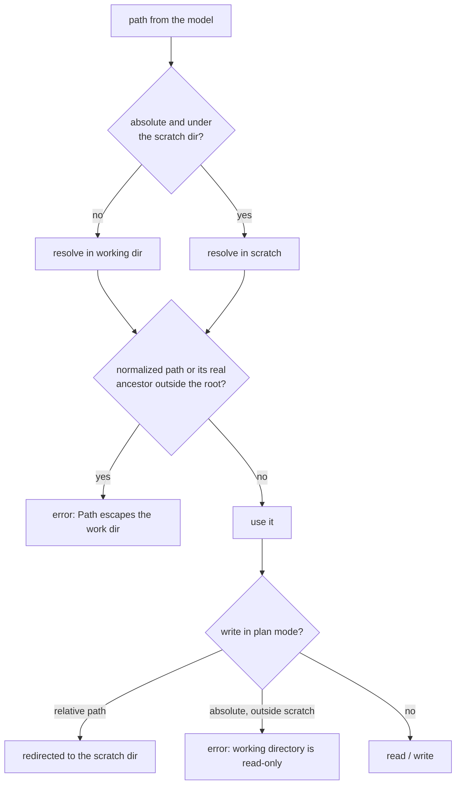
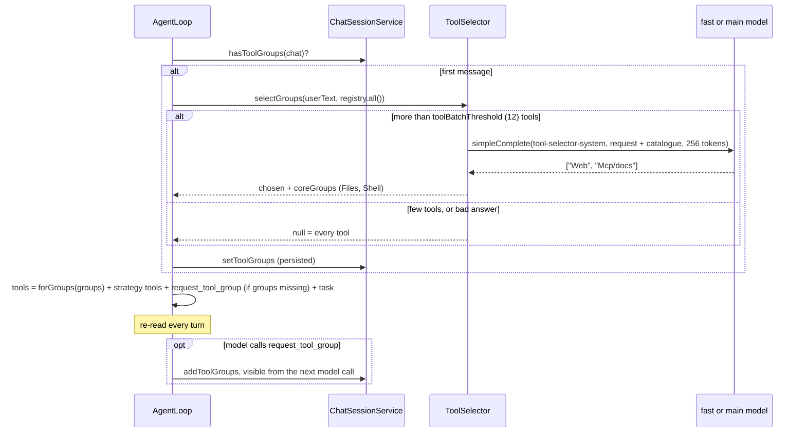
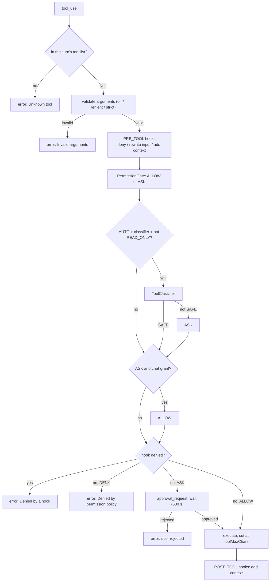

# Tools

What the model can call, how tools are grouped, selected per chat and gated. To write your own tool see
[EXTENDING §1](EXTENDING.md#1-tools).

## 1. Built-in tools

| Tool | Group | Kind | Input | Notes |
|---|---|---|---|---|
| `read_file` | Files | READ_ONLY | `path`, `offset?`, `limit?` | numbered lines, at most 2000 lines / 50 KB per call, then `[showing lines 1-2000 of N; continue with offset=2001]`; text files over 1 MB are refused; pdf and docx are read through [document readers](#document-readers) |
| `write_file` | Files | FILE_EDIT | `path`, `content`, `append?` | creates parent dirs; `append: true` adds to the end (for large files written in parts); preview is a `-`/`+` diff |
| `edit_file` | Files | FILE_EDIT | `path`, `old_string`, `new_string`, `replace_all?`, or `edits[]` | `old_string` must be unique unless `replace_all`; tolerates trailing whitespace and smart quotes/dashes (only if the match is unique); keeps BOM and CRLF; `edits` applies several replacements against the original text, all or none; the result is a short diff; a miss lists the closest lines |
| `glob` | Files | READ_ONLY | `pattern` | at most 200 paths, sorted; `**/x` also matches top-level files |
| `ls` | Files | READ_ONLY | `path?` | one directory, not recursive: directories first (`d name/`), then files (`f name size`); at most 200 entries; not available on a remote (docker daemon) work dir |
| `grep` | Files | READ_ONLY | `pattern` (Java regex), `path?`, `glob?` | `path:line:text`, at most 200 hits, files over 1 MB skipped |
| `bash` | Shell | OTHER | `command`, `timeout_seconds?` | runs through the `SandboxExecutor`; timeout capped at 600 s; stderr is merged into stdout; only the last 50 KB are kept and the result says `[output truncated: N lines omitted; full log: <scratch>/bash-N.log]` (read the log with `read_file` or `grep`) |
| `web_search` | Web | READ_ONLY | `query`, `count?` (≤ 20) | Brave with a key, DuckDuckGo HTML otherwise |
| `wikipedia_search` | Web | READ_ONLY | `query`, `lang?`, `count?` | titles, URLs, snippets |
| `web_fetch` | Web | READ_ONLY | `url` | http/https only; HTML reduced to text; cut at `fetchMaxChars` (40000); asks once per host (see [per-host approval](#per-host-web-approval)) |
| `web_download` | Web | READ_ONLY | `url`, `path` | writes the bytes unchanged to `path` in the chat work dir, returns path, size and content type; refused above `web.downloadMaxBytes` (100 MB, no file left); counts against `storage.maxBytes`; asks per host like `web_fetch` |
| `run_js` | Js | OTHER | `code`, `timeoutSeconds?` | only with the `jllm-js` plugin, see [JS](JS.md) |
| `skill` | Skills | READ_ONLY | `name` | only when skills are configured ([SKILLS](SKILLS.md)) |
| `task` | Agents | READ_ONLY | `prompts[≤8]`, `subagent_type?` | sub-agent fan-out; main agent only |
| `request_tool_group` | Agents | READ_ONLY | `groups[]` | only while groups are missing; main agent only |
| `history_recall` | Memory | READ_ONLY | `id?`, `query?`, `file?`, `scope?`, `offset?` | mnemonic strategy only ([CACHES §4](CACHES.md#4-mnemonic-strategy)) |
| `todo_write` | Todo | READ_ONLY | `todos[]` (`id?`, `content`, `status`) | scope strategy only: replaces the whole list, at most one `in_progress`; emits the `todos` event ([CACHES §5](CACHES.md#5-scope-strategy)) |
| `todo_read` | Todo | READ_ONLY | none | scope strategy only: the current list |
| `mcp__<server>__<tool>` | `Mcp/<server>` | READ_ONLY if `readOnly`, else OTHER | server schema | [MCP](MCP.md) |
| `<api>__<operationId>` | `Rest/<api>` | READ_ONLY for GET/HEAD, else OTHER | built from the spec | [MCP §3](MCP.md#3-rest-apis-openapi) |

`builder.withoutStandardTools()` drops Files, Shell and Web; `builder.withoutTools(names)` drops only the named standard tools (absent, not hidden), and a plugin can call `registrar.replaces(name)` to do the same and keep the tool from coming back through `HarnessToolRegistry.setSource`. `task`, `request_tool_group`, `history_recall` and the
todo tools are not in the registry: the loop adds them to the tool list of each request.

### Tool kinds

| Kind | Meaning | Effect |
|---|---|---|
| `READ_ONLY` | changes nothing | never asks; offered to read-only sub-agents |
| `FILE_EDIT` | writes files in the jail | runs unasked in `edit` and `plan` (confined to scratch in `plan`) |
| `OTHER` | anything else (shell, network writes) | asks except in `auto` |

## 2. Path jail

All file tools resolve paths against the chat's working directory and reject anything that escapes it, including
through symlinks (the deepest existing ancestor is resolved with `toRealPath`).

`glob` and `grep` walk the working directory. In plan mode `bash` runs with the scratch directory as its current
directory; only `DockerSandboxExecutor` mounts the working directory read-only.

## 3. Registry and ordering

`HarnessToolRegistry` holds the core tools (standard + injected + `skill`) and one list per external source (each MCP
server, each REST API). Every change publishes a new immutable snapshot sorted by `(group, name)`.

- The order does not depend on the injection order, so the tool block of the request is byte-stable (prompt cache,
  see [CACHES §1](CACHES.md#1-prompt-cache-layout)).
- Duplicate names are rejected at `build()`, and when a source is enabled later (nothing changes then).
- Names must match `[a-zA-Z0-9_-]{1,64}`; MCP and REST names are sanitized and cut to 64 characters.
- `/tools disable <name|group>` hides tools from the next request; the snapshot is kept.

## 4. Tool set of a chat

The tool list of a chat is decided once, on its first message, and stored in the session (`toolGroups`). It only grows.

Sub-agents choose their own set with the same selector, from the registry filtered by their type (`tools` list,
`readOnly`). They never get `task` or `request_tool_group`.

## 5. One tool call

All `tool_use` blocks of a response run concurrently on virtual threads; results are appended in the original order
and every `tool_use` always gets a `tool_result`.

The arguments are checked first, before hooks, permissions and approval, so the user is never asked about a malformed
call. An invalid call returns `Invalid arguments for '<tool>': <problems>. Expected input schema: <schema>` and the
model corrects it on its next turn. Modes (`output.validation` in the settings, default `lenient`; `/validation
[off|lenient|strict]` overrides it for the chat):

| Mode | Behaviour |
|---|---|
| `off` | no check |
| `lenient` | repairs `"5"` for an integer or number, `"true"` for a boolean, and `null` for an optional field; rejects the rest |
| `strict` | the input must match the schema exactly |

The default check is JSON Schema (draft 7) on `inputSchema()`; a schema the library cannot compile is skipped with a
warning. Replace it with `AgentHarness.builder().toolInputValidator(v)`, or add a further check after it with
`addToolInputValidator(v)`. A `ToolInputValidator` returns the input to use and the list of problems; chained
validators see the input as repaired by the previous one.

An exception from `execute` becomes an error result (`Error: …`); the loop goes on. A sub-agent's approval
requests go to the user through the parent's event sink, titled `[<type> #n] <tool>`; dialogs of one chat are shown
one at a time. `PermissionGate` returns only `ALLOW` or `ASK`; `DENY` is what an `ASK` becomes in a loop run
with `interactive=false` (the built-in main and sub-agent loops are both interactive).

## 6. Output limits

| Limit | Default | Where |
|---|---|---|
| `output.toolMaxChars` | 30000 | text of a tool result kept in the context |
| `output.eventMaxChars` | 2000 | text in the `tool_result` event |
| `web.fetchMaxChars` | 40000 | `web_fetch` body before the context limit |
| `web.downloadMaxBytes` | 100000000 | largest file `web_download` accepts |
| `storage.maxBytes` | -1 (no limit) | total size of a chat storage (web: the work dir of the chat; CLI: `<project>/.kendhar/scratchpad/<chatId>/`). A write by `write_file`, `edit_file` or `web_download` that would exceed it fails and creates no file. Project files edited by the model in the CLI are outside the chat storage and are not counted; writes made by a shell command are not counted until the next start |
| REST response | 20000 | `RestApiToolProvider` |
| `history_recall` page | 12000 (`mnemonic.recallMaxChars`) | per call, continue with `offset` |
| `context.scope.offloadChars` | 20000 | `scope` strategy: a larger result is offloaded to a file, head and tail stay (applies after the `toolMaxChars` cut) |

## Document readers

`read_file` looks up the file extension in the registered `DocumentReader`s (`extensions()`, `extract(Path)`), extracts
the text and then applies `offset`, `limit` and the line cap to it. The path jail runs before the reader. A binary
extension with no reader answers `No reader for .pdf; put the pdf plugin jar in the plugin directory and enable it under plugins`. Extraction has a 30 s timeout and a
5 MB text cap; the binary file may be up to 50 MB.

| Module | Extensions | Notes |
|---|---|---|
| `jllm-pdf` | `pdf` | Apache PDFBox 3; text only, `--- page N ---` markers; scanned PDFs answer "no extractable text (scanned?)"; password-protected files fail with a clear error |
| `jllm-docs` | `docx` (and `doc`) | JDK ZIP + StAX, no dependency; headings as `#`, list items as `-`, table rows as `a \| b`; headers, footers and comments skipped; tracked insertions kept, deletions dropped; legacy `.doc` answers "legacy .doc not supported, convert to docx" |

The front ends carry neither: `./mvnw install` copies each plugin jar to `target/plugins/`; pass that directory with
`--plugin-dir` (CLI) or `jllm.plugin-dir` (web), default `./plugins`, and enable the plugin: `"plugins": {"pdf":
{"enabled": true}}` in the settings file, `--plugins.pdf.enabled=true` for one CLI run, or
`--jllm.plugins.pdf.enabled=true` in the web application. An embedder can add the module as a dependency and call
`builder.plugin(new PdfPlugin())` (no settings entry needed), or `builder.discoverPlugins()` plus `plugins` settings.
Own formats: `builder.documentReader(reader)` or `registrar.documentReader(reader)`.

## Checkpoints

The first time a user turn writes a file with `write_file` or `edit_file`, the old content is copied to
`<workdir>/.kendhar/checkpoints/<chatId>/<turn>/` (files that did not exist are recorded and deleted on undo).
`/undo [n]` restores the last n turns that edited files. Files changed by `bash` are not recorded and not restored.

## Per-host web approval

`web_fetch` and `web_download` ask before contacting a host, although they are `READ_ONLY`; `web_search` and
`wikipedia_search` call fixed hosts and never ask. The question is an `approval_request` event with `type: "host"`,
the `host`, and the full URL as `preview`. The user answers once, or grants "this host and its subdomains for this
chat".

- A grant for `example.com` covers `example.com` and `*.example.com` on a label boundary (`badexample.com` is not
  covered); a grant for `www.example.com` does not cover `example.com`.
- Matching is on the host as written in the URL: lowercase, trailing dot removed, IDN converted to ASCII, port and
  scheme ignored. An IP literal matches only itself; there is no DNS resolution, so a name grant does not cover the
  IPs it resolves to and the reverse.
- Redirects are followed by the tool (at most 5 hops, https to http refused). A redirect to a host not granted asks
  for that host; a denial fails the call with an error naming the target.
- Grants are per chat and are kept with the other chat grants. They still hold after the chat has read untrusted
  output, unlike tool grants: a host not granted always asks, and that is what stops data leaving.
- `deny` permission rules on the tools apply first. A run that cannot ask (non-interactive) refuses a host not
  granted, in every permission mode.
- `ToolContext.hosts()` is the approver; `null` (direct calls in tests or embedding code) allows every host.
