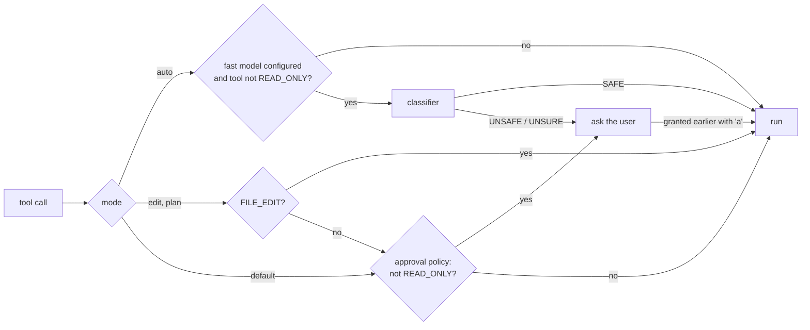
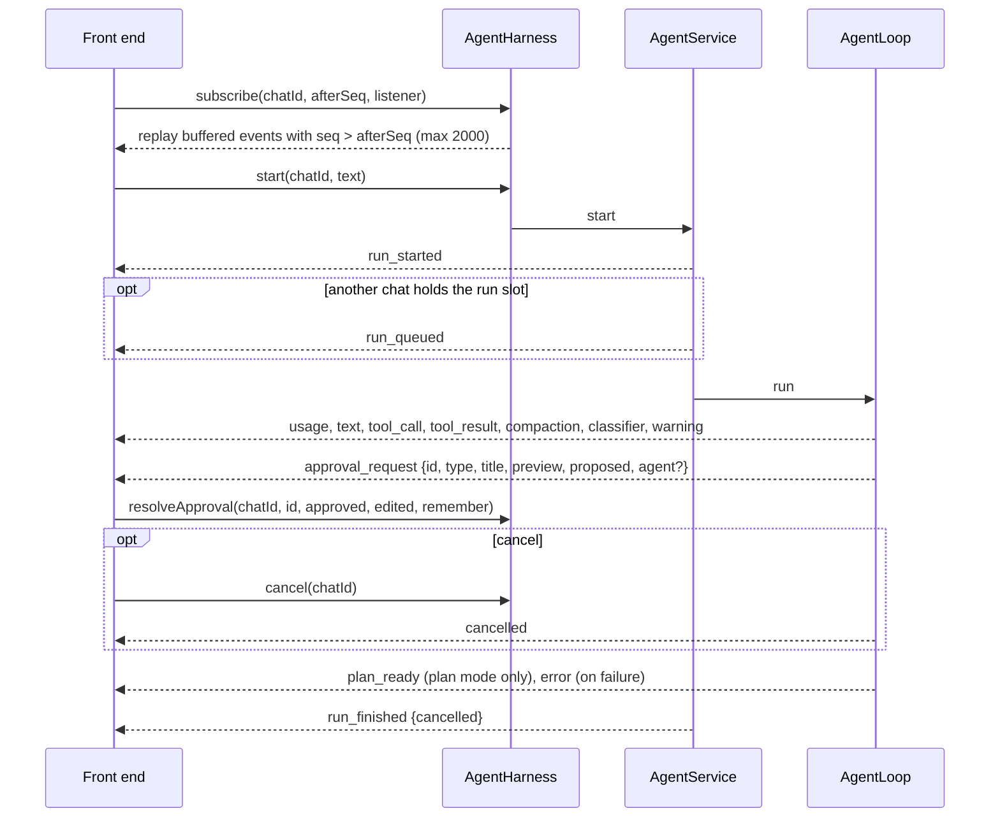

# Usage

Harness reference: build, permission modes, settings file, embedding and the event contract. Front-end specifics are in
[jllm-cli](../jllm-cli/README.md) and [jllm-web](../jllm-web/README.md).

See also: [TOOLS](TOOLS.md), [MCP and REST APIs](MCP.md), [SKILLS](SKILLS.md), [EXTENDING](EXTENDING.md),
[CACHES](CACHES.md), [INTERNALS](INTERNALS.md).

## 1. Build

The modules are part of the `jllm` Maven reactor. Java 21.

```sh
mvn -pl jllm-harness -am package            # jar, sources jar, test-jar (HarnessTestSupport)
mvn -pl jllm-harness -am package -Prelease  # also the javadoc jar
```

This jar is the library only. The front ends are separate modules:

| Module | What | Doc |
|---|---|---|
| `jllm-cli` | terminal chat, shaded runnable jar | [jllm-cli/README.md](../jllm-cli/README.md) |
| `jllm-web` | Spring Boot REST + SSE API and Vue chat UI | [jllm-web/README.md](../jllm-web/README.md) |

## 2. Command line and web front ends

Flags, startup directories, the interactive session and the approval prompt are in the
[CLI README](../jllm-cli/README.md); `jllm.*` properties and the REST/SSE API are in the
[web README](../jllm-web/README.md). Both build the same `AgentHarness`, with `CwdSandboxExecutor` and the
`FileHistory*` stores, and have **no isolation**: shell commands run as the current user.

## 3. Slash commands

Handled by `SlashCommands` without calling the model (except `/compact`). Shared by every front end; the CLI and the
web `POST /api/chat/{id}/messages` endpoint both route through it. The full table is in the
[CLI README](../jllm-cli/README.md#slash-commands). Menu toggles (`/tools`, `/mcp`, `/apis`, `/skills`) live in memory
only; the settings file is the startup default.

## 4. Permission modes

| Mode | Working dir | Scratch dir | Asks the user for |
|---|---|---|---|
| `default` | per tool | writable | every tool that is not `READ_ONLY` |
| `plan` | read-only for file tools; shell runs from scratch | writable | shell and other non-`FILE_EDIT` tools |
| `edit` | writable | writable | shell and other non-`FILE_EDIT` tools |
| `auto` | writable | writable | nothing; with a fast model, calls the classifier finds unsafe |



After a plan-mode answer a `plan_ready` event suggests `/edit`. The mode is the last text of the system prompt, so a
switch leaves the cached tool block and the text before it intact (see [CACHES §1](CACHES.md#1-prompt-cache-layout)).

## 5. Settings file

Every key is optional. `${ENV_VAR}` is expanded in every string; a missing variable fails the load. Unknown keys are
ignored.

```json
{
  "mcpServers": [{"name": "docs", "url": "https://h/mcp", "headers": {"Authorization": "Bearer ${DOCS_TOKEN}"},
                  "readOnly": true, "enabled": true, "group": "Mcp/docs"}],
  "restApis":   [{"name": "pets", "openApiUrl": "https://h/openapi.yaml", "baseUrl": "https://h/api",
                  "allowedPaths": ["GET /pets", "/pets/{id}", "/store/*"]}],
  "skills":     [{"name": "pdf", "path": "skills/pdf/SKILL.md"}],
  "instructionFiles": ["KENDAR.md", "~/KENDAR.md"],
  "agents":     [{"name": "scout", "description": "Looks around", "tools": ["read_file", "grep"],
                  "readOnly": true, "prompt": "Only report facts.", "inheritContext": false}],
  "fastModel":  {"name": "ollama", "baseUrl": "http://localhost:11434/v1", "apiKey": "", "model": "qwen3:4b",
                 "maxTokens": 4096, "maxRetries": 2, "timeoutSeconds": 600,
                 "requireApiKey": false, "useMaxCompletionTokens": false},
  "providers":  [{"name": "claude-sonnet", "type": "anthropic", "model": "claude-sonnet-5-5", "apiKey": "${ANTHROPIC_API_KEY}", "order": 1},
                 {"name": "local-qwen", "type": "openai", "baseUrl": "http://localhost:8080/v1", "model": "local",
                  "requireApiKey": false, "contextTokens": 32000, "smallModel": true, "temperature": 0.2, "order": 2}],
  "defaultProvider": "claude-sonnet",
  "permissions": {"deny": ["bash(rm -rf .*)", "write_file(.*\\.env)", "web_fetch"],
                  "ask": ["bash(.*curl.*)"], "allow": ["bash(mvn .*)"]},
  "execution":  {"maxParallel": 1},
  "sandbox":    {"tempDir": "/var/tmp/harness", "timeoutSeconds": 120, "backend": "docker",
                 "docker": {"image": "maven:3-eclipse-temurin-21", "network": "none"}},
  "context":    {"maxTokens": 100000, "auto": true, "keepTokens": 15000, "buffer": null, "keepRecentTurns": 6,
                 "strategy": "compaction", "mnemonic": {"maskTrigger": null},
                 "scope": {"offloadChars": 20000, "overflowOffloadChars": 2000, "previewChars": 1500,
                           "safetyPercent": 2, "reserveCap": 4096}},
  "output":     {"toolMaxChars": 30000, "eventMaxChars": 2000},
  "smallModel": false
}
```

| Key | Doc |
|---|---|
| `mcpServers`, `restApis` | [MCP](MCP.md) |
| `skills`, `instructionFiles` | [SKILLS](SKILLS.md) |
| `agents` | [EXTENDING §6](EXTENDING.md#6-sub-agent-types) |
| `providers`, `defaultProvider` | named model providers, see [Providers](#providers-and-temperature) |
| `permissions` | regex deny/ask/allow rules, see [Permission rules](#permission-rules) |
| `fastModel` | small model for compaction summaries, tool-group selection and the `auto` classifier |
| `execution.maxParallel` | default `1`: one model call in flight, sub-agents run depth-first. `N`: at most N model calls and N chat runs at once (chat runs need `serializeRuns`); `N != 1` lets read-only sub-agents run in parallel. `-1`: unlimited |
| `smallModel` | default `false`: append the small-model rules (`prompts/small-model.md`) to the system prompt; `--small-model` sets it |
| `sandbox.tempDir`, `sandbox.timeoutSeconds` | scratch root; default shell timeout (the tool caps it at 600 s) |
| `sandbox.backend`, `sandbox.localFallback`, `sandbox.docker.*` | `local` (default) or `docker`; fall back to local when docker is missing (default `true`); `binary`, `image`, `memory`, `cpus`, `pidsLimit`, `user`, `network`, `mode` (`oneshot` or `daemon`, a long-running container), `remote`, `remoteHost` (docker on another machine). See [SANDBOX](SANDBOX.md). CLI and web: `--sandbox`, `--docker-image`, `--docker-mode`, `--docker-remote`, `--docker-remote-host` |
| `context.*` | [CACHES](CACHES.md); `context.strategy` is `compaction`, `mnemonic` or `scope`; `context.scope.*` are the thresholds of `scope` ([CACHES §5](CACHES.md#5-scope-strategy)) |
| `output.toolMaxChars` | tool output kept in the context; the rest is cut with `[truncated N chars]` (the head is kept, the tail for `bash`) |
| `output.eventMaxChars` | tool output carried by the `tool_result` event to the front end |

### Providers and temperature

`providers` is a list of named model definitions (`name`, `type` = `anthropic` | `openai` | `qwen` | `llamacpp` |
`ollama`, `baseUrl`, `apiKey`, `model`, `maxTokens`, `maxRetries`, `timeoutSeconds`, `requireApiKey`,
`useMaxCompletionTokens`, `contextTokens`, `smallModel`, `temperature`, `order`, `thinking`). The old names `anthropic`, `openai`, `qwen`,
`llamacpp`, `ollama` stay valid without a definition.

- CLI: `--provider <name>` picks one; `--model`, `--base-url`, `--api-key` override it for the session only. With an
  unknown name, or `--model` alone, they define a `custom (session)` entry that is never written to the settings file.
- `/model` shows a numbered menu (configured providers and the session entry); `/model <name>` switches directly. New
  runs use the new model; the prompt cache restarts once. If the conversation does not fit the new `contextTokens`,
  you are asked whether to compact first; if you decline, or the strategy cannot compact (`mnemonic`), the switch is
  refused and the model stays.
- **Retry and fallback.** Each client retries a 429/5xx answer `maxRetries` times (default 5 remote, 2 local) with
  backoff. `order` (optional integer) chains the providers: when a provider still fails after its retries, the
  providers with a higher `order` are tried in ascending order; one without `order` is never a fallback. A request
  refused as too long, and a cancellation, are not passed on to another provider. A fallback that cannot be built
  (for example a missing key) is skipped.
- An agent type may set `"provider": "<name>"` (wins over an inline `model`), `"temperature"` and `"thinking"`.
- `temperature` (0 to 2) is resolved agent type, then provider, then unset; unset means nothing is sent.
  `explore` uses 0.2 and `plan` 0.3. OpenAI-compatible clients send it, and retry once without it if the server
  rejects it. **The Anthropic client never sends it:** current Claude models and the current API version reject
  `temperature`, so a value set on an Anthropic provider is ignored.
- `thinking` (`minimal` | `low` | `medium` | `high`) sets the reasoning effort, on a provider and on an agent type.
  Resolved request, then agent type, then provider, then unset; unset leaves the client's own default (Anthropic:
  no thinking, OpenAI-compatible: nothing sent).
  - Anthropic: extended-thinking budget of 2048 (`low`), 8192 (`medium`) or 16384 (`high`) tokens; `minimal` turns
    thinking off. `max_tokens` is raised to fit the budget, and a forced `toolChoice` is ignored while thinking is on.
  - OpenAI-compatible (openai, qwen, llamacpp, ollama): sent as `reasoning_effort`; `minimal` is `minimal`, or `none`
    on Ollama. A server that rejects it gets a retry: `minimal`/`none` steps down to `low`, anything else is
    dropped, and a warning is logged. The run continues.

### Permission rules

```json
"permissions": {
  "deny":  ["bash(rm -rf .*)", "bash(.*git push.*)", "write_file(.*\\.env)", "mcp__docs__.*", "web_fetch"],
  "ask":   ["bash(.*curl.*)"],
  "allow": ["bash(mvn .*)"]
}
```

A rule is `toolPattern` or `toolPattern(argPattern)`. `toolPattern` is a regex matched against the whole tool name
(`mcp__docs__.*` covers a server). `argPattern` is searched (`find`) in the main argument: `command` for `bash`,
`path` for `read_file`/`write_file`/`edit_file` (`\` is turned into `/` first), `url` for `web_fetch`, `query` for
searches, the compact JSON of the input for other tools. The first `(` separates the two parts. An invalid regex fails
the load, naming the rule (`permissions.deny[2]`). Order: `deny`, then `ask`, then `allow`; the first match wins.

- `deny` applies in every mode, including `auto`, and a per-chat grant cannot override it. The model sees
  `Denied by permission rule: <rule>` as a tool error. Sub-agents use the same rules. A deny rule without an argument
  pattern also removes the tool from the list sent to the model.
- `ask` forces the approval question; `allow` skips it in `default`, `edit` and `plan` modes (it never overrides `deny`,
  and plan-mode confinement still applies).
- Settings only: no flag changes the rules. `/permissions` lists them.
- A regex on a shell command is a guard rail, not a security boundary (quoting, variables, `python -c`). For real
  isolation use the docker sandbox (`sandbox.backend`: `docker`).

### Steering a running chat

While a run is active, `harness.steer(chatId, text)` queues a message that is applied after the current round of tool
calls (the running calls are never interrupted; if the answer in progress is final it becomes the next turn).
`harness.followUp(chatId, text)` is applied only when the agent would otherwise finish. On an idle chat both start a
run. `/cancel` clears the queues. Events: `steer_queued`, `steer_applied` (`kind`: `steer` | `followup`). Queued
messages enter the chat log only when applied.

## 6. Embedding

```java
ObjectMapper mapper = new ObjectMapper();
AgentHarness h = AgentHarness.builder()
        .modelClient(ModelClients.anthropic(AnthropicSettings.defaults(System.getenv("ANTHROPIC_API_KEY")), mapper))
        .settings(Path.of("harness.json"))
        .sessionStore(new InMemoryChatSessionStore())
        .approvalPolicy(ToolApprovalPolicy.byKind())
        .config(HarnessConfig.defaults().withMaxTokens(16_000))
        .systemPrompt("Project specific rules.")
        .objectMapper(mapper)
        .build();

String chatId = h.sessions().create(null).chatId();
h.sessions().setMode(chatId, PermissionMode.EDIT);
Runnable unsubscribe = h.subscribe(chatId, 0, ev -> {
    switch (ev.type()) {
        case "text" -> System.out.println(ev.data().path("text").asText());
        case "approval_request" -> h.resolveApproval(chatId, ev.data().path("id").asText(), true, null, false);
        default -> { }
    }
});
h.start(chatId, "List the files in the workspace");   // asynchronous
```

`start` returns at once; the run happens on a virtual thread and reports through events. A second `start` on a busy
chat throws `AgentService.RunAlreadyActiveException`.

### Front-end contract



| Event | Data |
|---|---|
| `run_started` | `text` |
| `run_queued` | waiting for the run slot (`serializeRuns`) |
| `usage` | `inputTokens`, `outputTokens`, `cacheReadTokens`, `cacheCreationTokens` |
| `text` | `text` of one text block |
| `tool_call` | `id`, `name`, `input` |
| `tool_result` | `id`, `name`, `isError`, `output` (cut at `eventMaxChars`) |
| `approval_request` | `id`, `chatId`, `type` (`tool` or `context`), `title`, `preview`, `proposed`, `agent` |
| `classifier` | `tool`, `verdict` |
| `compaction` | compaction: `tier`, `cleared`/`estimatedTokens`; mnemonic: `kind`, `masked`, `savedTokens`, `estimatedTokens`; scope: `strategy`, `estimatedTokens` |
| `todos` | `todos`: the complete list written by `todo_write` (`id`, `content`, `status`) |
| `warning`, `error` | `message` |
| `cancelled` | — |
| `plan_ready` | `message` |
| `run_finished` | `cancelled` |

Every event carries a per-chat `seq`. A reconnecting front end subscribes with the last `seq` it saw and gets no gap
and no duplicate. The buffer is cleared at the start of every run (earlier runs are in the persisted history).

For `approval_request` of type `context` (tier-3 compaction), `proposed` is the summary to approve; pass the
user's edited text as `edited`.

### Other facade methods

| Method | Purpose |
|---|---|
| `sessions()` | create, list, delete chats; mode; title |
| `commands()` | slash commands for a custom front end |
| `compact(chatId, focus)` | manual compaction |
| `contextTokens(chatId)`, `contextBudget()`, `contextStrategy()` | context state |
| `cost(session)` | estimated USD with `builder.pricing(new HarnessPricing(in, out, cacheRead, cacheWrite))` (per million tokens) |
| `tools()`, `sources()`, `skills()` | runtime toggles of tools, MCP/REST sources, skills |
| `workDir(chatId)`, `scratchDir(chatId)`, `sandbox()` | directories |
| `builder.stateStore(...)` | where tool grants and todo lists are kept (default in memory; the CLI and web use files) |
| `subAgentRuns()` | audit log of sub-agent runs |
| `pendingApprovals(chatId)`, `lastSeq(chatId)`, `isRunning(chatId)` | state for UIs |
