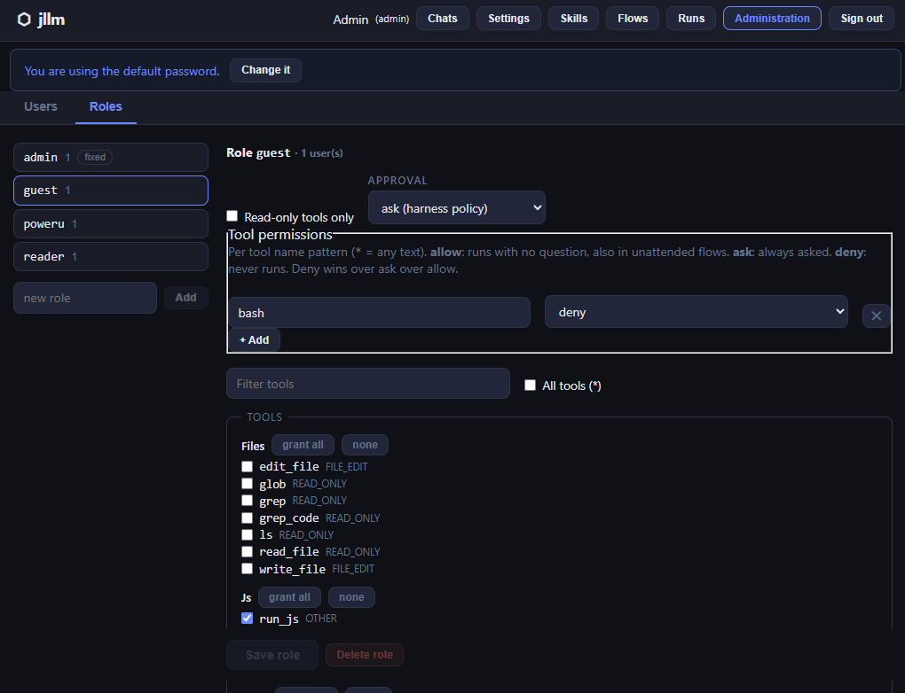

# Identity and access

Who may use the agent, which tools they get, and whose credentials a tool call carries. The library knows nothing
about sign-in; the web layer asks three small interfaces, so you can plug in your own identity system.

## Three interfaces

Defined in [jllm-web-commons](../../web/jllm-web-commons/README.md), mounted by [jllm-web-spring-starter](../../web/jllm-web-spring-starter/README.md). Each has a deny-by-default fallback, so a missing
implementation locks the application instead of opening it.

| Interface | Question it answers | Fallback |
|---|---|---|
| `WebAuthentication` | who sent this request (`Principal`: `id()`, `admin()`) and which `/api` paths are open | nobody; 401 |
| `ChatAccess` | may this user see this chat (`canSee`), and which chats a listing may load (`visibility`, applied by the store; default: everything) | none; 404 |
| `HarnessIdentity` | the user's credentials, tool policy and principal; where OAuth tokens are kept | no credentials, no tools |

A chat a user may not see answers 404, as if it did not exist.

## The sample implementation (`jllm-web`)

- **Password** sign-in with a sliding session cookie; the user's other sessions are revoked on a password change;
  five failed attempts lock a login or address for 30 s, and an unknown login and a wrong password give the same answer.
- **OpenID Connect**: authorization code with PKCE against one provider (Entra, Keycloak, Okta, Google, ...). Optional
  `allowed-domains`, linking by verified email, optional auto-provisioning with a default role. Modes
  `password`, `oidc` or `both`. Setup: [jllm-web](../../jllm-web/README.md#sign-in-with-openid-connect).
- **Role mapping** (off by default): the groups of the ID token pick the role at each sign-in, through an `idp` setting
  on each role (groups, priority); never the admin role unless allowed, never the last admin demoted; a password sign-in never changes the role. A broker
  (Keycloak) in front of a SAML provider works the same way. See [IdP role mapping](idp-role-mapping.md).
- **Roles** are files listing tool patterns (`read_file`, `mcp__docs__*`, `billing__*`), an optional `readOnly` flag,
  an `approval` setting, optional per-tool `toolPermissions` (allow, ask, deny) and settings, free JSON per feature, among them a `sandbox` (`none` by default, `shared-local`, `docker-isolated`, `docker-open`: where the role's users get files and a shell, see [Sandboxes](../guides/sandbox.md#the-web-a-sandbox-per-role)). One role per user, which must exist (SQL: foreign key `users.role` -> `roles`; files: checked in code). A role held by users cannot be deleted (409 naming them). `admin` always has every tool: only its approval, tool permissions and settings can change, and it cannot be removed.
- **Narrowing, never widening**: a user can switch off tools and skills their role allows, but cannot add any.
- **Own skills** per user, bounded in size and count.

## Whose rights a tool call uses

| Source | Credential |
|---|---|
| Your Java tools | whatever your code does; the tool context gives the chat id, from which the chat's principal is looked up (see [Spring Boot](../getting-started/spring-boot.md#your-services-as-tools)) |
| MCP servers, REST APIs | a static header (shared), a per-user `env:` header, or OAuth per user. A per-user OAuth call carries that user's token |
| Flows | a global flow runs as the user who starts it; roles can restrict Java actions, checked when the flow is saved |

## Not there yet

- One OIDC provider. Group to role mapping is evaluated at sign-in only: a group removed at the provider applies at
  the next sign-in (bound it with `role-mapping.max-age`); no SCIM, no back-channel logout ([limits](roadmap-and-limits.md)).
- Model credentials are global today; per-user model keys and OAuth are [in development](roadmap-and-limits.md#planned-per-user-model-credentials).
- No SAML or SCIM. Put an OIDC bridge (Keycloak, Entra, Okta) in front of a SAML provider; its groups reach the
  [role mapping](idp-role-mapping.md) when the bridge puts them in the ID token.
- Users, roles, skills and sessions are stored in SQL (`jllm-sql-spring-starter`: SQLite, MySQL, PostgreSQL), as files
  (`jllm.store=file`) or in memory (sessions in file mode). The repository interfaces are in `jllm-harness`, so another
  implementation does not touch the controllers or the harness ([SQL starter](../../web/jllm-sql-spring-starter/README.md)).

If you embed the harness in an application with its own users, skip `jllm-web` and pass your own principal to
`AgentHarness`; see [Embedding](../getting-started/embed-in-java.md) and
[Spring Boot](../getting-started/spring-boot.md).

Step-by-step hardening and enterprise setup: [Securing a jllm-web deployment](securing-and-enterprise-setup.md).
