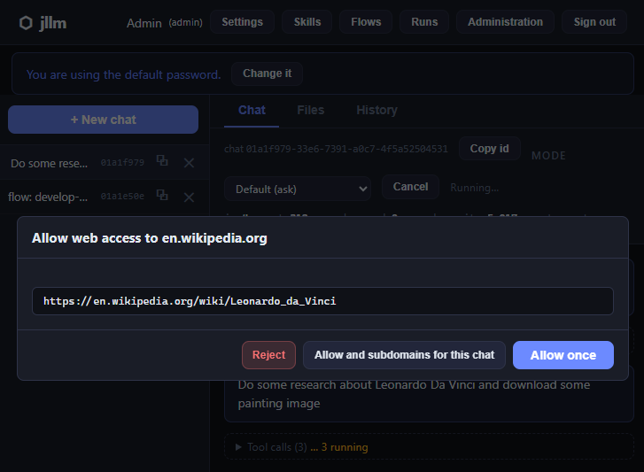

# Security model

What JLLM protects, what it does not, and which control to use for which risk. Everything here is a property of the
library; where the web application adds something, it says so.

## Threats and controls

| Threat | Control | Where |
|---|---|---|
| The model, or text it read, asks for a destructive action | tool kinds, approval policy, `deny` rules, hooks | [Tool control](#1-tool-control) |
| The model reads or writes outside its workspace | path jail, sandbox | [Isolation](#2-isolation) |
| The model sends data to an unexpected host | per-host approval, `deny` rules | [Network egress](#3-network-egress) |
| A user reaches tools or chats they should not | roles, per-user tool narrowing, chat access check | [Identity and access](identity-and-access.md) |
| Secrets leak through settings, logs or tool output | `env:` references, token store encryption, redaction hooks | [Secrets](#4-secrets) |
| Nobody can tell afterwards what the agent did | events, hooks, metrics | [Governance and audit](governance-and-audit.md) |

## 1. Tool control

Every tool call goes through one pipeline ([FLOW](../reference/flow.md), [TOOLS](../guides/tools.md#5-one-tool-call)):

1. Unknown tools are refused. Arguments are validated against the tool's JSON schema (`off`, `lenient`, `strict`).
2. `PRE_TOOL` hooks may deny, rewrite the input or add context.
3. The permission gate decides `ALLOW` or `ASK` from the tool **kind**, the mode and the rules.
4. `ASK` becomes an `approval_request` event with a preview. The run waits for your UI (600 s); a rejection is
   returned to the model as an error.

| Mechanism | Effect |
|---|---|
| Tool kind `READ_ONLY` / `FILE_EDIT` / `OTHER` | `OTHER` (shell, network writes) asks except in `auto`. The kind is a promise made by the tool author: mark custom tools honestly |
| Modes `default`, `plan`, `edit`, `auto` | what runs without asking. `plan` confines writes to a scratch directory |
| `permissions.deny` regex rules | apply in **every** mode and cannot be overridden by a chat grant; the model sees the rule that fired |
| Visibility lists (`allowList`/`denyList`, `allowedPaths`/`denyPaths`) | hidden MCP tools and REST operations never reach the model and cannot be called |
| `auto`-mode classifier | a fast model judges non-read-only calls; anything not judged safe asks |
| Tool grants | per chat, given by the user. A host that was not granted still asks, even after the chat has read untrusted output |
| Non-interactive runs | an `ASK` becomes a refusal. Flows marked `unattended` never ask |

For your own tools, validate inside the tool as you would any user-supplied input. The model is an untrusted caller.

## 2. Isolation

| Level | Backend | Guarantee |
|---|---|---|
| File tools | path jail, always on | `read_file`, `write_file`, `edit_file`, `glob`, `grep` run in the JVM and cannot leave the chat's working directory (`..` rejected; a symlink or junction that leaves the directory follows `files.externalLinks`: the CLI default is read-only follow, the web app always refuses, see [tools](../guides/tools.md#links-that-leave-the-work-dir-filesexternallinks)) |
| `bash` on the host | `local` sandbox (default) | **none**: commands run as the user of the JVM |
| `bash` in a container | `docker` `oneshot` | a container per command, working directory mounted |
| Container per chat | `docker` `daemon`, optionally remote | one long-running container per chat, removed with the chat; file tools can go through it too, so no host path is used |
| Scripting | [`jllm-js`](../guides/js.md) | GraalJS with no host access; reaches the world only through the tools you allow |

For untrusted input or multi-user hosting, use `docker` in daemon mode or the JavaScript sandbox, and withhold `bash`
from roles that do not need it. The daemon listens on `127.0.0.1` only, requires a per-container token compared in
constant time, and strips `JLLM_*` variables from the commands it runs ([SANDBOX](../guides/sandbox.md#security)).
It does not protect against code already inside the container, and it has no TLS.

## 3. Network egress

- `web_fetch` and `web_download` ask before contacting a host. The user may grant a host
  and its subdomains for one chat. `web_download` writes a file, so it is also gated like `write_file` (approval,
  plan-mode scratch copy), and a `write_file` permission rule covers it too. A redirect to another host asks again; https to http redirects are refused.
- An invalid TLS certificate asks separately, for that one call and host only.
- `web_search` and `wikipedia_search` call fixed hosts.
- MCP servers and REST APIs are reachable only if listed in the settings.
- To remove web access entirely, add `deny` rules for the web tools or leave them out of the role.
- The `local` sandbox has no network, memory, CPU or process limits. The Docker `oneshot` sandbox can cut the network
  with `sandbox.docker.network: none` (the default); daemon mode ignores that setting ([SANDBOX](../guides/sandbox.md#security)).

## 4. Secrets

- Settings accept `${ENV_VAR}` references; web user credentials are `env:NAME` references only.
- With the SQL store (`jllm-sql-spring-starter`) the tokens are rows of `oauth_tokens`: encrypted with `JLLM_TOKEN_KEY`
  when it is set, in clear otherwise (an invalid key stops the start); login sessions keep a hash of the token. The
  database password comes from `jllm.sql.password` (use `${ENV}`).
- OAuth tokens of MCP servers and REST APIs live in a `TokenStore`: a file encrypted with `JLLM_TOKEN_KEY` when there
  are users, the OS secret store (macOS Keychain, Windows DPAPI, Linux Secret Service) for one user, or your own
  implementation such as a database ([MCP](../guides/mcp.md#6-token-storage)).
- Per-user sources use that user's own token, so a call acts with the rights of the person behind the chat. A missing
  login is a tool result asking the user to connect; the tool list never changes mid-chat.
- The harness does not redact tool output by itself. If tools can return secrets, add a `POST_TOOL` hook.

## 5. Web application

`jllm-web` is a reference front end: password and OpenID Connect sign-in, roles, per-user tool narrowing and lockout
after repeated failed sign-ins. It does not terminate TLS; put it behind your reverse proxy. See
[Identity and access](identity-and-access.md) and [Deployment](deployment.md).

## 6. What it does not cover

- **Prompt injection is not solved.** The controls above limit what an injected instruction can do; they do not stop a
  model from being persuaded. Treat every tool result as untrusted and keep write and network tools behind approval.
- Skills, instruction files, agent prompts and the free text of the settings are scanned when loaded for hidden
  Unicode, injection phrasing and download-and-run or exfiltration patterns. A finding is logged and shown to the
  user (never stored nor sent to the model), but the file is **loaded anyway**: the scan is a heuristic warning, not
  a filter ([Suspicious content](../reference/usage.md#suspicious-content-in-loaded-files)). Review shared skills and
  project instruction files like code.
- MCP stdio servers run as child processes of the JVM user, outside any sandbox.
- Model providers receive whatever is in the context. Choose the provider and its data terms yourself, or use a local
  OpenAI-compatible endpoint.
- Chat history is not encrypted at rest (files under `.jllm/history`). Use disk encryption or your own
  `ChatSessionStore`.
- No IdP role mapping yet ([limits](roadmap-and-limits.md)).
- There has been no external security audit.
