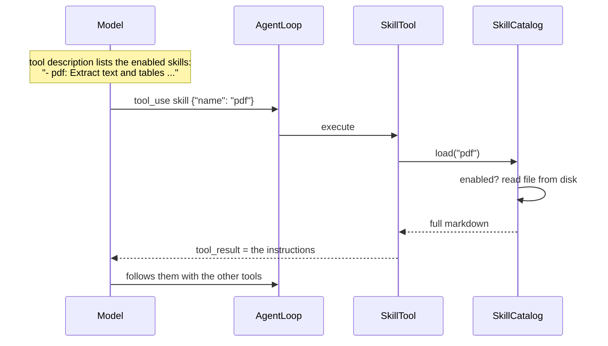
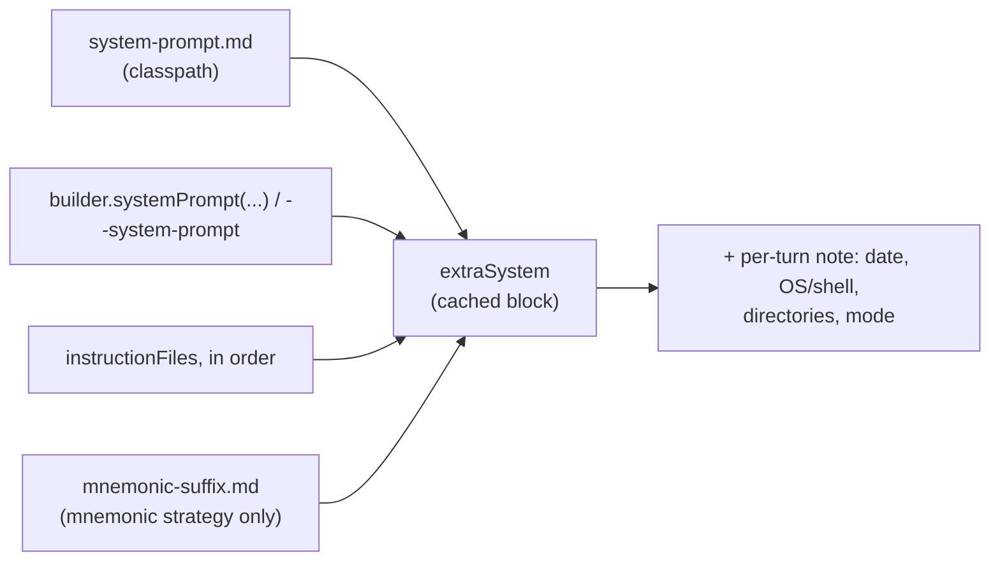

# Skills and instruction files

Two ways to give the model text it did not have: **skills** are loaded on demand through a tool, **instruction
files** are always part of the system prompt.

| | Skills | Instruction files |
|---|---|---|
| Settings key | `skills` | `instructionFiles` |
| When the model sees it | after calling `skill {"name": …}` | on every request |
| Cost | one line per skill in the tool description, full text only when used | the whole text, every request (cached) |
| Read from disk | on every load (edits apply at once) | once, at `build()` |
| Runtime toggle | `/skills` | none |

## 1. Skills

A skill is a markdown file of instructions, typically `SKILL.md`:

```markdown
---
name: pdf
description: Extract text and tables from PDF files with pdfplumber
---
# PDF handling
1. Check that pdfplumber is installed: `python -c "import pdfplumber"` ...
```

```json
"skills": [
  {"name": "pdf", "path": "skills/pdf/SKILL.md"},
  {"name": "release", "path": "/opt/skills/release.md", "description": "Cut a release of this repo"}
]
```

| Field | Meaning |
|---|---|
| `name` | what the model passes to `skill`; must be unique |
| `path` | file path, relative to the process working directory |
| `description` | when to use it; default: the `description:` line of the file (first match anywhere in it) |

A missing file is logged and the skill is left out; a duplicate name fails `build()`. With at least one skill the
harness registers one `skill` tool (group `Skills`, READ_ONLY, never asks).



- The whole file is returned, front matter included. It is a normal tool result: it stays in the context, is cut at
  `toolMaxChars`, and can be cleared or masked later by the context strategy like any other result.
- A skill only adds instructions. It does not add tools, and its steps go through the usual permission checks.
- Disabling a skill (`/skills disable pdf`) removes it from the description and makes `load` fail. The description
  is part of the tool block, so toggling a skill changes the cached prefix of the next request.
- Sub-agents get the `skill` tool like any other registry tool (unless their type's `tools` list leaves it out, or
  the type is read-only — it is READ_ONLY, so read-only types keep it).

### Per-user skills

A multi-user embedder can give each user skills of their own and hide settings skills from them through the
`UserPolicy` its `UserPolicyResolver` returns (see [USAGE](../reference/usage.md)):

```java
new UserPolicy(toolFilter, approval,
        List.of(new UserSkill("notes", "My notes", notesText)),   // extra skills (SkillText)
        name -> !hiddenForAlice.contains(name),                   // settings skills kept
        null);                                                    // tool permission decision (none)
```

- The extra skills are offered, next to the settings skills the filter keeps, only in that user's chats (main agent
  and sub-agents). Their files are read on each load. One whose file is missing, or whose name is a settings skill,
  is left out.
- The policy is resolved on each model call, so a change applies from the next request of every chat of the user
  (and, like any change of the tool block, costs one cache miss).
- With a user policy resolver the `skill` tool is registered even when the settings define no skill; a chat whose
  user has none gets no `skill` tool.
- `jllm-web` uses this for its global (admin) and own (user) skills.

## 2. Instruction files

```json
"instructionFiles": ["KENDAR.md", "~/KENDAR.md", "docs/RULES.md"]
```

- Default (no layer sets the key): `KENDAR.md`, `AGENTS.md`, `CLAUDE.md`, in that order. A list replaces the default
  completely; `[]` loads none.
- Read once at `build()`, in order. Relative paths are resolved against the directory the harness runs in; `~` is the
  user home. Missing files are skipped (logged at info), and so is a file with the same content as one already read
  (for example `CLAUDE.md` as a symlink to `AGENTS.md`).
- Each file is added as `Instructions from <file name>:\n<text>`.
- Placed after the base prompt and the builder's `systemPrompt(...)` addendum, inside the cached system block.



The per-turn note follows the cached text in the same block; see [CACHES §1](../reference/caches.md#1-prompt-cache-layout).

## 3. Directory-scoped instruction files

Instruction files in subdirectories apply when the agent starts working in that part of the tree.

- **Trigger**: a built-in file tool call (`read_file`, `write_file`, `edit_file`, `ls`, `glob`, `grep`, `grep_code`)
  that succeeded on a path inside the chat work dir. `glob` counts for the literal directory its pattern starts with;
  `ls`, `grep` and `grep_code` without a path count for the work dir. In plan mode a write goes to the scratch dir and
  does not count. Remote work dirs (container file backends) are not looked at.
- **Lookup**: each directory from the work dir down to the target (the path itself when it is a directory, else its
  parent), at most `files.scopedInstructionsDepth` (default 8) levels below the work dir, is checked for the file names
  of `instructionFiles` (`~/KENDAR.md` and `docs/RULES.md` give `KENDAR.md` and `RULES.md`). Paths outside the work
  dir are ignored, and so is a file whose real location is outside it (a symlink out of the work dir).
- **Skipped**: a file already in the system prompt, a file with the same content as one already loaded, an empty file,
  and a file the conversation already holds.
- **Delivery**: each new file is appended to the tool results of that turn as a text block, shallowest directory
  first, so the model reads it with its next request:

  ```
  Scoped instructions from src/web/AGENTS.md, for the work under src/web/:
  <text>
  ```

  The blocks go into the message log, never into the system prompt: the cached prefix stays the same (see
  [CACHES §1](../reference/caches.md#1-prompt-cache-layout)). The event `instructions_loaded {file, dir}` is emitted.
- **Once per chat**: the loaded set is the set of blocks in the chat's saved log, so a resumed chat does not add them
  again. A block that left the log (summarized by compaction, or undone with a rewind) is added again on the next
  access below its directory. A file changed after it was loaded is not re-read.
- **Trust**: the same as the project-level instruction files: the text is added as written, with no trust prompt (it
  adds instructions, not commands), and is not sanitized like tool output.
- `files.scopedInstructions: false` turns the feature off; `instructionFiles: []` turns it off too (no names to look
  for).

## 4. Agent prompts

Sub-agent types (settings `agents`) also carry text: `prompt` inline or `promptFile` (read at startup). It is added to
that sub-agent's system text only. See [EXTENDING §6](extending.md#6-sub-agent-types).
