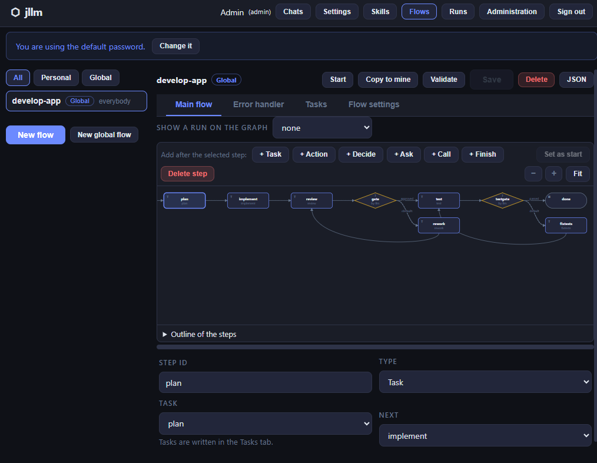

# jllm-workflows: deterministic flows

Flows let you describe a business process as a map of steps written in a JSON file. The application, not the model,
decides what happens next. The model does fuzzy work (understanding or writing text) inside bounded steps; the flow
decides order, branching, waiting and termination.

"Deterministic" means deterministic orchestration: the same flow, with the same inputs and the same decisions, walks the
same path. The model's answers are not deterministic.



This page is the practical guide.
Class names below are real; re-check against `plugins/jllm-workflows` when changing behavior.

## 1. Modules and installation

| Module | Content |
|---|---|
| (in `jllm-commons`) | `org.kendar.llm.harness.workflows.WorkflowApi`, the interface shared by the engine, the web half and the web application |
| `jllm-workflows` | the engine, the flow store, the chat slash commands and the command line (`WorkflowCli`) |
| `jllm-workflow-web` | the web endpoints (API only); the screens live in `jllm-web` |

`jllm-workflows` is an ordinary plugin: put the jar in the plugin directory and enable it by id in the settings file.
Without it there are no flows, no flow commands and no flow screens.

```json
"plugins": {
  "jllm-workflows":    { "enabled": true, "settings": { "dir": "~/.jllm-workflows", "adminRole": "admin" } },
  "jllm-workflow-web": { "enabled": true }
}
```

| Setting | Default | Meaning |
|---|---|---|
| `dir` | `~/.jllm-workflows` | where flows and runs are kept when the host offers no plugin storage |
| `adminRole` | `admin` | the role that may manage global flows |
| `chatUser` | `local` | the user that chat slash commands act as (chat has no sign-in) |
| `chatRoles` | none | the roles of that user |

In the web application the engine uses the host's plugin storage instead of `dir`, so it follows whichever storage the
web application is configured with. `jllm-workflow-web` needs `jllm-workflows`; if that one is missing or disabled it is
skipped with a warning.

Flows are never exposed to the model as tools. A flow starts only when someone asks for it: a slash command, the command
line, the web UI or program code.

## 2. A first flow

Flows are JSON. A flow with one model task:

```json
{
  "name": "summarize",
  "start": "sum",
  "tasks": {
    "summarize": {
      "agent": "general",
      "prompt": "Summarize in two sentences:\n{{input.text}}",
      "answer": "text"
    }
  },
  "steps": {
    "sum": { "type": "task", "task": "summarize", "next": "end" },
    "end": { "type": "finish", "result": { "summary": "{{steps.sum}}" } }
  }
}
```

Start it from the chat:

```
/flow-start summarize {"text": "Long text here"}
run 3f9c...: COMPLETED
result: {"summary":"..."}
```

### Top-level fields

| Field | Meaning |
|---|---|
| `name` | required; the name used to start the flow |
| `scope` | `personal` (default) or `global` |
| `roles` | global flows only: the roles the flow is shared with (list of names); missing or empty means everybody. Administrators always see every global flow |
| `start` | id of the first step |
| `steps` | map of step id to step |
| `tasks` | map of task name to task (see 4) |
| `limits` | `retries`, `questions`, `depth` (see 11) |
| `unattended` | `true` when nobody can answer questions (see 10) |
| `accepts` | customer request kinds accepted at every stage (see 8) |
| `helper` | name of a registered action that answers refused requests (see 8) |
| `onError` | the error handler (see 9); a default one is added when missing |

Every flow is checked when saved: unknown step ids, unregistered actions, tasks without prompt or agent, bad limits,
loops between flows and similar problems are refused then, not found during a run.

## 3. Slots

Text values in the flow can contain `{{path}}` slots. The engine fills them from the context; a missing value is an
error, never an empty string.

| Path | Value |
|---|---|
| `input.x` | the flow input (dotted paths go into objects) |
| `steps.id` / `steps.id.field` | the result of an earlier step |
| `requests.key` | data set by accepted customer updates |
| `error.kind`, `error.message` | only inside the error handler |
| `user`, `runId` | the identity of the user and of the run |

`input.chat` holds the conversation when the flow was started with `/flow-start --chat` (a list of
`{role, text}`). It is optional input and is never mixed into the flow history.

## 4. Steps

Every step has a `type`.

| Type | What it does | Main fields |
|---|---|---|
| `task` | runs a task with an agent | `task`, `next` |
| `action` | runs a Java action, no model | `action`, `next` |
| `decide` | turning point: picks one declared outcome | `by`, `outcomes`, `default`, `question` |
| `ask` | pauses and asks a person | `kind`, `text`, `options`, `next`, `onTimeout` |
| `call` | starts another flow, explicitly | `flow`, `scope`, `input`, `next` |
| `finish` | ends the flow | `result` |

Any step can also set `retries`, `retryWaitMs`, `questions` and `waitMs`.

`with` is an optional object of parameters for the Java action or chooser of the step. Its text values are slots, rendered
before the call (`"cwd": "{{input.projectDir}}"`); the action reads them as `call.params()`. One registered action
can so serve many differently configured steps. `with` must be an object; the built-ins below check their parameters
when the flow is saved.

### Tasks

A task is a prompt with slots and an enforced answer shape. Tasks live in the `tasks` map of the flow file.

```json
"tasks": {
  "classify": {
    "agent": "general",
    "system": "You are a support triage assistant.",
    "prompt": "Order {{input.order}}: {{input.message}}",
    "answer": { "category": "string", "confidence": "number", "note?": "string" }
  }
}
```

- `agent` is an existing agent definition of the harness.
- `answer` is `"text"` (the default) or an object of field types: `string`, `number`, `boolean`, `array`, `object`. A
  field ending in `?` is optional. The model must return a JSON object (code fences are stripped). A wrong shape raises
  a SHAPE error, which is retried (see 11) before it reaches the error handler.
- A task step can have Java actions attached to the task: `before` (prepare the slots), `after` (check, correct or
  reject the answer; returning a value replaces the answer) and `instead` (no model at all, pure logic).
- If the agent lists tools, the task runs in the real agent loop once, with that agent's tools and permissions. A tool
  call that needs approval stops the task and the engine asks the run's owner (single select: allow or refuse, one
  question per tool, counted in the step's question limit). On allow the task runs again with that tool allowed for the
  run; on refuse the step fails with a PERMISSION error. In an `unattended` flow nothing is asked and the step fails.
- Tasks of one run share one chat, owned by the starting user and titled `flow: NAME RUNID`.

### Tools and questions of a task

- `tools`: `"*"` gives the task every tool its running user's role allows, a list names tools (still limited by the role),
  `[]` is a plain completion. Absent: the agent's own tools. The role and the user's disabled tools can only narrow it.
- `clarify` (default true): the reply is checked for a question. A cheap pre-filter looks at the end of the reply; only
  then the host's fast model (the main model when none is configured) sees the last reply, nothing else, and answers
  `none`, `proceed` or `ask`. `proceed` runs the task again telling it to decide itself; `ask` pauses the run with a
  free-text question for the owner and continues with the answer. At most 3 rounds. In an `unattended` flow `ask` is
  treated as `proceed`. Replies and verdicts are journaled while the run waits, so a resume never calls the model again.

### Turning points (`decide`)

A turning point names the question, who decides and the allowed outcomes. The model can pick among declared outcomes;
it can never invent a path.

```json
"route": {
  "type": "decide",
  "question": "What does the customer want?",
  "by": "llm",
  "agent": "general",
  "prompt": "Customer message: {{input.message}}",
  "outcomes": { "refund": "rules", "exchange": "exch", "other": "help" },
  "default": "help"
}
```

| `by` | Who decides | Extra fields |
|---|---|---|
| `java` | a registered Java chooser reads the context and returns an outcome | `chooser` |
| `llm` | the model picks one word from the closed list | `agent`, `prompt` |
| `user` | the flow pauses and a person picks from the list | `who` (`owner`, `operator`, `customer`; a label) |

`outcomes` maps each outcome to the step that follows. An invalid answer (not in the list) goes to `default` when
declared, otherwise it is an error. Every decision is recorded with its inputs, its outcome and who decided; on resume a
recorded decision is reused and the model is not asked again.

All three choosers are the same kind of step, so an author can swap one for another without touching the rest of the
flow.

For a pass/fail turning point prefer `by: java` with the built-in `gate` chooser (see 5) over `by: llm`: it reads one
typed field of an earlier result (a task's structured answer, an exit code) and never reads prose.

### Asking people (`ask`)

```json
"addr": {
  "type": "ask",
  "kind": "single",
  "who": "customer",
  "text": "How should we pay you back for order {{input.order}}?",
  "options": { "money": "Money back", "credit": "Store credit" },
  "facts": { "amount": "{{input.amount}}" },
  "waitMs": 86400000,
  "onTimeout": "reminder",
  "next": "pay"
}
```

| Field | Meaning |
|---|---|
| `kind` | `text`, `single` or `multi` |
| `options` | value to label; the value is what the flow uses, the label is shown |
| `min`, `max` | picks for `multi` |
| `required` | default `true` |
| `pattern` | regular expression checked on a `text` answer |
| `who` | `owner` (default), `operator` or `customer`; a label shown with the question, not enforced |
| `facts` | extra data shown with the question (the classification, the rule that triggered a review) |
| `waitMs`, `onTimeout` | maximum wait; the step it falls to; without it a timeout is an error |

The answer is stored as the step result (`{{steps.addr}}`). An answer that does not fit (value not in the list, too many
picks, failed pattern) is refused and the question stays open.

### Calling another flow (`call`)

```json
"ref": {
  "type": "call",
  "flow": "refund",
  "scope": "global",
  "input": { "order": "{{input.order}}", "amount": "25" },
  "next": "store"
}
```

Rules: the parent declares the child by name and scope and passes the input explicitly; the child sees only that input.
The child is a run of its own (with its own snapshot and history) as the same user. It returns only the result its
`finish` step declares (`{{steps.ref.field}}`). While a child waits for a person the parent waits too, and cancelling
the parent cancels the children. A child error reaches the parent step like a thrown exception.

A decision outcome can lead directly to a `call` step. A Java chooser may also choose the flow to call:

```json
"pick": {
  "type": "call",
  "chooser": "followUpFlow",
  "allowed": ["refund", "shipping"],
  "scope": "global",
  "next": "end"
}
```

The returned name must be in `allowed`. This is for Java choosers only, never for the model. Depth, loops and the
user's rights are checked when the child starts.

A flow cannot call itself, directly or through a chain; a global flow can call only global flows; a personal flow can
call global flows and the user's own.

### Finishing

`finish` ends the flow. `result` is a map of slots returned to the caller (or to a parent flow). In a main flow `finish`
has no `outcome`; in an error handler it must have one (see 9).

## 5. Java actions and choosers

Flows refer to actions only by registered name. There is no reflection on arbitrary code, and users never create
actions: deployers do.

An action is a `Registry.FlowAction`, a chooser a `Registry.Chooser`. They are contributed by an `ActionProvider`
listed in `META-INF/services/org.kendar.llm.workflows.ActionProvider` (a jar in the plugin directory or on the
classpath). The same providers serve chat and command line.

```java
public class RefundActions implements ActionProvider {
    @Override
    public void register(Registry registry) {
        registry
            .action("loadOrder", call -> {
                String order = call.context().input().path("order").asText();
                return Json.parse("{\"amount\": 120, \"days\": 12}");   // becomes steps.<stepId>
            })
            .chooser("refundRule", call -> {
                JsonNode o = call.context().result("load");
                if (o.path("days").asInt() > 30) return "reject";
                return o.path("amount").asInt() <= 50 ? "auto" : "review";
            })
            .action("issueRefund", call -> {
                // safe against crash and resume: the same key after a restart
                payments.refundOnce(call.idempotencyKey(), call.context().result("load"));
                return Json.parse("{\"ok\": true}");
            })
            .restrict("issueRefund", "operator");   // optional: only these roles may use it
    }
}
```

- An action sees the whole context (`call.context()`: input, results, decisions, requests, user, run id) and the run and
  step identity (`call.runId()`, `call.stepId()`, `call.idempotencyKey()`). It influences the flow only through the
  value it returns; throwing an exception raises a flow error.
- An `after` action gets the model's answer as `call.taskResult()`.
- `call.params()` is the step's `with` object, with its slots rendered (an empty object when the step has none).
- A chooser must return one of the declared outcomes.
- The same permission and approval rules as for tools apply to actions with side effects; there is no second system.
- `restrict(action, roles...)` limits an action to roles. This is checked when a flow is saved, including a global flow
  against every role it is shared with.

### Built-in: `gate` and `run-command`

The plugin registers one chooser and one action of its own (`BuiltinActions`), seen by chat, web and command line alike.
Both are configured by the step's `with`.

**`gate` chooser.** Maps one typed value to an outcome, deterministically (core class
`org.kendar.llm.harness.gate.GateResultsHandler`).

```json
"gate": {
  "type": "decide", "by": "java", "chooser": "gate",
  "with": {
    "from": "steps.review", "field": "approved", "type": "boolean",
    "map": { "true": "approved", "false": "changes" }, "fallback": "changes"
  },
  "outcomes": { "approved": "test", "changes": "rework" }, "default": "rework"
}
```

| `with` field | Meaning |
|---|---|
| `from` | where the value is: `input...` or `steps.<step>...` |
| `field` | the field to read inside it, dotted for nested objects; absent: the whole value |
| `type` | `boolean`, `string`, `number` or `exitCode` (a whole number) |
| `map` | value to outcome; `"*"` matches any other value of the right type |
| `fallback` | the outcome for a value that is missing, has the wrong type or is not in the map |
| `allowed` | optional list of permitted outcomes; absent: the map's outcomes plus the fallback |

Text is never interpreted: `"approved": "yes"` is a string, not a boolean, and gives the fallback. Each decision is
journaled with the value read, whether the fallback was used and the reason, for example
`field 'approved' = false -> changes`. When the flow is saved the gate is built from its `with`: a bad type or map, a
`from` that is neither the input nor a step, or an outcome of the gate that the step does not declare is refused then.

An exit-code gate:

```json
"with": { "from": "steps.runtests", "field": "exitCode", "type": "exitCode",
          "map": { "0": "passed", "*": "failed" }, "fallback": "failed" }
```

**`run-command` action.** Runs a command through the platform shell (cmd on Windows, zsh on macOS, bash elsewhere; `shell`
overrides) and returns `{command, exitCode, timedOut, durationMs, tail}` as the step result.

```json
"runtests": {
  "type": "action", "action": "run-command",
  "with": { "command": "{{input.testCommand}}", "cwd": "{{input.projectDir}}", "timeoutSeconds": 1800, "tailLines": 80 },
  "next": "testgate"
}
```

| `with` field | Meaning |
|---|---|
| `command` | required; the command line |
| `cwd` | working directory (default: the directory of the process) |
| `timeoutSeconds` | positive number, default 600; past it the command and its children are killed, `timedOut` is true and `exitCode` -1 |
| `tailLines` | how many last lines of output (stdout and stderr together) to keep, default 50 |

The command runs as the user of the jllm process, with no sandbox: only use it in flows whose authors you trust.

The sample flow `runConfig/flows/develop-app.json` uses both: the review task answers `{approved, issues}` and a gate
reads `approved`; after the test task, `runtests` runs `input.testCommand` in `input.projectDir`, a gate reads
`exitCode`, and `fixtests` gets the real output tail. The flow reaches `done` only after a real exit code 0.

A chooser of your own can explain its choice the same way: implement `Registry.ExplainingChooser` and return a
`Registry.Choice(outcome, detail)`; the detail is journaled with the decision.

### Actions that ask questions

An action or chooser can ask people itself:

```java
registry.action("checkLimit", call -> {
    String reason = call.askText("reason", "Why is an exception needed?");
    String level = call.askSingle("level", "Approval level?",
            List.of(new Question.Option("l1", "Team lead"), new Question.Option("l2", "Director")));
    ...
}).asking("checkLimit");        // declares that it may ask (choosers: askingChooser)
```

A Java call cannot be frozen for days. When the answer arrives the engine runs the action again from the start and every
question already answered returns its recorded answer immediately, by key. So an asking action must lead to the same
questions for the same context, and anything with a side effect belongs after the last question or behind
`idempotencyKey()`.

## 6. Running flows

### Chat

| Command | Effect |
|---|---|
| `/flows` | list the flows you can start (`scope/name`) |
| `/flow-start [--chat] NAME [JSON]` | start a flow; `scope/name` states the scope; `--chat` copies the conversation in as `input.chat` |
| `/flow-resume RUN ANSWER` | answer the waiting question (a JSON list for several picks) |
| `/flow-request RUN KIND [JSON]` | send a customer request to a run |
| `/flow-cancel RUN` | cancel a run |

```
/flow-start refund {"order": "A-1001", "message": "I want my money back"}
run 7c1e...: WAITING
Approve the refund of 120? [single, asks operator]
  approve - Approve in full
  reject - Reject
/flow-resume 7c1e... approve
```

### Command line

```
java -cp ... org.kendar.llm.workflows.WorkflowCli [--dir D] [--user U] [--role R]... [--ask] [--scope S] COMMAND
```

| Command | Effect |
|---|---|
| `list` | flows of both scopes, labelled |
| `inputs NAME` | the input names the flow expects |
| `start NAME [JSON]` | start a run, no chat needed |
| `resume RUN ANSWER` | answer the waiting question |
| `request RUN KIND [JSON]` | send a customer request |
| `history RUN` | the recorded steps, decisions and requests |
| `cancel RUN` | cancel |

Without `--ask`, a wait point prints `paused RUN waiting for: ...` and the process ends; the run waits (days, if
needed) and is resumed from another process. With `--ask`, the question is prompted on the spot: a text prompt, a
numbered list for single select, a numbered list with several picks (comma separated) for multi select.

Creating and editing global flows is done in the web UI; it is not built on the command line.

### Web

`jllm-workflow-web` mounts these endpoints under its plugin path (authentication is done by the host). The
[jllm-web](../../jllm-web/README.md) **Flows** page edits flows as a graph on top of them (screenshot at the top of this page).

| Endpoint | Purpose |
|---|---|
| `GET /flows`, `GET /flows/{scope}/{name}`, `GET .../inputs` | list, show, inputs |
| `PUT /flows/{scope}`, `DELETE /flows/{scope}/{name}` | save and delete (global needs the admin role) |
| `POST /flows/{name}/copy` | copy a global flow into the user's space |
| `POST /runs`, `GET /runs`, `GET /runs/{id}`, `GET /runs/{id}/history` | start, list, inspect |
| `POST /runs/{id}/answer`, `POST /runs/{id}/requests`, `POST /runs/{id}/cancel` | answer, request, cancel |
| `GET /waiting`, `GET /waiting/count` | open questions of the user, and their number |
| `GET /catalog` | registered actions (`asks`, role limits) and choosers, `canManageGlobal`; feeds the editor pickers |
| `POST /flows/validate` | `{scope, flow}`: the save-time problems as `{errors:[...]}`, nothing is stored |

`GET /flows` returns `{scope, name, roles, canEdit, sharedWithYou}` per flow. `sharedWithYou` is false for a global flow an
administrator sees only because administrators see everything.

The screens in `jllm-web` are a Flows screen (personal and global flows; a designer with the flow structure as a graph on
top and the data of the selected step below, tabs for the error handler, tasks and flow settings, a JSON escape hatch,
validation before every save, start, copy, delete) and a Runs screen (runs with history, cancel and the open question by
kind), a badge with the number of waiting questions and a strip in the chat view. They appear only when the plugin
answers and follow its live events. Skills have their own Skills screen, for every user.

## 7. Ownership: personal and global flows

- **Personal** flows are stored per user and seen only by their owner.
- **Global** flows are defined once and run by everyone they are shared with. Only the admin role creates, edits or
  deletes them. An admin can restrict a global flow to certain roles. Users can run one, inspect it and copy it into
  their space; the copy is independent.
- The two scopes are separate namespaces. When a name exists in both, state the scope (`global/refund`).
- A global flow runs as the user who starts it, not as its author. The Java actions it references must be allowed for
  every user it is shared with; this is checked at save time.
- A run belongs to its starter: only that user sees its history and answers its questions.

Files (when no host storage is used): `dir/global/<name>.json` and `dir/users/<user>/<name>.json`.

### Your own persistence (for example SQL)

Flow definitions and runs are kept behind two interfaces, so any storage can hold them. Which one is used is decided in
`WorkflowsPlugin.install`, in this order:

1. the host publishes a `PluginStorages` service: flows and runs go through it (`PluginStores.Flows`, `PluginStores.Runs`);
2. otherwise files under `dir` (`FlowStore.Files`, `RunStore.Files`).

There are two ways to plug in a database.

**A. Implement the host's plugin storage (recommended; it also serves every other plugin).** Implement
`org.kendar.llm.harness.plugin.PluginStorage` and `PluginStorages` and publish them. In the web application, define a
`PluginStorages` bean; `HarnessConfiguration` then uses it instead of `FilePluginStorage` (which keeps documents in
`<project>/.jllm/plugin-data`).

```java
public interface PluginStorage {
    Optional<JsonNode> get(String owner, String collection, String id);
    void put(String owner, String collection, String id, JsonNode doc);   // insert or replace
    void delete(String owner, String collection, String id);
    List<String> ids(String owner, String collection);                    // sorted
    List<String> owners(String collection);                               // users, and "_global" if present
}
```

One table is enough:

```sql
CREATE TABLE plugin_doc (
  plugin_id  VARCHAR(100) NOT NULL,
  owner      VARCHAR(200) NOT NULL,   -- user name, or '_global' (PluginStorage.GLOBAL)
  collection VARCHAR(100) NOT NULL,
  id         VARCHAR(200) NOT NULL,
  doc        TEXT NOT NULL,           -- the JSON document
  PRIMARY KEY (plugin_id, owner, collection, id)
);
```

`forPlugin(id)` returns an object that fixes `plugin_id`. `put` is an upsert, `ids` is `ORDER BY id`, `owners` is
`SELECT DISTINCT owner`. The flows plugin uses the collections `flows` (owner = the user, or `_global` for global flows),
`runs` (owner = the starting user) and `runindex` (owner `_global`, id = run id, document `{"user": ...}`, used to find a
run by its id).

**B. Implement `FlowStore` and `RunStore` directly** (a different schema, such as one row per step or indexed columns).
Construct them in your own plugin or host and pass them to `WorkflowApiImpl.create(registry, runs, flows, adminRole)`;
`WorkflowsPlugin.install` shows the wiring.

```java
public interface FlowStore {
    List<FlowDef> listGlobal();
    List<FlowDef> listPersonal(String user);
    Optional<FlowDef> get(String scope, String user, String name);   // scope: "global" or "personal"; user is null for global
    void save(String scope, String user, FlowDef flow);              // insert or replace; flow.doc() is the JSON, flow.name() the key
    void delete(String scope, String user, String name);
}

public interface RunStore {
    void save(RunRecord run);                 // insert or replace; run.toJson() / RunRecord.fromJson(...)
    Optional<RunRecord> load(String runId);
    List<RunRecord> list(String user);
    List<RunRecord> listAll();                // all users; system use only (expiring waits)
}
```

Rules every implementation must follow:

- Store the flow as the JSON of `flow.doc()` and read it back with `FlowDef.parse(json)`; do not interpret the content.
- `save` replaces; there are no versions. Runs keep their own snapshot of the flow (see Snapshots), so editing a flow row
  never changes a run in progress.
- A run is saved after every step and read again on resume or after a restart, so `RunStore.save` must be durable when
  it returns. Use a transaction per save.
- Global flows (`user == null`) and personal flows are separate namespaces; the same name may exist in both.
- Reads for one user must never return another user's personal flows or runs.
- Names are used as keys: accept the same characters the file store does (`[A-Za-z0-9._@-]+`) or map them safely.
Test the store by swapping it for the file stores in `OwnershipTest` (see its `Workflows` construction), and check
that a run started before a restart resumes.

### Snapshots

There is no versioning. A run takes a private snapshot of the flow when it starts and uses only that snapshot to the end,
across pauses and restarts. Editing or deleting a flow affects only runs started afterwards.

## 8. Customer requests

A customer (or any outside actor) can send a message to a running flow, not only at its start. The flow declares which
kinds it accepts, at flow level (`accepts`) or per step (`accepts` inside the step, which wins):

```json
"accepts": {
  "cancel":  { "action": "cancel" },
  "address": { "action": "update", "key": "address", "kind": "text", "required": true },
  "restart": { "action": "redirect", "to": "load" }
}
```

| `action` | Effect |
|---|---|
| `cancel` | cancels the run (and its children) as its own end state |
| `update` | validates the payload by `kind` / `options` / `pattern`, stores it as `{{requests.key}}`, the flow stays where it is |
| `redirect` | jumps to step `to`, cancelling running children |

A request not accepted at the current stage is refused, or answered by a `helper` (a registered action that can only
answer questions and cannot move the flow). Every request is recorded in the history. A request is delivered to the
innermost waiting run that accepts it; a parent can declare `cancel` at its own level. A request accepted by a child is
stored on the child; the parent sees it only through the child's declared result.

```
/flow-request 7c1e... address "12 Main St"
/flow-request 7c1e... cancel
```

## 9. Error handling

Every flow ends with an error handler. If none is declared, a default one records the error and fails the run.

An error is: an action or chooser throwing, a model answer that does not fit its shape after the retries, a chooser
returning an undeclared outcome, a step that waits too long with no timeout path, a refused permission or approval, a
limit being hit, or a child flow ending in error. Cancelling is not an error.

The order: the step retries first (see 11); then the error goes to the handler, which is a small flow of its own and can
use the same step types. It ends with one of three outcomes:

| Outcome | Effect |
|---|---|
| `recovered` | the flow ends normally with the declared result |
| `retry` | goes back to the step named by `retryStep`, up to `retryLimit` times (default 3) |
| `rethrow` | the flow ends in error and the error moves up to a parent |

```json
"onError": {
  "start": "notify",
  "retryLimit": 2,
  "steps": {
    "notify": { "type": "action", "action": "alertOps", "next": "done" },
    "done":   { "type": "finish", "outcome": "recovered", "result": { "why": "{{error.kind}}" } }
  }
}
```

The handler sees `error.kind`, `error.message` and the usual context; it cannot change earlier results. It may use a
chooser to pick among the three outcomes. A failure inside the handler is not handled again: the run ends in error with
both errors. A child handles its own errors first; if it rethrows, the parent step fails with the child's error as cause
and the parent's handler runs.

## 10. Unattended flows

`"unattended": true` marks a flow nobody can answer. It is refused at save time if it uses an `ask` step, a `user`
chooser or an action or chooser declared as asking. A tool approval in an unattended flow is not asked: the step fails
with a PERMISSION error.

## 11. Limits

| Limit | Default | Applies to |
|---|---|---|
| `depth` | 4 | the whole chain of parent and child runs |
| `questions` | 5 | one step, counting every question asked by the step and by the Java action inside it |
| `retries` | 3 | one step, for temporary errors (action, shape, and child errors when the step sets `retries`) |

```json
"limits": { "depth": 3, "questions": 2, "retries": 1 }
```

A step may set its own `questions` and `retries`; a step's value wins over the flow's, the flow's over the default. The
depth of the flow that was started governs the whole chain; a child may lower it but not raise it. `retryWaitMs` waits
between retries. Values must be whole numbers of at least zero (zero retries: no retry; zero questions: the step may not
ask). There is no built-in maximum waiting time; set `waitMs` per step where wanted.

## 12. Runs, history and resume

A run stores its snapshot, input, status, position, and for every step the input, output, times and any error. Statuses:
`pending`, `running`, `waiting`, `completed`, `failed`, `cancelled`. A waiting run survives restarts and resumes without
repeating finished steps. Saving a result does not guarantee a side effect happened exactly once; use
`idempotencyKey()` in actions with side effects.

The history shows every step, decision (with who decided: model, Java rule or person), retry, request, answer, timeout
and the limit that was hit.

Who may answer is not enforced yet: the run's owner answers all questions, whatever the `who` label says (operator,
customer). The label tells a screen who the question is meant for.

## 13. Example: refund request

All three choosers in one flow. The Java actions `loadOrder`, `refundRule` (a chooser) and `issueRefund` are the ones
from section 5; `checkAmount` is an `after` action that throws (so the step is retried) when the reply does not state the
right amount.

```json
{
  "name": "refund",
  "scope": "global",
  "start": "load",
  "limits": { "retries": 2 },
  "accepts": { "cancel": { "action": "cancel" } },
  "tasks": {
    "explain": {
      "agent": "general",
      "prompt": "Write a polite refusal for order {{input.order}}. Facts: {{steps.load}}",
      "answer": "text"
    },
    "confirm": {
      "agent": "general",
      "prompt": "Confirm to the customer: {{steps.how}} of the amount {{steps.load.amount}}.",
      "answer": "text",
      "after": "checkAmount"
    }
  },
  "steps": {
    "load": { "type": "action", "action": "loadOrder", "next": "intent" },

    "intent": {
      "type": "decide", "by": "llm", "agent": "general",
      "question": "What does the customer want?",
      "prompt": "Customer message: {{input.message}}",
      "outcomes": { "refund": "rule", "exchange": "other", "complaint": "other", "other": "other" },
      "default": "other"
    },
    "other": { "type": "finish", "result": { "outcome": "not a refund" } },

    "rule": {
      "type": "decide", "by": "java", "chooser": "refundRule",
      "question": "Can we decide automatically?",
      "outcomes": { "auto": "how", "review": "review", "reject": "no" }
    },

    "no": { "type": "task", "task": "explain", "next": "denied" },
    "denied": { "type": "finish", "result": { "outcome": "rejected", "message": "{{steps.no}}" } },

    "review": {
      "type": "decide", "by": "user", "who": "operator",
      "question": "Review the refund of {{steps.load.amount}}",
      "outcomes": { "approve": "how", "reject": "no" }
    },

    "how": {
      "type": "ask", "kind": "single", "who": "customer",
      "text": "How should we pay you back?",
      "options": { "money": "Money back", "credit": "Store credit" },
      "waitMs": 604800000, "onTimeout": "no",
      "next": "pay"
    },

    "pay": { "type": "action", "action": "issueRefund", "retries": 0, "next": "reply" },
    "reply": { "type": "task", "task": "confirm", "next": "end" },
    "end": { "type": "finish", "result": { "outcome": "refunded", "message": "{{steps.reply}}" } }
  }
}
```

What it shows: the model is used where understanding text (`intent`) and wording (`confirm`) matter, never for the money
decision; Java decides where there are firm rules (`rule`) and performs the side effect (`pay`, protected by the run and
step identity); people decide where judgment or consent is needed (`review`, `how`).

## 14. Example: nested flows (complaint)

A parent flow reuses the refund flow as a child and a shipping flow as another.

```json
{
  "name": "complaint",
  "scope": "global",
  "start": "load",
  "limits": { "depth": 3 },
  "tasks": {
    "final": { "agent": "general", "prompt": "Write the final message to the customer. Outcome: {{steps.store}}" },
    "sorry": { "agent": "general", "prompt": "Write an apology for order {{input.order}}." }
  },
  "steps": {
    "load": { "type": "action", "action": "loadOrder", "next": "why" },
    "why": {
      "type": "decide", "by": "llm", "agent": "general",
      "question": "What is this about?",
      "prompt": "Complaint: {{input.message}}",
      "outcomes": { "damaged": "comp", "late": "comp", "wrong": "comp", "other": "comp" },
      "default": "comp"
    },
    "comp": {
      "type": "decide", "by": "java", "chooser": "compensation",
      "question": "Is compensation due?",
      "outcomes": { "refund": "ref", "replacement": "ship", "apology": "sorry" }
    },
    "ref":  { "type": "call", "flow": "refund",   "scope": "global",
              "input": { "order": "{{input.order}}", "message": "{{input.message}}" }, "next": "store" },
    "ship": { "type": "call", "flow": "shipping", "scope": "global",
              "input": { "order": "{{input.order}}" }, "next": "store" },
    "sorry": { "type": "task", "task": "sorry", "next": "end" },
    "store": { "type": "action", "action": "saveOutcome", "next": "msg" },
    "msg":   { "type": "task", "task": "final", "next": "end" },
    "end":   { "type": "finish", "result": { "done": "yes" } }
  },
  "onError": {
    "start": "h",
    "steps": { "h": { "type": "finish", "outcome": "recovered", "result": { "why": "{{error.kind}}" } } }
  }
}
```

The child runs as its own run, linked to the parent step `ref`. If the operator is asked inside the child, the parent
shows that question too; answering it through the parent or the child works. If the child ends in error, step `ref`
fails with kind `CHILD` and the parent's `onError` runs.

## 15. Example: asking from Java and a request mid-run

```json
{
  "name": "onboarding",
  "start": "collect",
  "accepts": { "cancel": { "action": "cancel" } },
  "steps": {
    "collect": {
      "type": "ask", "kind": "multi", "min": 1, "max": 2,
      "text": "Which services do you want?",
      "options": { "mail": "Mail", "vpn": "VPN", "git": "Git" },
      "accepts": { "email": { "action": "update", "key": "email", "kind": "text", "pattern": ".+@.+" } },
      "next": "create"
    },
    "create": { "type": "action", "action": "createAccounts", "next": "end" },
    "end":    { "type": "finish", "result": { "services": "{{steps.collect}}", "email": "{{requests.email}}" } }
  }
}
```

While the run waits at `collect`, `/flow-request RUN email "a@b.org"` stores the address, and
`/flow-request RUN cancel` ends the run as cancelled.

## 16. What flows are not

- Not a programming language: complex logic belongs in Java actions.
- The model never changes the map: it supplies data and picks among declared choices.
- Flow files never reference arbitrary code.
- Flow state is kept apart from conversation state.
- Not a second permission system and not a general business-process platform.

Plugin jars run with full application rights, which is why Java actions and choosers are the right place for firm rules,
and why only trusted people may write to the plugin directory.
