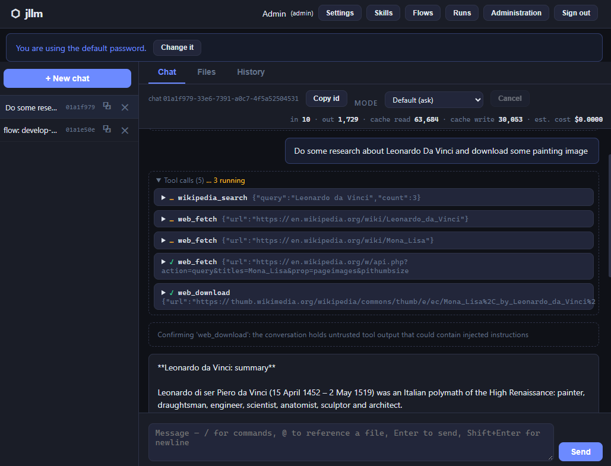
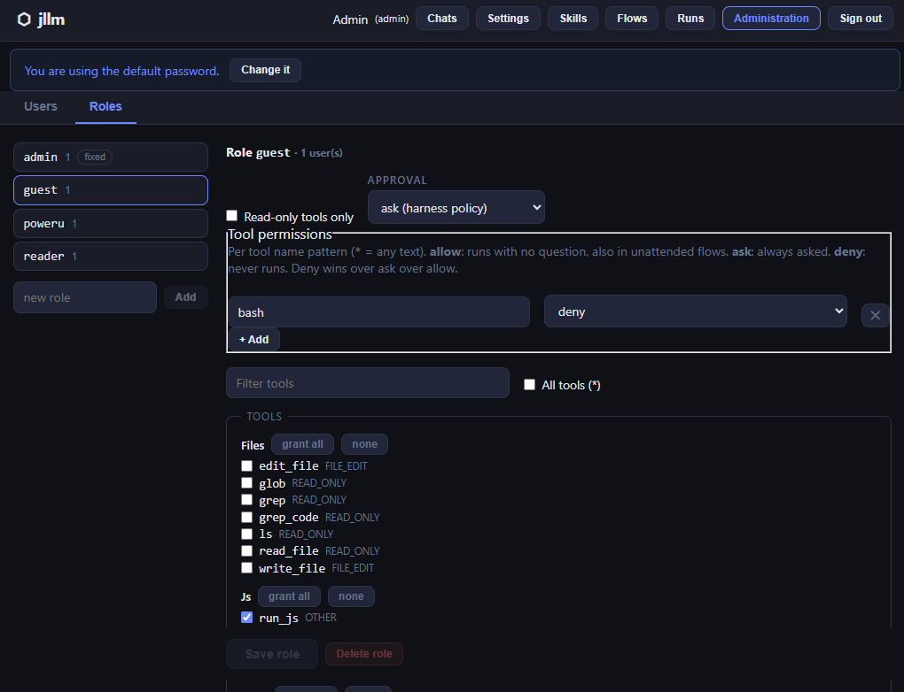

# jllm-web

Browser front end for [jllm-harness](../core/jllm-harness/README.md): a Spring Boot application with a REST + SSE API and a
Vue 3 chat UI. The Spring layer is a thin adapter; all agent logic lives in the framework-free harness.



## Build and run

```sh
mvn -pl jllm-web -am package
java -jar jllm-web/target/jllm-web-1.4.0-jllm.jar --provider anthropic --jllm.webauth-dir=runConfigs/unsafe/webauth
```

Then open <http://localhost:8080>. The UI is plain static files in `src/main/resources/static`: Vue 3 as an ES module
with its in-browser template compiler (vendored in `vendor/`), no Node, npm, Vite or any build step. Edit a file,
reload the page (with the server running from `target/classes`, or restart it).

## Configuration

Standard Spring Boot properties, prefix `jllm.` (`application.properties`, environment). On the command line use the same
flags as the CLI, without the prefix: `--provider openai`, `--docker-image IMAGE`, `--docker-scope user`, `--small-model`
(`--flag value` or `--flag=value`). Spring's own flags (`--server.port=9000`) are unchanged.

The file tools never follow a symlink or junction that leaves a chat's work dir: the web application forces `files.externalLinks` to `none` and logs one WARN at startup when the settings ask for another value ([tools guide](../docs/guides/tools.md#links-that-leave-the-work-dir-filesexternallinks)).

| Property | Default | Meaning |
|---|---|---|
| `jllm.provider` | `anthropic` | `anthropic`, `openai`, `openaiGpt62`, `gemini`, `grok`, `qwen`, `llamacpp`, `ollama` |
| `jllm.api-key` | `<PROVIDER>_API_KEY` env var | API key |
| `jllm.model` | per provider | model name |
| `jllm.base-url` | per provider | endpoint override |
| `jllm.max-tokens` | 32000 | output limit of one response |
| `jllm.context-tokens` | harness default (100000) | context window; wins over the settings file |
| `jllm.max-turns` | harness default (40) | model calls per user turn |
| `jllm.chats-dir` | `chats` (current directory) | folder of the chat directories, where the users' commands run. Startup fails when the webauth folder, the SQLite file, the configuration folder, the plugin folder or the flows seed folder is inside it (canonical paths) |
| `jllm.config-dir` | `<webauth-dir>/config` | `jllm.store=file`: the folder of the JSON configuration files (see [Virtual configuration](#virtual-configuration)). With SQL the configuration is in the database |
| `jllm.context-strategy` | `compaction` | `compaction`, `mnemonic` or `scope`; wins over the settings file |
| `jllm.small-model` | `false` | append the small-model rules to the system prompt |
| `jllm.sandbox` | | ignored on the web: the sandbox kind is per role (see below). Still read by the CLI |
| `jllm.docker-image` | `python:3.12-slim` | image of the docker sandbox; wins over the settings file |
| `jllm.docker-scope` | `chat` | `chat` (one container per chat, removed with the chat) or `user` (one container per user, shared by the user's chats; the admin decides, see [SANDBOX](../docs/guides/sandbox.md)); wins over the settings file |
| `jllm.docker-profile` | `standard` | not used for web roles: the role's kind decides (`docker-isolated` is `hardened`, `docker-open` is `standard`) |
| `jllm.docker-remote` | `false` | flag `--docker-remote`: docker on another machine; each chat's workspace is uploaded to its container and backed up under `<X>/<chatId>/.jllm/` ([SANDBOX](../docs/guides/sandbox.md#remote-docker)) |
| `jllm.docker-remote-host` | from `DOCKER_HOST` | address where the remote host's published ports are reached |
| `jllm.system-prompt` | none | text appended to the built-in system prompt, after the stored system prompt and the global instructions (see [Virtual configuration](#virtual-configuration)). No `SYSTEM.md` or `APPEND_SYSTEM.md` file is read |
| `jllm.search-api-key` | `BRAVE_API_KEY` env var | Brave key for `web_search` |
| `jllm.pricing.input-per-million`, `output-per-million`, `cache-read-per-million`, `cache-write-per-million` | 0 | USD per million tokens, for the cost estimate |
| `jllm.web.public-url` | none | the externally visible base URL (`https://jllm.example.com`); OAuth logins redirect to `<public-url>/oauth/callback`. Required when a per-user OAuth source uses the authorization code flow |
| `jllm.web.allow-missing-bwrap` | `false` | On Linux, `shared-local` (backend or any role) needs a working `bwrap`; without it the server refuses to start. `true`: log an error and start anyway; roles of kind `shared-local` then get no sandbox and their tool calls error |
| `jllm.web.use-real-password` | `false` | `true`: at startup every user still on the default password gets a random 24-character one. The admin password is logged once at WARN; other users are only logged as generated, an admin resets them. Never regenerated afterwards. Users linked to an identity provider are skipped |
| `jllm.web.allow-unencrypted-tokens` | `false`; **not set in the shipped properties**, which are local-only (`server.address=127.0.0.1`) | Without `JLLM_TOKEN_KEY` the users' OAuth tokens are stored in clear (file and SQL stores): a loud WARN while the server is local-only, a refusal to start when `jllm.web.use-real-password=true` or `server.address` is not loopback. `true` accepts clear text anyway; do not ship it. Encrypted tokens are bound to user id and source (AES-GCM associated data) |
| `jllm.web.trusted-proxies` | none | reverse proxies whose `X-Forwarded-For` the sign-in throttle believes |
| `jllm.web.session-max-age-days` | `30` | absolute session lifetime |
| `jllm.web.enforce-password-change-on-loopback` | `false` | A user on the default password can only change it, sign in or out: every other `/api` call answers `403 password_change_required`. Requests from the loopback address are exempt unless this is `true`, a forwarding header (`X-Forwarded-For`, `Forwarded`, `X-Real-IP`) is present, or `server.address` is not a loopback address (unset, `0.0.0.0` and `::` count as non-loopback). A reverse proxy, tunnel or sidecar on the same host that sends no forwarding header makes remote requests look local: set this to `true` there |
| `jllm.web.content-security-policy` | built-in | `Content-Security-Policy` value for every response. Blank: `default-src 'self'; script-src 'self' 'unsafe-eval'; style-src 'self' 'unsafe-inline'; connect-src 'self'; object-src 'none'; base-uri 'self'; form-action 'self'; frame-ancestors 'none'` (`unsafe-eval`: Vue compiles its templates in the browser; `unsafe-inline` styles: `style=""` attributes). `off`: no CSP header. Any other text replaces the policy. `X-Content-Type-Options: nosniff` and `Referrer-Policy: no-referrer` are always sent, unless a handler already set them |
| `jllm.store`, `jllm.sql.url`, `.user`, `.password`, `.pool`, `.seed`, `.driver-dir` | `sql` with the SQL starter, else `file` | where users, roles, chats, tokens and settings live; see [SQL store](#sql-store). `jllm.webauth-dir` (default `webauth`) is the file store folder and the default place of the SQLite file |
| `jllm.plugin-dir` | `./plugins` when it exists | directory of plugin jars |
| `jllm.plugins.<id>.enabled`, `jllm.plugins.<id>.settings.*` | none | per-plugin switch and settings; win over the `plugins` section of the settings file |
| env `JLLM_UPLOAD_MAX_FILE_SIZE`, `JLLM_UPLOAD_MAX_REQUEST_SIZE` | 100MB, 200MB | multipart upload limits |

## Virtual configuration

The web application reads no configuration from a working or chat directory. Everything comes from a `ConfigProvider`
that is either the SQL one (`jllm.store=sql`, tables `settings_layer`, `instructions`, `agents`, `skills`, `plugin_docs`) or
the file one (`jllm.store=file`, JSON files under `jllm.config-dir`, `RemoteFileConfigProvider`). Without one of them the server does not start.

| What | Where | Edited by |
|---|---|---|
| settings (MCP servers, plugins, `web.*`, ...) | the settings document | administrators, `PUT /api/admin/config/settings` |
| system prompt (`replace`, `append`), global, role and user instructions | `instructions` | administrators, `/api/admin/config/instructions/{system\|global\|role\|user}/{name}?owner=` |
| sub-agents, inline prompt | `agents` | administrators, `/api/admin/config/agents/{name}` |
| skills | `skills` | administrators (global), users (own) |

A setting that names a file is refused when loaded and in the admin API: `promptFile` of an agent, the `path` of a skill,
`instructionFiles`. Stdio MCP servers are dropped on the web as before; the MCP servers come only from the settings.
There is no folder trust on the web: no project folder exists and the chat directories are never a source.

Instructions of a role or a user are added to the system prompt of their chats. The instruction files a chat directory may hold
(`AGENTS.md`, `CLAUDE.md`, `KENDAR.md`) are off by default; an administrator can enable them per role with the role setting
`scoped-instructions` set to `true` (`PUT /api/admin/roles/{role}/settings/scoped-instructions`), and then they reach the model
labelled as content of the user, not as administrator instructions.

`jllm-web --import-config <dir>` imports a file configuration once into the provider of the store in use and exits: `settings.json`
(agent prompt files and skill paths read and stored inline, `instructionFiles` stored as global instructions), `SYSTEM.md`,
`APPEND_SYSTEM.md`, and the instruction files `AGENTS.md`, `CLAUDE.md`, `KENDAR.md`. Existing entries of the same name are replaced.

Also set: `server.port=8080` and `spring.mvc.async.request-timeout=-1` (SSE streams must not time out).

The sandbox, history and scratch directories are the same as in the CLI, under each chat directory of `jllm.chats-dir`.
The sandbox is set **per role** by an administrator (Administration, Roles, Sandbox): `none` (the default: no file tools and no `bash`;
each attempt is a tool error the model sees, the server keeps running), `shared-local` (processes on the server in the chat
directory with a minimal environment: `PATH`, `LANG`, `HOME` = chat dir; confined with `bwrap` on Linux, no network unless the role sets
`network`; **not confined on Windows and macOS**, testing only; on Linux without a working `bwrap` the role gets no sandbox), `docker-isolated` (hardened container: no network unless granted, resource limits) or `docker-open`
(standard container with network). Plain `local` is rejected. Scope (chat or user) and, for isolated or shared-local, network are per role; a docker role may set
`localFallback` (default false, admin-only): when docker is unavailable the chat may continue in a shared-local sandbox, never as a host shell; image and the rest come from `jllm.docker-*`.
`jllm.sandbox` is ignored on the web (a warning is logged). A chat without a user, or a role that cannot be read, is `none`. Sign-in is a
simple reference implementation (below); bind the server to localhost or put it behind your own HTTPS proxy.

## Users, roles, skills and sign-in

This module is a reference implementation of the multi-user mechanism of
[jllm-web-commons](../web/jllm-web-commons/README.md); the common module and the
[starter](../web/jllm-web-spring-starter/README.md) stay generic and know none of what follows.

With `jllm.store=file` (or no SQL starter) everything lives under one folder (property `jllm.webauth-dir`, default `webauth`, relative to the start folder).
The sample is `runConfigs/unsafe/webauth/`, which the IDE run configurations in `.run/` pass explicitly; they start in
`runConfigs/unsafe/tmp/` (ignored by git). Files are read on each
use, so changes (by hand or from the UI) apply without a restart.

| Path | Content |
|---|---|
| `webauth/users/<id>.json` | `{name, role, email?, externalId?, password?, credentials, disabledTools?, disabledSkills?}` |
| `webauth/permissions/<role>.json` | `{tools, readOnly?, approval?, toolPermissions?, <settings>...}`: every other top-level key is a role setting (free JSON per feature, e.g. `sandbox`; unknown keys kept) |
| `webauth/global-skills/<name>.md` | skills written by the admin, offered to every user |
| `webauth/user-skills/<id>/<name>.md` | a user's own skills |

### Sign-in
- Login and password. A user file without `password` (the seeded demo users) has the **default password: the login
  itself**; the UI shows a banner until the user picks their own. Users made or reset in Administration never get it: an
  admin gives a password (8+ characters, not the login), or leaves it empty and a random one-time password is generated,
  shown once (`temporaryPassword`), and must be changed at the first sign-in (`403 password_change_required` until then).
- Stored passwords are `pbkdf2$<iterations>$<salt>$<hash>` (PBKDF2WithHmacSHA256, 210000 iterations, random salt;
  a stored count outside 1..10 000 000 matches nothing). Comparison is constant-time, the default-password path costs one
  PBKDF2 like the others. A one-time password is the same hash behind `temp$`.
- The cookie `jllm_session` (HttpOnly, SameSite=Strict, Secure on HTTPS) holds a random session token; sessions are
  in memory (7 days sliding, and at most `jllm.web.session-max-age-days`, default 30, from sign-in whatever the use), so a
  restart signs everybody out. A deleted user is signed out at once.
- **Throttle**: the check and the count are one atomic step. Three failed attempts lock a login for 30 minutes (429);
  an address is locked for 10 minutes after 100 attempts in that window. Unknown login and wrong password give the same
  answer. At most 10 000 keys are kept (oldest dropped); a restart clears every lock. An admin lifts a lock with
  `POST /api/admin/users/{id}/unlock` (Unlock button in Administration; `lockedFor` in the user list). Resetting a password
  unlocks too. A locked admin can be unlocked by another admin or by restarting the server.
- **Behind a reverse proxy** every caller has the proxy's address unless `jllm.web.trusted-proxies` lists the proxy
  (addresses or CIDRs, comma separated): then `X-Forwarded-For` is read from the right, skipping trusted proxies. Without it the header is ignored.
- **CSRF backstop** (besides SameSite=Strict): a POST/PUT/DELETE with `Sec-Fetch-Site` other than `same-origin`/`none`,
  or an `Origin` that is neither the request's `Host` nor the origin of `jllm.web.public-url`, answers 403. Requests without
  these headers (scripts, curl) pass.

### Sign-in with OpenID Connect

An alternative to the password, against one identity provider (Google, Entra, Keycloak, Okta, ...), with the
authorization code flow and PKCE. It ends in the same `jllm_session` cookie.

```properties
jllm.web.public-url=https://jllm.example.com          # required when the mode is oidc or both
jllm.auth.mode=both                                    # password (default) | oidc | both
jllm.auth.oidc.name=Company SSO                        # button label
jllm.auth.oidc.issuer=https://idp.example.com/realms/x # <issuer>/.well-known/openid-configuration
jllm.auth.oidc.client-id=jllm
jllm.auth.oidc.client-secret=env:JLLM_OIDC_SECRET      # env: reference only
jllm.auth.oidc.scopes=openid profile email
jllm.auth.oidc.allowed-domains=example.com             # empty = any verified email
jllm.auth.oidc.auto-provision=false
jllm.auth.oidc.default-role=user                       # required (and must exist) with auto-provision
```

- Register `<public-url>/auth/oidc/callback` as the redirect URI (exact match). Keycloak: a confidential client with
  standard flow and PKCE S256. Google: an OAuth client of type *Web application*; issuer `https://accounts.google.com`.
- Startup fails naming the key when `public-url`, `issuer`, `client-id` or the secret is missing, when discovery fails,
  or when `default-role` is blank or unknown. Discovery and token endpoints must be HTTPS.
- The link is `issuer#sub` (`externalId` in the user file). A user without it is linked on the first login when the
  token has `email_verified=true`, an allowed domain, and the email equals the `email` of exactly one unlinked user
  (the admin sets it in the Users tab). Otherwise, with `auto-provision`, a user is created with `default-role`
  (id = the email local part, a number is added on a collision). Otherwise the sign-in is refused. The provider
  never changes a role, unless the role mapping is enabled (below).
- A user with an `externalId` and no password cannot use `/api/login`, has no default password, and the page
  hides password changes for them.
- Failures go to `/?authError=<code>` (`denied`, `invalid_token`, `unknown_user`, `domain_not_allowed`,
  `email_not_verified`, `expired`, `no_role`). An address is limited like the password sign-in (100 attempts per 10 minutes).
- A pre-created user is linked by a verified email only if their role is not `admin` and not `unattended`: an administrator links
  those (set the `externalId`). Set `jllm.auth.oidc.allowed-domains` so only your domains can sign in or be provisioned.
- **Role mapping** (off by default): the groups of the ID token pick the role at each sign-in. Each role lists its
  groups in its `idp` setting (`{"groups": ["engineering", "team-*"], "priority": 10}`, Roles tab > *Sign-in
  mapping*); the global options are in the *Role mapping* tab, with a preview, or in properties:

  ```properties
  jllm.auth.oidc.role-mapping.enabled=false     # true: map at every sign-in
  jllm.auth.oidc.role-mapping.claim=groups      # dotted path for nested claims (realm_access.roles)
  jllm.auth.oidc.role-mapping.on-no-match=default   # default | keep | refuse (code no_role)
  jllm.auth.oidc.role-mapping.allow-admin=false # true: a group may grant the admin role
  jllm.auth.oidc.role-mapping.max-age=8h        # optional: a provider session older than this signs in again
  ```

  Options saved in the admin screen are stored (`stored-settings.json` or the `settings_section` table, section
  `web.roleMapping`) and win over the properties. A linked user's role is set at each provider sign-in,
  with or without a password; password sign-ins never change it, and the last admin is never demoted. The break-glass
  admin should sign in with its password, or not be linked to the provider. Setup,
  rules and troubleshooting: [IdP role mapping](../docs/enterprise/idp-role-mapping.md).
- `GET /api/auth/config` (open): `{password, oidc?: {name, loginUrl}}`. Mode `oidc` answers 404 on `/api/login`; mode
  `password` answers 404 on `/auth/oidc/*`. `/api/logout` ends the local session only.

### Roles



- `tools`: tool-name patterns, `*` matching any run of characters: `"read_file"`, `"mcp__docs__*"` (a whole MCP
  server, also tools it adds later), `"billing__*"` (a REST API), `["*"]` (everything).
- `readOnly`: optional; `true` keeps only read-only tools. `approval`: optional; `"off"` turns approval prompts off,
  `"ask"` (default) uses the harness policy, `"always"` asks like `ask` and no mode (`auto`, `edit`) waives a question.
- Role settings `allowed-modes` (array of `default`, `plan`, `edit`, `auto`; default all): the modes the role's users may
  select. `POST /api/chat/{id}/mode` and `/plan`, `/edit`, `/auto`, `/mode` answer 403 / an error for another one, and a
  run never uses a mode outside the list (it falls back to the first allowed of default, plan, edit, auto).
- Role setting `unattended` (`true`, set by an administrator only like every role setting): nobody answers the role's
  permission questions. Every call that would ask is denied automatically, the model gets
  `denied: unattended run, no one can approve <tool>`; `allow` entries of `toolPermissions` still run. Flows marked
  `"unattended": true` can be saved and run only by administrators and by users of such a role. Flagged tool output is
  rejected in an unattended chat; elsewhere the user chooses as it is, cleaned or reject in the approval dialog.
- The web has no equivalent of the CLI `--dangerously-skip-permissions`: no property, role field or API.
- The approval dialog strips zero-width and bidi control characters (U+200B-200F, U+202A-202E, U+2066-2069) from titles
  and previews. A role without a valid file gets no tools.
- `admin` is fixed: it always has every tool; only its `approval` (default `ask`), `toolPermissions` and settings (`sandbox` included) can be changed, and it cannot be deleted or recreated. At least
  one admin user always remains, and an admin cannot delete their own account.
- One role per user. Shipped: `guest` (`run_js` and the web tools), `reader` (`run_js` and read-only file tools), `poweru` (`run_js`, `bash`, file and web tools), `admin`. A role lists `run_js`, `bash`, both or neither.

### User settings (every user, own account only)
- **Password**: change it (current password required); the other sessions of the user are signed out.
- **Tools**: switch off tools the role allows (`disabledTools`, patterns too). A tool works only if the role allows
  it and the user has not switched it off: a user can narrow the role, never widen it.
- **Skills** (own screen in the header, for every user; administrators also manage the global skills there): one list of the skills of the settings file, the global skills and the user's own; each can be switched
  off (`disabledSkills`). Users add, edit and delete their own skills (64 KB each, at most 50); an own skill cannot
  take the name of a shared one, and a global skill created later with its name hides it until it is renamed. Own
  skills need the role to allow the `skill` tool.
- Settings are per user, not per chat: they apply to every chat of the user from its next turn. Existing chats are
  not migrated.

### Administration (role `admin`)
Users (create, rename, change role, set or reset password, delete with their own skills), roles (with every tool,
MCP server and REST API the harness knows, also disabled or failing sources). Global skills are edited in the Skills screen.

### Flows and runs (when the `jllm-workflow-web` plugin answers)
- **Flows** (every user): personal and global flows. The designer shows the flow structure as a graph on top and the data
  of the selected step below; further tabs for the error handler, tasks and flow settings; raw JSON as a fallback. The
  server validates before every save. Global flows: administrators see and edit all of them (and choose the roles they
  are shared with); other users see the ones shared with them, read only, and can start or copy them.
- **Runs**: the user's runs, their open questions, history and cancel.

### Chats and credentials
- Chats belong to the user who created them. Others get 404; the admin sees all chats.
- Credentials: a user file can declare headers per source, e.g.
  `"credentials": { "mcp:docs": { "Authorization": "env:DOCS_TOKEN" } }`. The value is read from the environment on each
  call. Literal values are ignored, so secrets stay out of the directory. An OAuth header of the same source wins.

### OAuth logins

REST APIs with `oauth` and MCP servers with `oauth` (see [MCP](../docs/guides/mcp.md#oauth)) are per user by default here: each
user connects their own account, and every call of their chats carries their own token.

- **Encryption is required**: set `JLLM_TOKEN_KEY` (32 random bytes in base64: `openssl rand -base64 32`). The tokens
  are kept in `<webauth>/tokens/users/<id>.json`, AES-GCM encrypted; the shared (admin) logins in
  `<webauth>/tokens/auth.json`. With a per-user source and no key, the server refuses to start: backups, other admins
  and container volumes all see these files. Without a key at all the server warns at startup, and refuses to start
  when exposed (`jllm.web.use-real-password=true` or a non-loopback `server.address`) unless
  `jllm.web.allow-unencrypted-tokens=true`; this applies to the file and the SQL token store alike. To rotate, move the old key to `JLLM_TOKEN_KEY_OLD` and set a new one.
- **`jllm.web.public-url`**: the redirect URI is exact, so the authorization server must know
  `<public-url>/oauth/callback` (register it with the client, or it is registered dynamically). Without it, a per-user
  source with the authorization code flow is refused at startup; the device code flow needs no redirect.
- **Connecting**: Settings → **Connections** lists the user's sources (connected, expiry, not connected, service
  account) with Connect and Disconnect. A call without a login shows a **Connect** button in the chat. `/login api:<x>`
  typed in a chat answers with the same link. The authorization page opens in a new tab; when it comes back the chat
  gets a `login` event; resend or steer ("retry").
- Every user can `/login` and `/logout` their own per-user sources; the shared logins (`perUser: false`, and the
  discovery login of a per-user MCP server: `/login mcp:<x> shared`) and provider logins are for the admin.
- The callback is the only route without sign-in. Its `state` is single-use, expires after 10 minutes and must come
  back in the browser of the user who started the login (another signed-in user gets 403: no login CSRF, no account
  mix-up). It never shows tokens or the authorization server's messages.
- Deleting a user deletes their token file and closes their MCP sessions.

## REST API

Chat endpoints are under `/api/chat`; the other tables below list their own paths. Errors are `{"error": "..."}`.

| Method and path | Body / params | Result |
|---|---|---|
| `POST /api/chat` | `{title?}` | new chat summary |
| `GET /api/chat` | | chat summaries (`chatId`, `title`, `mode`, `running`, `updatedAt`, `usage`) |
| `GET /api/chat/{id}` | | summary plus `messages`, `pendingApprovals`, `lastSeq`; 404 if unknown |
| `DELETE /api/chat/{id}` | | cancels the run, deletes the chat, its sub-agent runs and its directory; 204 |
| `POST /api/chat/{id}/messages` | `{text}` | a prompt: 202 `{started}`; a slash command: 200 `{command, output, switchTo, refresh}`; 409 if a run is active |
| `POST /api/chat/{id}/cancel` | | `{running}` |
| `POST /api/chat/{id}/mode` | `{mode}` | `{mode}`; `default`, `plan`, `edit`, `auto` (`bypass` is the old name of `auto`) |
| `POST /api/chat/{id}/clear` | | empties the conversation; 409 during a run |
| `POST /api/chat/{id}/compact` | `{focus?}` | `{changed, tokensBefore, tokensAfter, clearedToolResults}`; 409 during a run, 502 on a model error |
| `GET /api/chat/{id}/events?after=N` | | SSE stream, see below |
| `GET /api/chat/{id}/approvals` | | pending approvals |
| `POST /api/chat/{id}/approvals/{approvalId}` | `{approved, editedText?, remember?}` | `{resolved}`; 404 if no longer pending |
| `GET /api/chat/{id}/subagents?toolUseId=` | | sub-agent transcripts, optionally those of one `task` call |
| `GET /api/chat/{id}/files?q=` | | up to 50 file paths of the working directory (depth 8) containing `q`, for `@` mentions |
| `GET /api/chat/{id}/usage` | | tokens and `estimatedCostUsd` |
| `GET /api/chat/commands` | | slash commands (`action: server`) plus one `prompt:` shortcut per tool group |
| `GET /api/chat/{id}/references` | | references of the chat |
| `GET /api/content-warnings` | | warnings found in loaded files (suspicious content) |
| `GET/PUT /api/chat/{id}/fs/content`, `POST .../fs/upload`, `POST .../fs/rename`, `GET .../fs/download`, `GET .../fs/glob`, `GET .../fs/tree` | | file explorer over the chat's work directory (FilesApi) |
| `/api/plugins/{id}/**`, `GET /api/plugins/{id}/events` | | web plugins and their event stream |
| `GET /auth/oidc/login`, `GET /auth/oidc/callback` | | OpenID Connect sign-in (see above) |

### Sign-in, settings and administration (this module)

| Method and path | Body | Result |
|---|---|---|
| `POST /api/login` | `{id, password}` | user `{id, name, role, defaultPassword, source, email}` + cookie; 401 `Invalid credentials`; 429 when locked |
| `POST /api/logout` | | 204 |
| `GET /api/me` | | the signed-in user; 401 otherwise |
| `POST /api/me/password` | `{current, next}` | 204; 401 wrong current; 400 shorter than 8 or equal to the default |
| `GET /api/me/tools` | | `{tools, mcp, api, disabled}`: what the role allows, with `enabled` / `on` |
| `PUT /api/me/tools` | `{disabled}` | 204; entries meaning nothing for the role are dropped |
| `GET /api/me/skills` | | `{usable, skills: [{name, description, source, enabled, shadowed}]}` |
| `GET /api/me/skills/{name}` | | `{name, description, source, content}` |
| `PUT /api/me/skills/enabled` | `{disabled}` | 204 |
| `POST /api/me/skills`, `PUT /api/me/skills/{name}`, `DELETE /api/me/skills/{name}` | `{name, description, content}` | own skills; 409 name taken, 413 too large, 403 not own |
| `GET/POST /api/admin/users`, `PUT/DELETE /api/admin/users/{id}` | `{id, name, role, password?}` | admin only (403 otherwise); rows have `roleManagedByIdp` |
| `POST /api/admin/users/{id}/password` | `{password?}` | set, or reset to the default when absent |
| `GET/POST /api/admin/roles`, `PUT/DELETE /api/admin/roles/{name}` | `{name, tools, readOnly, approval, toolPermissions?, settings?: {<feature>: JSON}, sandbox?: {kind: none\|shared-local\|docker-isolated\|docker-open, scope?, network?, localFallback?}}` | `admin` 403; delete 409 while held; absent `settings` keeps them, `sandbox` replaces that key; 400 invalid (`sandbox` and `idp` are checked) |
| `GET /api/admin/roles/{name}/settings`, `PUT/DELETE /api/admin/roles/{name}/settings/{feature}` | any JSON (PUT) | the settings map; 404 unknown role or feature, 400 invalid key or value |
| `GET/PUT/DELETE /api/admin/auth/role-mapping` | `{enabled?, claim?, onNoMatch?, allowAdmin?, maxAge?}` (PUT; absent keys kept) | the role mapping options in force plus `stored`, `editable`, `defaultRole`, `properties`; DELETE drops the stored ones; 400 invalid |
| `POST /api/admin/auth/role-mapping/preview` | `{groups: [..] or "a, b"}` | the role those groups give and why (`role`, `matches`, `outcome`); works while the mapping is off |
| `GET /api/admin/catalog` | | `{tools, mcp, api}`: everything a role can be granted |
| `GET/POST /api/admin/skills`, `GET/PUT/DELETE /api/admin/skills/{name}` | `{name, description, content}` | global skills; settings-file skills read-only |

### OAuth (OAuthApi in jllm-web-commons)

| Method and path | Params | Result |
|---|---|---|
| `GET /api/oauth` | | `{sources: [{source, perUser, serviceAccount, connected, expiresAt?, sharedConnected?}], store}`; never a token. A non-admin sees the per-user sources and service accounts |
| `POST /api/oauth/{source}/start` | `chatId?`, `shared?` | `{authorizeUrl}` (or `{message}` with a device code); 403 for a shared login when not admin; 409 when one is in progress |
| `DELETE /api/oauth/{source}` | `shared?` | 204: logout |
| `GET /oauth/callback` | `state`, `code` / `error` | a small HTML page; 400 unknown, used or expired state; 403 another user |

### Events (SSE)

`GET /api/chat/{id}/events?after=<seq>` replays the buffered events with `seq` greater than `after`, then streams new
ones. Each SSE message has `id` = `seq`, `event` = the event type and the event JSON as data. A reconnecting client
passes the last `seq` it saw and gets no gap and no duplicate; `GET /api/chat/{id}` returns `lastSeq` for the first
subscription. The event types and their data are the harness ones (`run_started`, `text_delta`, `text_reset`, `text`,
`tool_call`, `tool_result`, `approval_request`, `usage`, `compaction`, `stuck`, `verify_failed`, `warning`, `error`,
`cancelled`, `plan_ready`, `login_required`, `login`, `run_finished`): see the [front-end contract](../docs/reference/usage.md#front-end-contract).

Each subscriber has a bounded queue drained on its own thread. A client that falls behind is dropped (`subscriber_dropped`)
and its SSE stream is closed without that event: reconnect with `after=<last seq>` to replay.

Streaming: `text_delta` (and `thinking_delta`, `text_reset`) are sent without an SSE `id` and with `seq` 0: they are
live only and never replayed, so they must not move the client's last `seq`. The UI appends them to an open
assistant bubble; the final `text` event replaces its content and closes it, `text_reset` drops it, a cancel or an
error leaves it marked as cut off.

Typical turn: `POST /messages` → events until `run_finished`; on `approval_request` answer with
`POST /approvals/{id}`.

## Frontend

Vue 3 loaded as an ES module by relative import (`vendor/vue.esm-browser.prod.js`; no import map, since an inline one violates the CSP `script-src`). Components are plain
JavaScript objects with a `template` string, so nothing is compiled or transpiled. No router, one reactive store
(`store.js`) fed by the SSE stream. To upgrade Vue, replace the vendored file with `vue.esm-browser.prod.js` from the
`vue` npm package.

| File (under `src/main/resources/static`) | Role |
|---|---|
| `index.html` | stylesheets, mount point |
| `main.js`, `App.js` | create the app, layout |
| `store.js` | state, SSE subscription, actions (send, cancel, mode, approvals) |
| `api.js` | `fetch` wrapper (`api`, `post`) that turns `{error}` into exceptions |
| `components/SessionList.js` | chats list, new and delete |
| `components/ChatToolbar.js` | mode selector, cancel, token and cost meter |
| `components/MessageStream.js` | messages and grouped tool calls |
| `components/ChatComposer.js` | input, slash-command and `@file` completion |
| `components/SignIn.js` | login and password |
| `components/SettingsPanel.js` | the user's password, tools and skills |
| `components/AdminPanel.js` | users (with the *managed by IdP* marker), roles, role mapping |
| `components/RoleMappingPanel.js` | the role mapping options and the preview |
| `components/RoleEditor.js`, `components/ToolPicker.js` | the grouped tool / MCP / REST tree, shared by the role editor (grant) and the user settings (switch off) |
| `components/SkillEditor.js` | name, description, markdown body of a skill |
| `components/ApprovalDialog.js` | shows `approvals[0]`; approve, "Allow for this chat" (sends `remember: true`, tool approvals only), reject, edit a proposed context summary |
| `app.css`, `chat.css`, `files.css`, `admin.css` | styles |

## Java classes

The handlers (chat, files, OAuth, sign-in, own settings, admin), the `Gate` and the `jllm.*` properties live in
[jllm-web-commons](../web/jllm-web-commons/README.md), free of Spring; the controllers, interceptors and auto-configuration
in [jllm-web-spring-starter](../web/jllm-web-spring-starter/README.md). This module keeps the startup, the static UI and
the reference stores: the file repositories, the sign-in sessions and the beans that choose them, plugged in through
`WebAuthentication`, `ChatAccess` and `HarnessIdentity`. It depends on the starter alone.

| Class | Role |
|---|---|
| `JllmWebApplication` | Spring Boot entry point, CLI-style flags, API key prompt; does not component-scan the starter, whose auto-configuration registers it |
| `WebAuthConfiguration` | beans below; supplies `WebAuthentication`, `ChatAccess`, `HarnessIdentity` and the `AuthApi`, `OidcApi`, `MeApi` and `AdminApi` handlers, whose controllers the starter then mounts |
| `auth.InMemoryLoginSessionRepository` | sign-in sessions in memory (a `LoginSessionRepository`) |
| `users.FileUserRepository` | `webauth/users/<id>.json` (a `UserRepository`, interface in jllm-harness `org.kendar.llm.harness.identity`, as is `User`) |
| `users.FileRoleRepository` | `webauth/permissions/<role>.json` (a `RoleRepository`; `Role` in jllm-harness) |
| `users.FileSkillRepository` | `webauth/global-skills/` and `webauth/user-skills/<id>/` (a `SkillRepository`) |
| `users.JsonFiles` | atomic writes of the `webauth` files |
| `SampleFlows` | the sample workflow files |

The file repositories (`FileStoresAutoConfiguration`) are used when no other bean of the type exists: `jllm.store=file`, or
no SQL starter. With `jllm-sql-spring-starter` on the class path (the release ships it in `lib-ext/sql`) SQL is the
default; another store supplies its own `UserRepository`, `RoleRepository`, `SkillRepository` and `LoginSessionRepository` beans. The harness settings layers come from a
`SettingsSource` bean (default: the settings files), the settings an administrator stores at runtime from a
`SettingsSink` bean (default: `webauth/stored-settings.json`; SQL: table `settings_section`; a stored value wins, see
[usage §5](../docs/reference/usage.md#5-settings-file));
a `TokenStore` bean (passed through `HarnessIdentity.tokenStore()`) can replace the OAuth token files. Chat history
(`ChatSessionStore`, `SubAgentRunLog`, `MnemonicStore`, `StateStore`) is optional beans too; default: files under each
chat's history root.

Tests: `SampleUsersTest`, `LoginTest`, `MeControllerTest`, `AdminControllerTest`, `OAuthWebTest`, `OidcTest` (also the role mapping against the in-process provider), `RoleMappingAdminTest`, `JllmWebApplicationArgsTest`, `JllmWebBootTest`, `RealPasswordInitializerTest`, `DefaultPasswordEnforcementTest`, `ChatUriVariantsTest` (chat ownership over URI variants), `FileStoresAutoConfigurationTest`, `SqlBootTest`, `SqlIntegrationTest`
(`mvn -pl jllm-web -am test`).

## SQL store

Implemented by [jllm-sql-spring-starter](../web/jllm-sql-spring-starter/README.md): SQLite (default), MySQL and PostgreSQL
(both experimental), chosen by the JDBC url, plain JDBC. In this module's tests the starter is a test dependency and
`src/test/resources/application.properties` sets `jllm.store=file`; `SqlBootTest` and `FileStoresAutoConfigurationTest`
cover the SQL store and the switch.

## Sample global flows

`jllm.flows-seed-dir` names a folder of flow files (`--jllm.flows-seed-dir=$PROJECT_DIR$/runConfigs/unsafe/flows` in the sample
run configurations; it holds `develop-app`: plan, implement, review loop, test loop). At startup `SampleFlows` adds each
`*.json` to the global flows of the `jllm-workflows` plugin when no flow of that name exists; nothing is overwritten.
Not set: nothing happens. The flows plugin ships no flows.
