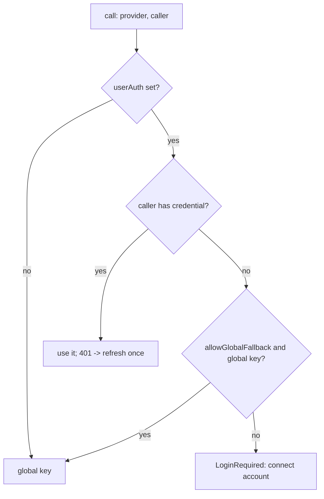

# LLM provider authentication — plan

Status: core implemented (settings, `provider:<name>` source, per-call credentials, caller scope, `fast` provider,
web user endpoints and the Connections tab). Not implemented yet: the admin UI (providers are set in the settings
file), a role/permission for who may set their own key, per-user cost attribution, the switch-time warning of `/model`,
a shared OAuth/service account for providers (`client_credentials` is rejected for providers), and the CLI hidden-input
`/login <provider>` for `userAuth: token`. The text below is the design; "Open items" lists what is undecided.

## Goal

Providers (`providers[]` in the settings) can authenticate with a global token, a per-user token, or a per-user OAuth
login. The admin chooses the mode per provider. The default is today's behaviour: one global API key.

## Modes

| Mode | Credential | Set by | Default |
|---|---|---|---|
| Global token | `apiKey` or `<TYPE>_API_KEY` | Admin, in settings | yes |
| Per-user token | Each user's own API key or token | Each user, once the admin enables it | no |
| Per-user OAuth | Each user's own OAuth login | Each user, once the admin enables it | no |

A shared OAuth login or service account (`client_credentials`) reuses the same machinery. Add it only if wanted.

## Settings

```json
{ "name": "work-claude", "type": "anthropic", "apiKey": "${ANTHROPIC_API_KEY}",
  "userAuth": "token" | "oauth" | null,
  "oauth": { "issuer": "...", "clientId": "..." },
  "allowGlobalFallback": false }
```

- `userAuth: null`: global key only (today's behaviour).
- `oauth`: required for `userAuth: oauth`, rejected for `userAuth: token`. Same shape as the REST API `oauth` block;
  `clientSecret` only as `${ENV}`.
- `allowGlobalFallback` (default false): a user without their own credential may use the global key. Needs a global
  key; `true` without one is a validation error.
- `ProviderSettings` gets the fields and every caller is fixed. No compat overloads.

## Credential resolution (per call)

```
call(provider, caller)
  userAuth null                          -> global key
  caller has a stored credential         -> use it (OAuth refreshed as needed)
        401                              -> refresh once; never fall back to the global key
  allowGlobalFallback and a global key   -> global key
  otherwise                              -> LoginRequiredException
                                            web: "connect your account for <provider>"
                                            chat: /login provider:<name>
```



## Whose credential is used

Every model call uses the credential of the user it runs for, never another user's. Same rules everywhere
(resolution above, including `allowGlobalFallback`).

| Call | User |
|---|---|
| Chat turn | Owner of the chat |
| Helper in a chat (title, summary, compaction, tool selection, auto-mode tool classifier) | Owner of the chat |
| Sub-agent | Owner of the parent chat |
| Plugin tool that calls a model | Owner of the chat the tool runs in |
| Flow task (workflows plugin) | The user the flow run is for (`Call.principal()`) |
| Flow classifier (`classify`, e.g. the clarify check) | The user the flow run is for (principal passed to `classify`) |
| Startup probe, call with no user | Global key only |

Flows:
- A flow run keeps its user for all its tasks, including unattended runs and runs resumed later (waiting runs).
  A task never switches to the admin's or the triggering process's credential.
- If that user has no usable credential and the fallback is off, the task fails with the connect-your-account
  message, like a chat turn does. The user fixes it with `/login <provider>` or in the settings panel and resumes.
- A classifier failure must not hide this: `FlowEngine` treats a failing classifier as `none` and goes on (~807).
  A missing login is not a classifier failure; it propagates and shows to the user.
- Flows defined by the admin as shared still run with the credential of the user who starts the run, not the admin's.

## Who does what

| | Admin | User |
|---|---|---|
| Mode and OAuth settings | sets (file, later admin UI) | |
| `allowGlobalFallback` | sets | |
| Token entry or OAuth connect | | own credential only |
| Revoke a user's credential | yes | own only |

## Design

### Caller identity
- Reuse the existing authorization layer, no new plumbing on the `ModelClient` interface. `Identity` already maps a
  chat to its principal (`sessions.find(chatId).map(principal)`) and `CredentialResolver.headers(user, source)` already
  resolves per-caller headers for REST and MCP. Providers become one more source, `provider:<name>`.
- `ModelRequest` carries no chat or principal today. The agent loop sets a scoped "current chat" for the duration of
  its run (like `ExternalSources.CALLER` for tool calls); the clients resolve the principal from it. Helper calls
  (titles, summaries, compaction, tool selection, yes/no checks) run inside the chat's loop and inherit it, so they use
  the current user's credential with the same fallback rules.
- Mechanism: a `ThreadLocal` in one small `CallerScope` class, plus `CallerScope.wrap(...)` for runnables, callables
  and suppliers. The scope is captured on the submitting thread and restored on the worker. Do not rely on
  `InheritableThreadLocal`: it does not cross the `ForkJoinPool` used by `CompletableFuture.supplyAsync`.
  `ScopedValue` is preview in JDK 21, so it is not used.
- Each client reads the scope once at the entry of `complete`/`stream`/`simpleComplete` and keeps the captured
  principal for the header lookup, the 401 refresh and the retries. Header resolution then never depends on the thread
  of the HTTP layer.
- A call with no scope (startup probes) uses the global key only and never another user's credential (fail closed).
- Web chats: the owner of the chat. CLI: the single local principal.

#### Verified async boundaries (`core/jllm-harness`)
- HTTP and streaming (`StreamingCall`, both clients): synchronous on the calling thread (no `sendAsync`). Safe once the
  principal is captured at entry.
- `LimitedModelClient`: semaphore only, same thread. Safe.
- Scope root: `AgentService.start` submits `execute(chatId, ...)` to a virtual-thread executor (line ~101). Set the
  scope at the start of `execute`, from the chat's principal.
- Hops that must be wrapped:
  - `ToolClassifier` (~46): `CompletableFuture.supplyAsync(() -> model.simpleComplete(...))`, ForkJoin pool.
  - `NoiseQualifier` (~87): `CompletableFuture` around a model call, ForkJoin pool.
  - `SubAgentTool` (~116 and the single-thread batch executor): sub-agent runs in virtual threads; they use the chat
    owner's credential.
  - `AgentLoop.toolExecutor` (~1197): tools run in virtual threads; wrap so a tool that reaches a model (plugin
    `OneShotModel`, sub-agents) keeps the scope.
- `CancelToken.send` (`jllm-commons`) uses `http.sendAsync(...)` then blocks on `f.get()`. The request, and so the
  headers, is built by the supplier before the send on the calling thread. Safe, but the header lookup must stay in
  the request builder and never move into an async callback.
- Web modules: no executor reaches a model call. `JllmWebApplication` (console input), `ChatController` (SSE
  heartbeat) and `OAuthController` (login on a virtual thread) are unrelated. No wrapping needed there.
- Workflows plugin: this is a separate scope root, not a chat thread. `FlowEngine` calls `OneShotModel.complete(Call)`
  from the engine's own threads (unattended flows included), and the `Call` carries `principal()` (the user id).
  - Agentic path (`runAgentTask` in the loop): set the scope from the chat's principal at the start of
    `AgentLoop.runAgentTask`, as for `AgentService.execute`. Both roots must go through one shared entry point.
  - Plain path (`AgentOneShotModel.complete`, no tools): calls `client.simpleComplete` directly with no chat. Set the
    scope from `call.principal()` here.
  - `OneShotModel.classify(system, user)` has no principal. Decision: add one,
    `classify(principal, system, user)`, and set the scope from it in `AgentOneShotModel.classify`. No compat
    overload; callers to change:
    - `OneShotModel.classify` (`jllm-commons`) and `AgentOneShotModel.classify` (~41).
    - `Registry.Classifier.classify` (`plugins/jllm-workflows`, `Registry` ~64) and its lambda in `WorkflowsPlugin` (~50).
    - `FlowEngine` (~804), the only caller: pass the principal of the flow run (as for `Call.principal()`).
    - Tests: `ClarifyTest` and any other `classifier((s, u) -> ...)` lambda.
  - The tool classifier in the loop (`ToolClassifier`, auto mode) is a different thing: it runs in the loop and gets
    the scope through its wrapped `supplyAsync`.
- Other in-loop helpers (`ToolSelector`, `ContextManager`) run on the loop thread and inherit the scope.
- `FallbackModelClient`, `TemperatureModelClient`, `ThinkingModelClient` pass the caller through. The `order` chain
  moves to the next provider on `LoginRequired` only if that provider can authenticate the user; otherwise the prompt
  is surfaced.

### Login source
- Source name `provider:<name>`, registered in `OAuthSources` next to REST APIs and MCP servers.
- Extract `OAuthSettings` from `RestApiSettings.OAuth` and a generic login from `RestOAuthLogin` (no OpenAPI spec:
  endpoints from the issuer or explicit URLs). Shared by REST APIs and providers.
- `/login`, `/logout`, `loginList` and the web redirect pick the sources up through `logins()` and `names()`.

### Per-user token storage
- `TokenStore` entry keyed `(userId, provider:<name>)`, `OAuthToken` without refresh token or expiry.
- Header by provider type: `x-api-key` for Anthropic, `Authorization: Bearer` otherwise.
- Check encryption at rest in `FileTokenStore` and `NativeTokenStore` before shipping.

### Clients
- The fixed `.authProvider(...)` hook on `OpenAiCompatModelClient` and `AnthropicModelClient` becomes a per-call
  header supplier fed by the resolver.
- Anthropic OAuth may need extra static headers (`anthropic-beta`): optional `headers` map on the provider.
- Wiring (verified in `AgentHarness.Builder.build()` and `HarnessConfiguration`):
  - No construction cycle. `ProviderCatalog` is built first (line ~845); `OAuthSources` (line ~889) needs only the
    settings, token store and http client. Move the token store, http and `OAuthSources` creation before the catalog
    and pass the resolver in.
  - One path builds the main client outside the catalog: the web `modelClient` bean (`ModelClientFactory.create` from
    `JllmProperties`; `.modelClient(...)` is set, so `defaultProvider` is skipped). The other two, `settings.fastModel()`
    (~923) and per-agent `a.model()` (~1058), are removed: a provider marked `fast` and the agent's `provider` replace
    them (see "Also needed").
  - `ModelSwitch` (`/model`) swaps clients at runtime; the new client must be built with the resolver too.
  - `HarnessConfiguration` should build the active client through the catalog instead of the `JllmProperties` bean,
    keeping the property overrides (`apiKey`, `baseUrl`, `model`) as a custom provider.

### Web
- User: `/me` endpoint to set, replace, remove and test a token (never echoed or logged). OAuth Connect button through
  the existing redirect flow. `SettingsPanel.js` shows connected, not connected, using the shared key.
- Admin: `AdminPanel.js` mode selector, OAuth fields, `allowGlobalFallback`, per-user state, revoke. If providers are
  file-only there today, the settings file is the baseline and the UI is a follow-up.
- Changing the mode of a live provider orphans stored credentials: warn, offer `forgetAll`.

### Security
- Provider `oauth` defined only in project settings goes through the trust prompt of REST APIs
  (`dropUntrustedProjectOAuth`); the token is sent to the project's `baseUrl`.
- `clientSecret` only as `${ENV}`. Keys never echoed, logged or put in chat.

## Also needed (gaps found on review)

- **No separate fast model or inline agent model: a provider marked `fast`.** Today `fastModel` (`HarnessSettings`) and
  an agent's inline `model` (`AgentSettings.model`) are raw `LlmSettings`, built by `ModelClients.from` outside the
  catalog. Verified in `HarnessSettings`: they are plain Jackson record fields (`treeToValue` of the merged layers),
  with no defaults applied (`int maxTokens`, `boolean requireApiKey` are 0/false when absent, unlike
  `ProviderSettings.toLlmSettings()`), and as a JSON object `fastModel` is merged key by key across layers, so a
  project layer can change its `baseUrl` while the user's `apiKey` or auth stays: a credential sent to a
  project-chosen URL. `providers` is an array, which a later layer replaces as a whole, so that mix cannot happen.
  Decision: a fast model is a standard provider marked `"fast": true`.
  - `ProviderSettings` gets `Boolean fast`. The fast client is the provider marked fast (error if two are), else the
    main model. It is built by the catalog like every provider, so it gets `userAuth`, `oauth`,
    `allowGlobalFallback`, the credential resolver and the type defaults, with nothing extra.
  - Remove `fastModel` from `HarnessSettings` and the inline `model` from `AgentSettings` (no compat shim). Agents
    use `provider`, which already goes through the catalog. Callers to fix: the `HarnessSettings` constructors that
    take `fastModel` (about a dozen), `AgentHarness` (~923 and ~1058), `AgentSettings`, `ModelClients.forRole`,
    the tests, the docs.
  - An old `fastModel` or agent `model` in a settings file is unknown to the lenient mapper: it is ignored with the
    "Unknown setting" warning. Make that a startup error for these two keys, with a message naming the replacement,
    so the helper model does not silently become the main model.
  - `LlmSettings` and `ModelClients.from` get no auth fields: the catalog is the only place that attaches
    credentials. `LlmSettings` stays the connection record.
  - Helper calls (auto-mode classifier, summaries, tool-group selection, `OneShotModel.classify`) use the fast
    provider with the chat owner's credential, under that provider's own `userAuth` and fallback rules. A user with
    no credential for the fast provider and no fallback gets the connect message, as for the main model.
- **`/model` and menus:** switching to a provider the user has no credential for should warn at switch time, not fail on
  the first call. `MenuController` and the provider list show per-user state (connected, not connected, shared key).
- **User deletion:** drop the user's provider credentials (`forgetAll`, as for MCP sessions). Same on logout.
- **Store backends:** per-user tokens go through `TokenStore`, so a SQL `tokenStore()` from `HarnessIdentity` (the SQL
  store project) holds them too. Nothing provider-specific in the file store only.
- **Web permissions:** who may set their own provider token (a role/permission, like other `/me` features). Admin
  views never show a token, only state. State-changing endpoints keep the existing CSRF and session rules.
- **Settings layers:** `userAuth`, `oauth` and `allowGlobalFallback` come from admin layers only. A project layer may
  not enable fallback to a global key or point a per-user token at another `baseUrl` without the trust prompt. A
  literal `apiKey` in a project file stays refused as today.
- **CLI:** one local principal. `userAuth: token` means the key is asked once by `/login <provider>` (hidden input) and
  kept in the token store; `userAuth: oauth` uses the loopback or device flow. Neither needs the admin/user split.
- **Providers other than Anthropic/OpenAI:** OAuth headers differ (Azure `Authorization: Bearer` vs `api-key`, Google
  extra project header). The provider-level `headers` map covers it; list the tested types in the user doc.
- **Cost and metrics:** with a user's own key, usage and cost are that user's. Attribute `HarnessPricing` and metrics
  per user and show which credential (user or shared) a call used, never the secret.
- **Logging:** never log an `Authorization` or `x-api-key` value, in request errors, retries or the `/me` test call.
- **Prompt cache:** a different key per user means no shared prompt cache across users. Expected, note it in the doc.
- **Fallback chain:** the next provider is tried with its own rules for the same user (user credential, then its
  fallback), never with the first provider's credential.

## Tests

- User token overrides the global key; two users get distinct credentials.
- Fallback only with `allowGlobalFallback`; validation fails without a global key.
- Helper call uses the chat owner's credential, on each hop: `ToolClassifier`, `NoiseQualifier`, sub-agent, tool
  thread. A call with no scope uses the global key only (fail closed).
- The principal is captured once per call: a scope change mid-retry does not change the credential.
- Flow run for user A while user B is active in another chat: A's tasks and classifier use A's credential.
- A resumed or unattended flow run uses the run's user, not whoever resumes it.
- Missing login in a flow task fails the task with the connect message; in the classifier it propagates and is not
  swallowed as `none`.
- Missing credential gives the connect prompt.
- 401 refreshes once and never falls back to the global key.
- OAuth login and refresh against `FakeOAuthServer`.
- Untrusted project oauth is dropped.
- apiKey-only provider unchanged.
- A provider marked `fast` with `userAuth` serves helper calls with the chat owner's credential; two providers marked
  fast, or an old `fastModel` / agent `model` key, fail at startup with a clear message.
- An agent with `provider` set resolves credentials through the catalog like the main model.

## Order of work

1. Settings, validation, `OAuthSettings` extraction.
2. Generic login and `OAuthSources` registration.
3. `CallerScope` set at the two roots (`AgentService.execute` and `AgentLoop.runAgentTask`, one shared entry point),
   from `call.principal()` in the plain `OneShotModel` path, from the new principal argument of `classify` (plugin API
   change, callers listed above), and wrapped at the four hops above.
4. Provider source in the resolver; per-call header supplier in both clients.
5. Catalog, `fast` flag (remove `fastModel` and the agent inline `model`), `ModelSwitch` and `HarnessConfiguration`
   wiring.
6. Web user endpoints and `SettingsPanel`.
7. Admin UI.
8. Trust, docs (link from `README.md` and `docs/USAGE.md`), tests.

Risk is now thread propagation of the scope (step 3) and the three client-construction paths that bypass the catalog
(step 5). The `ModelClient` interface itself no longer changes.

## Implementation notes

- `OAuthSettings` (commons) is the oauth block of REST APIs and providers; `GenericOAuthLogin` is the login both use
  (`RestOAuthLogin` adds the OpenAPI spec as a source of endpoints). `ProviderTokenLogin` keeps a per-user key as a
  token without refresh or expiry.
- `ProviderAuth` (an `AuthSource`) resolves the credential; the clients call `AuthSource.bind(CallerScope.current())`
  once per call. Scope roots: `AgentLoop.inChatScope` (used by `AgentService` and `runAgentTask`) and
  `AgentOneShotModel` (`call.principal()` and the new `classify(principal, system, user)`). Wrapped hops:
  `ToolClassifier`, `NoiseQualifier`, `SubAgentTool`, the tool executor.
- A model call with no login ends the turn with the connect message and a `login_required` event. In `FallbackModelClient`
  a provider the user has no credential for is skipped; if none can authenticate the user, the first prompt is shown.
  `FlowEngine` lets `LoginRequiredException` out of the clarify classifier.
- The web `modelClient` bean is gone unless the application supplies one: `HarnessConfiguration` passes the active
  provider (and a session entry for `jllm.apiKey`/`baseUrl`/`model`) to the harness, which builds it in its catalog.
- A project settings file may define a provider with `userAuth`, `oauth` or `allowGlobalFallback` only after the trust
  prompt, and `clientSecret` only as `${ENV}`.
- Web: `PUT /api/oauth/provider:<name>/token` (write-only), `POST .../test`, `DELETE` (existing), listed in
  `GET /api/oauth` with `kind: token` and `usesSharedKey`.

## Remaining work

Not implemented yet:

- Admin UI: providers are set in the settings file (step 7 of the order of work).
- A role or permission for who may set their own key; today any signed-in user can.
- Per-user cost attribution (`HarnessPricing` and metrics) and showing which credential a call used.
- The `/model` warning at switch time when the user has no credential for the target provider.
- Shared OAuth or service account for providers (`client_credentials` is rejected for providers).
- CLI hidden-input `/login <provider>` for `userAuth: token`.
- User doc notes: tested provider types (Azure, Google headers) and the prompt-cache note.

## Behaviour changes

- A session override (`--api-key`, `--base-url`, `--model` in the CLI; `jllm.apiKey`, `baseUrl`, `model` in the web
  application) drops the provider's `userAuth`, so a user credential is never sent to an overridden URL.
- The web `jllm.provider` name is lowercased before the lookup, so a configured provider whose name has capitals does
  not match.
- `fastModel` and the inline `model` of an agent are removed: a startup error that names the replacement.
- `ProviderCatalog` takes the credential resolver; `OneShotModel.classify` and `Registry.Classifier.classify` take the
  principal first; the model clients take an `AuthSource` instead of an `AuthProvider`.

## Open items

- Provider-level `headers` map for Anthropic OAuth: confirm needed.
- Fallback chain on `LoginRequired`: skip or surface (plan: skip only if the next provider can authenticate the user).
- Shared OAuth / service account for providers: in or out of the first cut.
